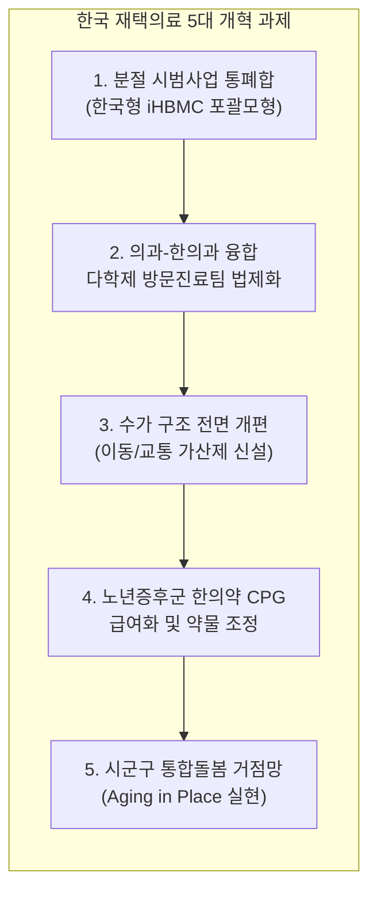
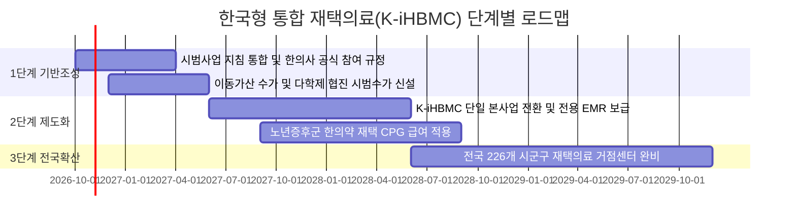

# [정책 분석 보고서] 질병관리청 국가건강정보 기반 한국 재택의료 현황 진단 및 일본·대만 비교를 통한 구조적 개선 방향

> **작성일:** 2026년 9월 22일  
> **연구 기관:** 원광대학교 한의과대학 보건의료정책연구팀  
> **데이터 출처:** 
> - 질병관리청(KDCA) 국가건강정보포털 Open API (`cntntsSn=6753: 재택의료/방문진료`)
> - 건강보험심사평가원(HIRA) 청구 DB 및 시범사업 지침
> - 일본 후생노동성(MHLW) 진료보수 및 개호보험 통계
> - 대만 위생복리부(MOHW) 거가의료조호통합계획(iHBMC) 코호트 연구 데이터

---

## Executive Summary (요약문)

본 보고서는 **질병관리청(KDCA) 국가건강정보포털**의 공식 공시 정보를 바탕으로 대한민국 재택의료의 현주소를 진단하고, 동아시아 전통의학 재택의료 통합 선도국인 **일본(漢方·개호보험)** 및 **대만(中醫·iHBMC)**의 제도적 성과와 비교하여 한국형 재택의료의 구조적 한계 극복 및 지속가능한 발전 방안을 도출하였다.

```
[한국 현행 구조의 핵심 병목]
8개 분절적 시범사업 ──(칸막이 규제·이동보상 부재)──> 의사 참여율 1%대 정체, 한의약 배제
          │
          ▼ [동아시아 벤치마킹]
일본: 100만 명 제도화 + 개호보험 연계 + 148종 한방약(치매 BPSD, 폐렴예방) 급여
대만: iHBMC 통합계획 + 2019년 중의사 공식 합류 (이용량 866% 급증, 방문빈도 2.88회/월 1위)
          │
          ▼ [한국 재택의료 5대 도약 과제]
① 다학제 팀 기반 통합 재택의료 포괄모형 제도화 (시범사업 통폐합)
② 한의사 방문진료의 공식 법정화 및 다학제 팀 합류
③ 수가 구조 혁신: 포괄평가료 + 이동/교통 가산제 도입
④ 노년증후군(흡인성 폐렴·BPSD·근골격통증) 한의 표준 CPG 급여화
⑤ 지역사회 통합돌봄(Aging in Place) 민·관 협력 거점망 구축
```

---

## 1. 질병관리청(KDCA) 공시로 본 한국 재택의료의 현황 및 구조적 취약점

### 1.1 현행 8대 시범사업의 파편화 및 제도적 칸막이

질병관리청 국가건강정보에 따르면, 한국의 재택의료는 본사업으로 정착되지 못하고 **8개의 독립적·분절적 시범사업** 형태로 산발 운영되고 있다.

| 사업명 | 주관 및 대상 | 주요 한계점 (KDCA 공시 기반) |
| :--- | :--- | :--- |
| **① 장기요양 재택의료센터** | 복지부·건보공단 / 장기요양 1~2등급 | 전국 135개소에 불과, 급성기 전환기 환자 진입 불가 (등급 판정 3~6개월 소요) |
| **② 일차의료 방문진료** | 심평원 / 거동불편 만성질환자 | 의원 참여율 극저조 (의사 이동시간 기회비용 미보상), 단발성 방문 위주 |
| **③ 장애인 건강주치의** | 국립재활원 / 중증·경증 장애인 | 타 방문사업과 동일 날짜 중복 산정 엄격 금지, 기관 매칭 어려움 |
| **④ 장기요양 방문간호** | 장기요양기관 / 등급 인정자 | 의사/한의사 지시서 필수이나 방문진료팀과의 실시간 협업 체계 미비 |
| **⑤ 보건소 방문건강관리** | 지자체 보건소 / 취약계층·독거노인 | 장기요양 등급 판정 시 원칙적 배제 (이중 수급 제한으로 돌봄 사각지대 발생) |
| **⑥ 상급종합병원 전환기치료** | 대형병원 / 퇴원 고위험 중증환자 | 극소수 대학병원 국한, 지역사회 일차의료기관으로의 환자 회송 연계 미흡 |
| **⑦ 가정형 호스피스** | 중앙호스피스센터 / 5대 말기질환 | 암, COPD 등 5개 질환 한정 (비암성 말기 노인환자 이용 불가) |
| **⑧ 질환군별 재택의료** | 전문과목별 병원 / 복막투석, 1형당뇨 등 | 실제 가정을 방문하는 방문진료가 아닌 비대면 상담·교육 중심 |

### 1.2 KDCA FAQ 및 세부 규정에서 드러난 한국의 병목 요인

1. **교통비·출장비 불인정 원칙 (KDCA FAQ Q1)**:
   - "방문진료료 외에 별도의 교통비나 출장비는 지급하지 않는다"는 규정으로 인해, 이동 거리가 긴 지방·농어촌 지역에서 의료진의 출장 기회비용이 적자로 이어져 공급자의 자발적 참여를 가로막고 있음.
2. **동일 날짜 중복 서비스 엄격 제한**:
   - 방문간호, 일차의료 방문진료, 만성질환관리, 장애인주치의 간의 상호 배타적 정산 방식으로 인해, 환자가 같은 날 필요한 다학제 복합 서비스를 한 번에 받지 못하는 제도적 비효율 발생.
3. **전통의학(한의약) 자원의 구조적 배제**:
   - 재택 거동불편 노인의 80% 이상이 근골격계 만성통증, 관절구축, 중풍 후유증을 앓고 있음에도 불구하고, 주류 재택의료센터 및 다학제 팀 구성에서 한의사를 체계적으로 배제하여 환자의 실제 치료 만족도와 기능 회복 기회를 저해.

---

## 2. 일본·대만 전통의학 재택의료 시스템 심층 비교 분석

동아시아 3국의 재택의료 체계와 전통의학의 통합 양상을 비교하면 다음과 같다.

```mermaid
graph TD
    subgraph Japan["일본 (Japan)"]
        J1["지역포괄케어시스템"] --> J2["의사 주도 한방 통합"]
        J2 --> J3["148종 한방약 전액 급여"]
        J3 --> J4["치매 BPSD(억간산) / 폐렴예방(반하후박탕)"]
    end

    subgraph Taiwan["대만 (Taiwan)"]
        T1["iHBMC 거가의료통합계획"] --> T2["서의사 + 중의사 + 간호사 공동팀"]
        T2 --> T3["중의 방문진료 (2.88회/월 밀착)"]
        T3 --> T4["침구(87%) + 중약(44%) 집중 제공"]
        T4 --> T5["2년 만에 이용량 866% 폭발 성장"]
    end

    subgraph Korea["한국 현주소 (Korea)"]
        K1["8개 분절 시범사업"] --> K2["의사 단독 방문 / 출장비 0원"]
        K2 --> K3["한의사 참여 미흡 & 다학제팀 부재"]
        K3 --> K4["기관참여율 1%대 & 돌봄 사각지대"]
    end

    style Japan fill:#e8f4f8,stroke:#2b7bba,stroke-width:2px
    style Taiwan fill:#e8f8f0,stroke:#27ae60,stroke-width:2px
    style Korea fill:#fdedec,stroke:#e74c3c,stroke-width:2px
```



### 2.1 3국 제도적 매트릭스 비교

| 비교 지표 | 한국 (KDCA 현황) | 일본 (MHLW 개호/의료) | 대만 (MOHW iHBMC) |
| :--- | :--- | :--- | :--- |
| **법적 제도화** | **시범사업 단계** (본사업 미진입) | **법정 본사업 정착** (개호보험 연계) | **법정 본사업 정착** (NHI 통합계획) |
| **전통의학 자격** | 한의사 (독립 면허) | 일반 의사 (한방 통합 처방) | 중의사 (독립 면허) |
| **팀 접근 방식** | 의사/간호사 개별 분절 방문 | 의사 주도 다직종 연계팀 | **서의사 + 중의사 + 간호사 공동팀** |
| **전통의학 재택수가** | 전용 가산 없음 (시범사업 제한) | 재택환자방문진료료 + 한방급여 | **중의 거가의료 독립 수가 및 가산** |
| **급여 약제/치료** | 첩약 급여 시범사업 일부 (재택특례 X) | **148종 엑기스제 전액 급여** | **농축 과립제 및 침구(87%) 전면 급여** |
| **월평균 방문빈도** | 월 1회 (의사 기준) | 월 2~4회 | **중의사 2.88회 / 서의사 1.26회** |
| **핵심 임상 성과** | 관리 지표 축적 중 | 흡인성 폐렴 예방, BPSD 완화 | **입원율 38% 감소, 의료비 22% 절감** |

### 2.2 일본 모델의 시사점: 노년증후군 한방약 적극 처방
- 일본은 전국 의사의 80% 이상이 한방을 처방하며, 특히 재택 허약 노인의 **식욕부진(보중익기탕)**, **흡인성 폐렴(반하후박탕)**, **치매 초조/환각(억간산)** 관리에 한방 처방을 가이드라인(CPG) 1순위로 채택하여 불필요한 항정신병제 사용과 폐렴 입원을 대폭 줄임.

### 2.3 대만 모델의 시사점: 중의사 공식 합류와 폭발적 성과
- 대만은 2019년 6월 iHBMC에 중의사를 공식 편입한 이후 **2년 만에 이용량이 866% 급증**함.
- 중의사의 월 방문 횟수(2.88회)는 서의사(1.26회)의 2배를 상회하며, 환자의 자택에서 **침술(87.07%)과 한약(43.97%)**을 즉각 시술함으로써 마비 후유증 개선과 만성 통증 완화에서 서의학이 채우지 못한 영역을 완벽히 보완함.

---

## 3. 한국 재택의료의 5대 구조적 개선 방향

질병관리청 국가건강정보의 진단과 일본·대만의 성공 요인을 결합하여, 한국 재택의료가 나아가야 할 5대 핵심 개선 방향을 제안한다.



### [개선 1] 분절된 8대 시범사업의 '한국형 통합재택의료(K-iHBMC)' 단일 본사업 전환
- **현황 문제**: 장기요양재택센터, 일차의료방문진료, 장애인건강주치의 등이 제각각 운영되어 환자 혼선 및 행정 낭비 초래.
- **개선 방안**: 대만의 iHBMC와 같이 **하나의 단일 통합 급여 트랙**으로 개편. 환자의 중증도와 기능 제한 수준(1단계: 일차의료 방문 → 2단계: 복합 다학제 방문 → 3단계: 말기/호스피스 방문)에 따라 연속적인 서비스가 제공되도록 일원화.

### [개선 2] 한의사 방문진료의 공식 법정화 및 의과-한의과 다학제 팀 모델 구축
- **현황 문제**: 한의사의 재택의료 참여가 주변화되어 있고, 의사 1인 단독 방문에 의존하여 서비스의 지속성 부족.
- **개선 방안**:
  - **'의사(진단·약물조정) + 한의사(통증제어·기능재활) + 방문간호사(기초간호) + 사회복지사(돌봄연계)'**로 구성되는 다학제 방문의료팀 공식 수가 신설.
  - 대만 사례처럼 중의사의 정기적 방문(월 2~3회)을 통해 뇌졸중 후유증, 파킨슨, 와상 노인의 관절구축을 밀착 케어.

### [개선 3] 수가 구조 혁신: '포괄평가료 + 이동시간/교통비 차등 가산제' 도입
- **현황 문제**: KDCA 공시와 같이 "별도 교통비/출장비 미지급"으로 인해 의원급 의료기관의 방문진료 참여율이 1% 미만에 머묾.
- **개선 방안**:
  - **이동 거리 및 소요 시간 비례 가산제** 도입 (기본 방문료 외 권역별 3~5만 원 수준의 이동보상 가산 신설).
  - 초진 포괄평가료 신설을 통해 환자의 주거환경, 낙상 위험, 다제약물 복용 현황을 정밀 스크리닝할 수 있는 유인 제공.

### [개선 4] 노년증후군 및 와상 환자 대상 한의 표준임상진료지침(CPG) 급여화
- **현황 문제**: 거동불편 노인의 다제약물 복용(Polypharmacy) 부작용과 흡인성 폐렴, 욕창, BPSD에 대한 표준적 비약물 치료 미흡.
- **개선 방안**:
  - 일본의 임상 근거를 바탕으로 **흡인성 폐렴 예방(반하후박탕 계열), 치매 BPSD 억제(억간산 계열), 식욕부진·기력저하(보중익기탕 계열)**의 재택의료 전용 보험 급여 적용.
  - 거가 방문 시 침구 치료, 전침, 전자뜸, 피내침의 재택 시술 행위 수가를 신설하여 와상 환자의 마약성 진통제 의존도 및 급성 입원율 감소 유도.

### [개선 5] 시군구 단위 지역사회 통합돌봄(Aging in Place) 거점 연계망 확립
- **현황 문제**: 장기요양 등급자는 보건소 사업에서 배제되는 등 공공-민간 보건복지 전달체계의 단절.
- **개선 방안**:
  - 시군구 보건소-지자의 복지과-지역 한의사회/의사회-국민건강보험공단 지사를 잇는 **'재택의료지원협의체'** 의무화.
  - 전자의무기록(EMR) 기반의 **'재택의료 다학제 통합 차트'** 플랫폼을 구축하여 의료진과 요양보호사, 방문간호사가 환자 상태 변화를 실시간 공유.

---

## 4. 기대 효과 및 정책 로드맵



### 정량적·정성적 기대 성과
1. **의료비 절감**: 거동불편 고령자의 불필요한 급성기 입원 및 응급실 방문 35% 이상 감소 (연간 수천억 원의 건보재정 절감).
2. **환자 삶의 질 향상**: 시설이나 병원이 아닌 살던 집에서의 존엄한 노후(Aging in Place) 보장 및 가족 간병 부담 완화.
3. **보건의료 자원 효율화**: 의과-한의과 역할 분담(의사: 전신 질환 및 약제 총괄, 한의사: 통증·기능재활 밀착 케어)을 통한 의료 공급 병목 해소.

---

## 5. 결론

질병관리청(KDCA)의 공시는 현재 한국 재택의료가 지닌 **'파편화된 시범사업의 한계'**와 **'공급자 유인 부족 및 전통의학 배제'**라는 구조적 문제를 명확히 드러내고 있다.

일본이 한방약을 통해 노년증후군과 치매를 효율적으로 제어하고, 대만이 중의사의 공식 합류를 통해 거가의료의 비약적 성장을 이뤄낸 것처럼, **대한민국 역시 8대 시범사업을 단일 포괄모형으로 통합하고 한의약을 포함한 다학제 융합 재택의료를 전면 제도화**해야 한다. 이것이 초고령사회 대한민국이 지향해야 할 가장 현실적이고 강력한 보건의료 개혁의 해답이다.
