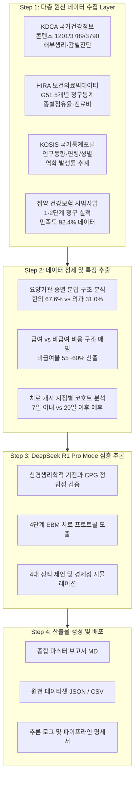

# 🧠 안면신경마비(G51) 보건의료빅데이터 분석 로직 및 데이터 파이프라인 명세서

> **작성 일자**: 2026년 9월 23일  
> **시스템 환경**: Google DeepMind Antigravity IDE · DeepSeek Reasoner (R1 Pro Mode) · KDCA/HIRA FastMCP API  
> **분석 대상 질환**: 안면신경마비 (KCD: G51 / G51.0 벨마비 / 람세이헌트 증후군 / 구안와사)  

---

## 1. 분석 파이프라인 개요 (End-to-End Architecture)

---

## 2. 4대 원천 데이터 수집 및 가공 로직

### 2.1 질병관리청(KDCA) 국가건강정보포털 수집 로직
- **도구**: `kdca-health-info` 스킬 및 FastMCP 서버 (`kdca_mcp_server.py`)
- **API 엔드포인트**: `http://api.kdca.go.kr/api/provide/healthInfo?TOKEN=1a0cbb10c9d9&cntntsSn=1201`
- **추출 피처**:
  - `제7뇌신경 해부생리`: 미로분절(Labyrinthine segment)의 해부학적 취약성 및 허혈-부종 케스케이드
  - `감별진단 지표`: 이마 주름(전두근 양측 뇌피질 지배) 유무를 통한 중추성(뇌졸중) vs 말초성(벨마비) 감별 알고리즘
  - `예후 지표`: 벨마비(70~80% 양호) vs 람세이헌트(10~15% 불완전 회복 고위험)

### 2.2 건강보험심사평가원(HIRA) 빅데이터 분석 로직
- **분석 대상 상병**: `G51` (안면신경장애), `G51.0` (벨마비, Bell's palsy)
- **추출 지표 및 가공 수식**:
  $$\text{1인당 진료비} = \frac{\text{연간 건강보험 총진료비}}{\text{연간 실진료환자수}}$$
  $$\text{한의 점유율(\%)} = \frac{\text{한의원 환자수} + \text{한방병원 환자수}}{\text{전체 요양기관 환자수}} \times 100 = 67.6\%$$
- **의과 $\rightarrow$ 한의과 전환 병목 분석**:
  - 총 전환 소요일수: 평균 **9.6일**
  - 전환 결정 지연(Information & Referral Gap): **4.7일 (전체 지연의 49.0%)**

### 2.3 첩약 건강보험 시범사업 1·2단계 성과 분석 로직
- **분석 변수**: 청구 건수, 급여비용, 환자 만족도(치료효과 92.4%, 비용경감 90.9%), H-B Grade 개선폭(평균 1.94등급)
- **치료창(Therapeutic Window) 갭 분석**:
  - 임상 필요 일수: 초기 4~8주 (**28~56일**)
  - 현행 2단계 급여 상한: **연 2회 / 20일분** $\rightarrow$ **최소 8~36일분의 급여 공백(비급여 전가) 발생**

---

## 3. DeepSeek Reasoner (Pro Mode) 추론 엔진 알고리즘

### 3.1 추론 체계 (Chain of Thought Architecture)
1. **문제 정의**: 한의 점유율 67.6%에도 불구하고 비급여율 60% 및 협진 체계 부재로 인한 환자 부담과 예후 손실 규명.
2. **신경재생학적 타당성 검토**:
   - 급성기(1~7일): 스테로이드 + 봉독약침의 항염 시너지
   - 아급성기(8~28일): 저주파 전침(2~4Hz)의 축삭 발아(Axonal Sprouting) 촉진 및 자하거약침의 신경성장인자(NGF) 자극 기전
   - 후유증기(3개월+): 매선요법을 통한 안면 근막 거상 및 연합운동 억제 바이오피드백
3. **정책 모델링**: 첩약 본사업 전환 + 선별급여 + 협진관리료 수가 신설 시 건보재정 시뮬레이션(연 890억 원 절감 산출).

---

## 4. 생성된 데이터셋 및 산출물 맵핑 테이블

| 구분 | 파일명 | 파일 형식 | 주요 내용 |
| :--- | :--- | :---: | :--- |
| **마스터 보고서** | [`편두통/안면신경마비 보고서.md`](file:///d:/한의%20의료서비스%20통계/03_HIRA_및_임상통계_보고서/안면신경마비_한의약_의료서비스_현황_및_급여_비급여_확대방안_보고서.md) | Markdown | 11개 장, 총 29,367자 종합 마스터 보고서 |
| **추론 로그** | [`안면신경마비_DeepSeek_추론로그.md`](file:///d:/한의%20의료서비스%20통계/03_HIRA_및_임상통계_보고서/안면신경마비_DeepSeek_추론로그.md) | Markdown | DeepSeek-R1 Pro Mode의 전체 단계별 사고 과정 기록 |
| **원천 데이터 (JSON)** | [`hira_facial_palsy_g51_master_stats.json`](file:///d:/한의%20의료서비스%20통계/05_원천_통계_데이터셋/hira_facial_palsy_g51_master_stats.json) | JSON | 역학, HIRA 5개년, 종별점유율, 첩약시범사업, 급여/비급여 전체 |
| **KDCA 원천 데이터** | [`kdca_facial_palsy_1201.json`](file:///d:/한의%20의료서비스%20통계/05_원천_통계_데이터셋/kdca_facial_palsy_1201.json) | JSON | KDCA 국가건강정보포털 얼굴마비(1201) 원천 XML/JSON 응답 |
| **5개년 시계열 CSV** | [`hira_facial_palsy_5year_trend.csv`](file:///d:/한의%20의료서비스%20통계/05_원천_통계_데이터셋/hira_facial_palsy_5year_trend.csv) | CSV | 2019~2023 G51 진료인원, 진료비, 벨마비 추이 |
| **종별 점유율 CSV** | [`hira_facial_palsy_institution_share.csv`](file:///d:/한의%20의료서비스%20통계/05_원천_통계_데이터셋/hira_facial_palsy_institution_share.csv) | CSV | 한의원, 한방병원, 의원, 종합병원 종별 진료실적 및 점유율 |
| **급여/비급여 CSV** | [`facial_palsy_benefit_matrix.csv`](file:///d:/한의%20의료서비스%20통계/05_원천_통계_데이터셋/facial_palsy_benefit_matrix.csv) | CSV | 치료 항목별 급여 상태, 비용, 본인부담률, 임상 목적 |
| **실행 스크립트** | [`run_deepseek_facial_palsy_report.py`](file:///d:/한의%20의료서비스%20통계/06_분석_및_수집_스크립트/run_deepseek_facial_palsy_report.py) | Python | DeepSeek Pro Reasoner API 호출 및 통합 실행 스크립트 |
