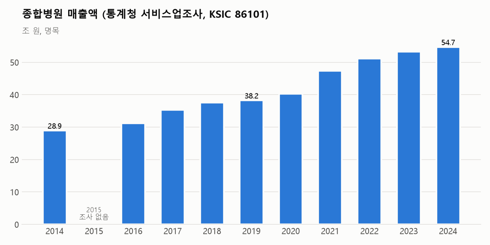
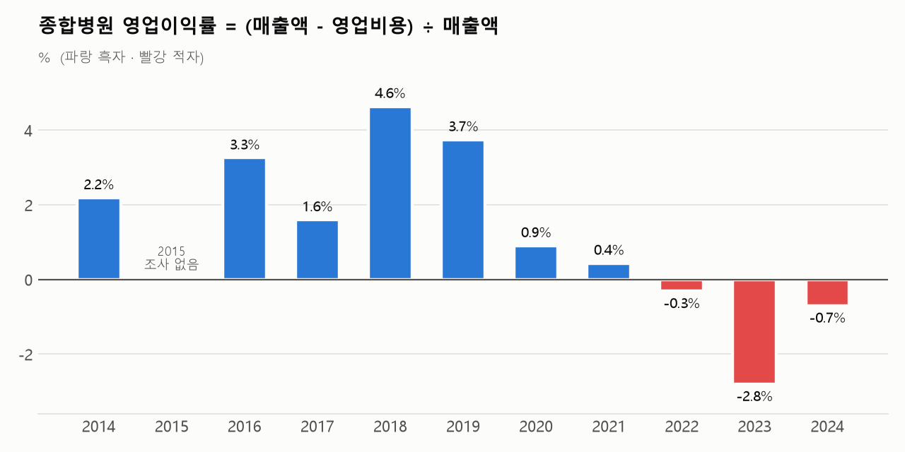
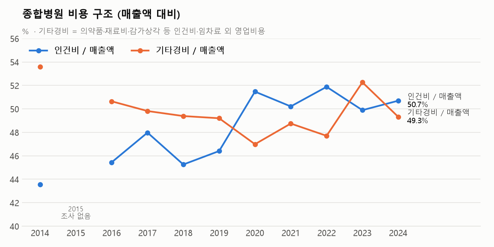
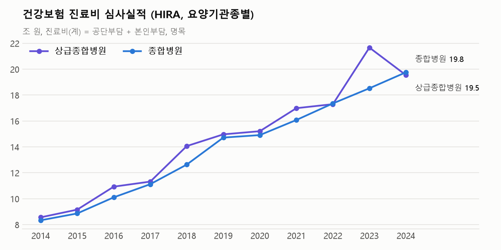

# 종합병원 매출액·영업이익률 10개년(2014~2024) 분석 보고서

> **자료원**: ① 통계청(국가데이터처) 「서비스업조사」 시도/산업별 총괄 — 전국 × 종합병원(KSIC 86101) ② 건강보험심사평가원 「요양기관종별 진료비 심사실적」(KOSIS 354/DT_LEE_02)
> **수집 경로**: korea-stats MCP 서버(KOSIS OpenAPI 래퍼) — `06_분석_및_수집_스크립트/general_hospital_finance_kosis_mcp.py`
> **원자료**: `05_원천_통계_데이터셋/07_종합병원_경영지표/` (CSV 2종)
> **분석 기간**: 2014~2024년(2015년 결측, 아래 4절) · 모든 금액은 명목
> **작성일자**: 2026년 10월 30일

---

## 1. 핵심 요약

| 구분 | 2014 | 2019 | 2024 | 2014→2024 |
| :--- | ---: | ---: | ---: | ---: |
| 사업체수(개) | 331 | 355 | 375 | +44 |
| 종사자수(명) | 230,709 | 294,891 | 350,670 | 연 +4.3% |
| **매출액(조 원)** | **28.91** | **38.21** | **54.68** | **+89.1% (연 6.6%)** |
| 영업비용(조 원) | 28.28 | 36.78 | 55.06 | +94.7% (연 6.9%) |
| **영업이익(억 원)** | **6,334** | **14,318** | **−3,831** | 흑자 → 적자 |
| **영업이익률(%)** | **2.19** | **3.75** | **−0.70** | −2.9%p |
| 인건비 / 매출액(%) | 43.6 | 46.4 | 50.7 | +7.1%p |
| HIRA 진료비, 상급종합+종합(조 원) | 16.90 | 29.69 | 39.30 | +132.5% (연 8.8%) |

1. **매출은 10년 새 1.9배로 늘었으나 이익은 없어졌다.** 매출액은 28.9조 원에서 54.7조 원으로 연 6.6%씩 늘었다. 영업비용은 연 6.9%로 더 빨리 늘어 영업이익률이 2018년 4.6%를 정점으로 떨어졌다. 2022년부터는 3년 연속 영업적자다.
2. **구조적 원인은 인건비다.** 인건비는 10년간 120.1% 늘어 매출(89.1%)을 크게 앞질렀다. 매출 대비 인건비 비중은 43.6%에서 50.7%로 올랐다. 종사자 1인당 인건비가 5,460만 원에서 7,900만 원으로 45% 오르는 동안 1인당 매출은 1.25억 원에서 1.56억 원으로 24% 오르는 데 그쳤다.
3. **수익성은 두 국면으로 갈린다.** 2016~2019년 평균 영업이익률은 +3.3%(누적 영업이익 +4.76조 원)였다. 2020~2024년 평균은 −0.5%(누적 −1.46조 원)였다.
4. **2023년이 바닥(−2.8%)이었다.** 매출은 4.1% 늘었는데 영업비용은 6.7% 늘었다. 특히 기타경비(의약품·재료비·관리비 등)가 14.1% 늘었다.
5. **2024년 의정 갈등은 종별로 정반대 충격을 줬다(HIRA).** 상급종합병원 진료비는 9.8% 줄었고, 입원일수는 25.4% 줄었다. 종합병원 진료비는 오히려 6.7% 늘었고, 특히 입원 진료비가 10.7% 늘었다. 종합병원(KSIC 86101, 상급종합 포함) 전체로는 적자 폭이 2023년보다 줄었다(−2.8% → −0.7%). 매출이 2.6% 늘어난 반면 영업비용은 0.5% 느는 데 그쳤기 때문이다.
6. **건강보험 의존도가 높아졌다.** HIRA 건강보험 진료비(상급종합+종합)는 연 8.8%로 늘어 서비스업조사 매출(연 6.6%)보다 빨랐다. 매출 대비 비율은 58.5%(2014)에서 71.9%(2024)로 올랐다. 보장성 강화로 비급여 진료가 급여로 옮겨 온 흐름과 맞는다.

---

## 2. 매출액과 영업이익률 추이 (통계청 서비스업조사)





| 연도 | 통계표 | 사업체 | 종사자 | 매출액(조) | 영업비용(조) | 영업이익(억) | **영업이익률(%)** | 매출 증가율(%) | 비용 증가율(%) | 기관당 매출(억) |
| :---: | :--- | ---: | ---: | ---: | ---: | ---: | ---: | ---: | ---: | ---: |
| 2014 | DT_1KB6001 | 331 | 230,709 | 28.91 | 28.28 | 6,334 | **2.19** | – | – | 874 |
| 2015 | – | – | – | – | – | – | **조사 없음** | – | – | – |
| 2016 | DT_1KB9001 | 338 | 255,945 | 31.16 | 30.14 | 10,155 | **3.26** | – | – | 922 |
| 2017 | DT_1KB9001 | 340 | 263,098 | 35.32 | 34.75 | 5,653 | **1.60** | 13.3 | 15.3 | 1,039 |
| 2018 | DT_1KB9001 | 347 | 277,638 | 37.59 | 35.85 | 17,431 | **4.64** | 6.4 | 3.1 | 1,083 |
| 2019 | DT_1KB9001 | 355 | 294,891 | 38.21 | 36.78 | 14,318 | **3.75** | 1.7 | 2.6 | 1,076 |
| 2020 | DT_2KB9001 | 366 | 319,056 | 40.27 | 39.91 | 3,652 | **0.91** | 5.4 | 8.5 | 1,100 |
| 2021 | DT_2KB9001 | 363 | 327,616 | 47.35 | 47.14 | 2,071 | **0.44** | 17.6 | 18.1 | 1,304 |
| 2022 | DT_2KB9001 | 373 | 343,742 | 51.17 | 51.33 | −1,602 | **−0.31** | 8.1 | 8.9 | 1,372 |
| 2023 | DT_3KB9001 | 373 | 348,702 | 53.29 | 54.78 | −14,935 | **−2.80** | 4.1 | 6.7 | 1,429 |
| 2024 | DT_3KB9001 | 375 | 350,670 | 54.68 | 55.06 | −3,831 | **−0.70** | 2.6 | 0.5 | 1,458 |

*영업이익률 = (매출액 − 영업비용) ÷ 매출액. 2014·2016~2021년은 KOSIS에 영업이익 항목이 없어 매출액과 영업비용으로 계산했다. 2022~2024년은 KOSIS의 영업이익 공표값과 계산값이 일치한다.*

### 국면별 해석
- **2014~2019년, 흑자 확대기(1.6~4.6%)**: 2018년 이익률(4.6%)이 가장 높다. 그해 매출은 6.4% 늘고 비용은 3.1% 느는 데 그쳤다. 2018년은 상급병실(2·3인실)과 MRI 등의 급여화가 시작된 해로, HIRA 상급종합병원 진료비가 24.3% 급증했다.
- **2020~2021년, 코로나19기(0.4~0.9%)**: 2020년 매출 증가율(5.4%)이 비용 증가율(8.5%)에 못 미쳐 이익률이 0.9%로 내려앉았다. 2021년에는 매출과 비용이 함께 17~18% 늘어 이익률이 0.4%에 머물렀다.
- **2022~2024년, 적자기(−0.3 ~ −2.8%)**: 비용 증가가 매출 증가를 3년 연속 앞섰다. 2024년은 비용 증가율이 0.5%로 낮아지면서 적자 폭이 줄었다. 이 해에는 전공의 이탈로 상급종합병원의 진료량과 인건비 일부가 함께 줄었다.

---

## 3. 비용 구조



| 연도 | 인건비/매출(%) | 기타경비/매출(%) | 임차료/매출(%) | 1인당 인건비(백만 원) | 1인당 매출(백만 원) |
| :---: | ---: | ---: | ---: | ---: | ---: |
| 2014 | 43.6 | 53.6 | 0.7 | 54.6 | 125.3 |
| 2016 | 45.4 | 50.6 | 0.7 | 55.3 | 121.7 |
| 2018 | 45.3 | 49.4 | 0.7 | 61.3 | 135.4 |
| 2020 | 51.5 | 47.0 | 0.6 | 65.0 | 126.2 |
| 2022 | 51.9 | 47.7 | 0.7 | 77.2 | 148.9 |
| 2023 | 49.9 | 52.3 | 0.6 | 76.2 | 152.8 |
| 2024 | 50.7 | 49.3 | 0.7 | 79.0 | 155.9 |

- 영업비용은 인건비, 임차료, 기타경비로 구성된다. 기타경비에는 의약품비, 재료비, 감가상각비, 관리운영비가 포함된다. 서비스업조사는 매출원가와 판매관리비를 따로 공표하지 않는다(0 또는 −).
- **인건비 비중은 2020년에 처음 50%를 넘은 뒤 50% 안팎에 머문다.** 같은 기간 종사자는 연 4.3%씩 늘었다(10년간 +12만 명). 매출이 늘어난 몫의 상당 부분이 인력 증원과 임금 상승으로 흡수됐다.
- **2023년 적자 확대는 기타경비에서 나왔다.** 2023년 기타경비는 2022년보다 3.44조 원(+14.1%) 늘어 매출 증가분(2.12조 원)을 웃돌았다. 인건비는 같은 해 0.2% 느는 데 그쳤다. 원인 항목(의약품·재료·에너지 등)은 이 통계로 나눠 볼 수 없다.

---

## 4. 건강보험 진료비 (HIRA 심사실적)



| 연도 | 상급종합(조) | 종합병원(조) | 합계(조) | 의료기관 전체 중 비중(%) | 합계 ÷ 서비스업조사 매출(%) |
| :---: | ---: | ---: | ---: | ---: | ---: |
| 2014 | 8.56 | 8.34 | 16.90 | 40.2 | 58.5 |
| 2015 | 9.16 | 8.86 | 18.02 | 40.1 | – |
| 2016 | 10.93 | 10.11 | 21.04 | 41.8 | 67.5 |
| 2017 | 11.32 | 11.12 | 22.45 | 41.3 | 63.6 |
| 2018 | 14.07 | 12.64 | 26.71 | 43.5 | 71.0 |
| 2019 | 14.97 | 14.72 | 29.69 | 43.6 | 77.7 |
| 2020 | 15.21 | 14.91 | 30.13 | 43.6 | 74.8 |
| 2021 | 16.99 | 16.08 | 33.07 | 44.3 | 69.8 |
| 2022 | 17.30 | 17.36 | 34.66 | 42.3 | 67.7 |
| 2023 | 21.67 | 18.53 | 40.19 | 44.8 | 75.4 |
| 2024 | 19.54 | 19.76 | 39.30 | 42.4 | 71.9 |

*진료비(계) = 공단부담금 + 법정 본인부담금. 비급여, 의료급여, 자동차보험, 산재는 포함하지 않는다.*

**2024년 종별 충격(2023 → 2024)**

| 구분 | 입원 일수 | 입원 진료비 | 외래 일수 | 외래 진료비 |
| :--- | ---: | ---: | ---: | ---: |
| 상급종합병원 | −25.4% | −13.4% | −9.9% | −3.5% |
| 종합병원 | −0.1% | +10.7% | −5.1% | −1.0% |

- 입내원일당 진료비는 상급종합병원이 16.9만 원에서 34.0만 원으로, 종합병원이 9.9만 원에서 20.5만 원으로 10년 새 약 2배가 됐다. 진료량(입내원일수)은 크게 늘지 않았다(상급 +13.6%, 종합 +14.9%). 진료비 증가는 대부분 일당 진료비(수가, 진료 강도, 급여 범위)에서 왔다.
- 2024년 상급종합병원의 입원 감소분 일부는 종합병원으로 옮겨 갔다. 종합병원 입원 일수는 거의 그대로인데 입원 진료비는 10.7% 늘어, 중증도가 더 높은 환자가 유입됐을 가능성이 있다.
- ⚠️ **2023년 상급종합병원 진료비(21.67조 원, 전년 대비 +25.3%)는 확인이 필요하다.** 같은 해 입원 일당 진료비가 13.5% 뛰었는데, 이는 추세에서 크게 벗어난다. HIRA 심사실적은 '심사년도' 기준이어서 청구 시점 이동의 영향을 받을 수 있다. 진료년도 기준 건강보험통계연보와 대조하기 전까지는 2023→2024년 감소폭(−9.8%)도 과대 추정일 수 있다. 참고로 2018년(14.07조 원)과 2019년(14.97조 원) 값은 언론에 보도된 건강보험통계연보 수치와 맞는다(2019년 연보 15.10조 원, 차이 0.9%).

---

## 5. 자료 해석상 유의점

1. **2015년 결측**: 2015년은 경제총조사 연도라 서비스업조사를 하지 않았다. 2015년 경제총조사(DT_1KI15xx)는 산업 소분류(861 병원)까지만 공개돼 종합병원만 분리할 수 없다. 그래서 10년 변화는 2014년을 기준으로 계산했다(2014→2024년, 10년 구간).
2. **산업분류 개정**: 2014년 값은 9차 KSIC(Q86101), 2016년 이후 값은 10차 KSIC(86101) 기준이다. 2016년을 두 기준으로 비교하면 매출 차이가 0.31%로 작아 시계열을 이어 썼다.
3. **범위**: KSIC 86101 '종합병원'에는 상급종합병원이 포함된다. 2024년 사업체 375개는 HIRA 상급종합(47개)과 종합병원(약 330개)을 합친 규모와 비슷하다. 상급종합병원과 종합병원의 수익성을 따로 보려면 보건산업진흥원 「병원경영분석」이나 의료기관 회계정보공시가 필요하다.
4. **영업이익 개념**: 서비스업조사의 영업이익은 매출액에서 영업비용을 뺀 사업체 단위 표본조사 추정치다. 병원 회계의 의료이익(의료수익 − 의료비용)이나 당기순이익과는 다르다. 정부 보조금, 코로나19 손실보상금, 기부금, 이자수익, 장례식장 같은 부대사업 손익이 어디에 반영되는지에 따라 병원협회·진흥원 공표치와 차이가 날 수 있다.
5. **명목 기준**: 물가를 반영하지 않았다. 실질 성장률은 이보다 낮다.
6. **HIRA ÷ 서비스업조사 비율**은 심사년도와 회계연도, 조사 범위가 서로 달라 근사치로만 읽어야 한다.

---

## 6. 재현 방법

```bash
# 1) 수집 (korea-stats MCP 원격 서버, KOSIS 키 불필요)
python 06_분석_및_수집_스크립트/general_hospital_finance_kosis_mcp.py
# 2) 그림 생성
python 06_분석_및_수집_스크립트/plot_general_hospital_finance.py
```

| 자료 | KOSIS 기관/통계표 | 조회 조건 |
| :--- | :--- | :--- |
| 서비스업조사 2014 | 101 / DT_1KB6001 | 시도 00(전국) × 산업 Q86101 |
| 서비스업조사 2016~2019 | 101 / DT_1KB9001 | 00 × 86101 |
| 서비스업조사 2020~2022 | 101 / DT_2KB9001 | 00 × 86101 |
| 서비스업조사 2023~2024 | 101 / DT_3KB9001 | 00 × 86101 |
| HIRA 요양기관종별 진료비 심사실적 2014~2024 | 354 / DT_LEE_02 | 종별 .02(상급종합)·.10(종합병원)·.01(의료기관 계) × 계·입원·외래 |
