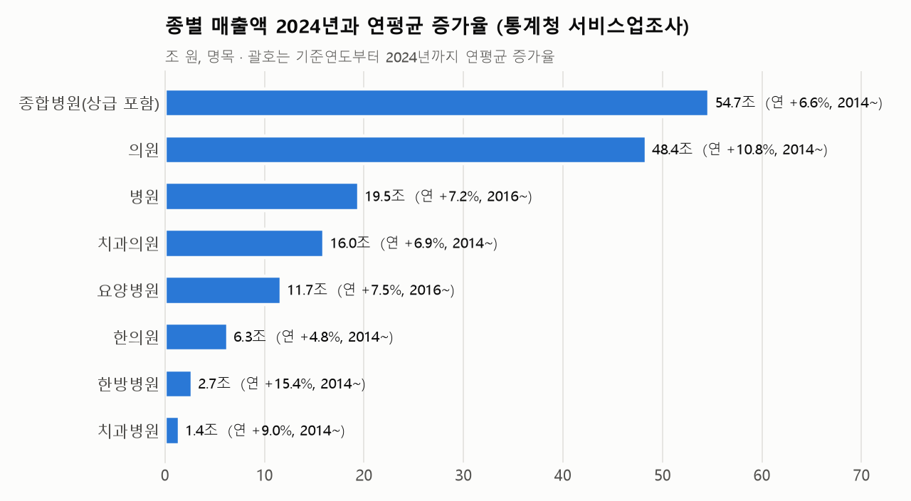
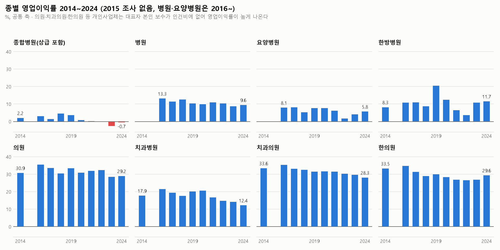
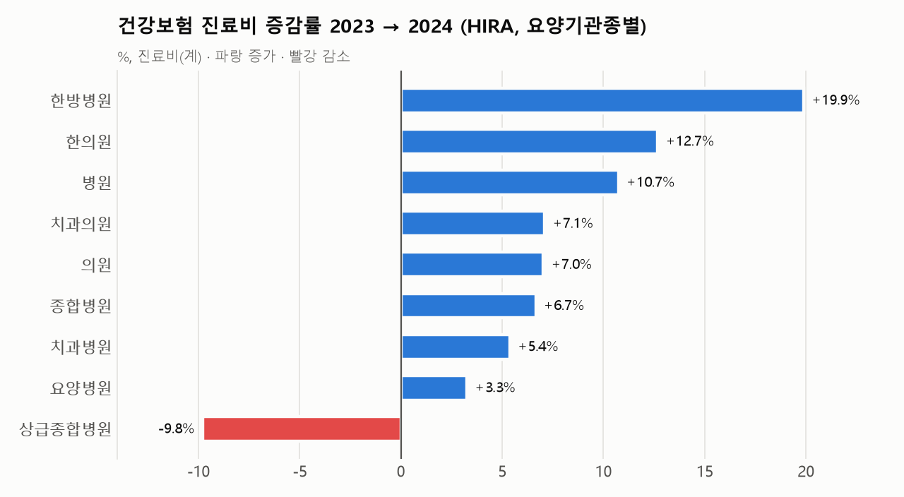

# 의료기관 종별 매출액·영업이익률 10개년(2014~2024) 분석 보고서

> **분석 대상**: 상급종합병원·종합병원, 병원, 요양병원, 의원, 치과(치과병원·치과의원), 한방병원, 한의원
> **자료원**: ① 통계청(국가데이터처) 「서비스업조사」 시도/산업별 총괄(전국, 보건업 세세분류) ② 건강보험심사평가원 「요양기관종별 진료비 심사실적」(KOSIS 354/DT_LEE_02)
> **수집 경로**: korea-stats MCP 서버(KOSIS OpenAPI 래퍼) — `06_분석_및_수집_스크립트/general_hospital_finance_kosis_mcp.py`
> **원자료**: `05_원천_통계_데이터셋/07_종합병원_경영지표/` (CSV 2종)
> **분석 기간**: 2014~2024년(2015년 결측, 7절) · 모든 금액은 명목
> **작성일자**: 2026년 10월 30일 (같은 날 종합병원 단독 분석에서 종별 분석으로 확대)

---

## 1. 핵심 요약

| 종별 (KSIC) | 기준연도 | 매출액 기준연도 → 2024 (조 원) | 연평균 증가율 | 영업이익률 기준연도 → 2024 | 평균 이익률 2016~19 / 2020~24 | 2024 사업체 | 사업체당 매출 (억 원) |
| :--- | :---: | ---: | ---: | ---: | ---: | ---: | ---: |
| **종합병원**(상급 포함, 86101) | 2014 | 28.91 → **54.68** | 6.6% | 2.2% → **−0.7%** | 3.3% / −0.5% | 375 | 1,458 |
| **병원**(일반병원, 86102) | 2016 | 11.17 → **19.47** | 7.2% | 13.3% → **9.6%** | 12.0% / 10.0% | 1,376 | 141 |
| **요양병원**(86105) | 2016 | 6.56 → **11.67** | 7.5% | 8.1% → **5.8%** | 7.4% / 5.2% | 1,568 | 74 |
| 병원 + 요양병원 | 2014 | 14.05 → 31.13 | 8.3% | 9.7% → 8.2% | 10.3% / 8.2% | 2,944 | 106 |
| **의원**(일반의원, 86201) | 2014 | 17.30 → **48.37** | **10.8%** | 30.9% → **29.2%** | 33.4% / 30.7% | 35,954 | 13.5 |
| **치과병원**(86103) | 2014 | 0.61 → **1.44** | 9.0% | 17.9% → **12.4%** | 19.9% / 15.9% | 241 | 59.5 |
| **치과의원**(86202) | 2014 | 8.17 → **15.98** | 6.9% | 33.6% → **28.3%** | 33.3% / 30.4% | 18,916 | 8.4 |
| 치과 합계 | 2014 | 8.77 → 17.42 | 7.1% | 32.5% → 26.9% | 32.2% / 29.3% | 19,157 | 9.1 |
| **한방병원**(86104) | 2014 | 0.65 → **2.72** | **15.4%** | 8.3% → **11.7%** | 12.9% / 9.2% | 561 | 48.6 |
| **한의원**(86203) | 2014 | 3.92 → **6.29** | **4.8%** | 33.5% → **29.6%** | 31.4% / 27.8% | 14,522 | 4.3 |
| 상급종합병원 | – | 손익 자료 없음, 건강보험 진료비만 (5절) | 진료비 연 8.6% | – | – | – | – |

*병원과 요양병원은 2016년이 기준연도다. 9차 산업분류(2014년)에서는 요양병원이 일반병원에 포함돼 있어, 10년 비교는 '병원 + 요양병원' 행으로 한다.*

**핵심 발견**

1. **수익성은 두 무리로 나뉜다.** 병원급(종합·병원·요양·한방·치과병원)의 2024년 영업이익률은 −0.7~12.4%다. 의원급(의원·치과의원·한의원)은 28~30%다. 이 차이의 상당 부분은 회계 개념에서 나온다. 의원급은 대부분 개인사업체라 원장 본인의 보수가 인건비에 들어가지 않고 영업이익에 포함된다(7절 ①). 따라서 의원급의 영업이익률은 '원장 소득을 포함한 이익률'로 읽어야 한다.
2. **조사한 모든 종별에서 이익률이 10년 전보다 낮아졌다. 예외는 한방병원 하나다.** 하락폭이 큰 순서는 치과병원(−5.5%p), 치과의원(−5.3%p), 한의원(−3.9%p), 병원(2016년 대비 −3.7%p), 종합병원(−2.9%p), 요양병원(2016년 대비 −2.3%p), 의원(−1.7%p)이다. 한방병원만 8.3%에서 11.7%로 올랐다.
3. **성장 속도는 한방병원(연 15.4%)과 의원(연 10.8%)이 가장 빠르고, 한의원(연 4.8%)이 가장 느리다.** 한방병원은 사업체 수가 210개에서 561개로 2.7배가 됐다. 한의원은 사업체가 11% 늘었지만, 사업체당 매출은 4.3억 원으로 종별 가운데 가장 작다.
4. **종합병원만 적자로 돌아섰다.** 2022년부터 3년 연속 영업적자다. 같은 기간 병원은 9~10%, 요양병원은 2~6%의 흑자를 유지했다.
5. **2024년 의정 갈등의 충격은 상급종합병원에 집중됐다(HIRA).** 상급종합병원 진료비는 9.8% 줄었다. 반면 병원(+10.7%), 종합병원(+6.7%), 한방병원(+19.9%), 한의원(+12.7%)은 늘었다. 2024년 서비스업조사에서도 병원 매출이 12.6% 늘고 이익률이 8.9%에서 9.6%로 올라, 진료 수요가 아래 단계 의료기관으로 옮겨 간 흐름과 맞는다.
6. **건강보험 의존도는 종별로 크게 다르다.** 2024년 매출에서 건강보험 진료비가 차지하는 비율은 종합병원 72%, 치과의원 37%, 한방병원 30%다. 한방병원은 매출의 대부분이 건강보험 밖(자동차보험, 비급여 등)에서 나온다.

---

## 2. 종별 매출액



| 종별 | 2014 | 2016 | 2017 | 2018 | 2019 | 2020 | 2021 | 2022 | 2023 | 2024 |
| :--- | ---: | ---: | ---: | ---: | ---: | ---: | ---: | ---: | ---: | ---: |
| 종합병원 | 28.91 | 31.16 | 35.32 | 37.59 | 38.21 | 40.27 | 47.35 | 51.17 | 53.29 | 54.68 |
| 병원 | (14.05)* | 11.17 | 12.23 | 13.24 | 14.68 | 14.83 | 15.76 | 17.02 | 17.28 | 19.47 |
| 요양병원 | * | 6.56 | 7.25 | 7.83 | 8.56 | 9.54 | 10.45 | 10.54 | 11.09 | 11.67 |
| 의원 | 17.30 | 21.87 | 24.00 | 26.52 | 29.45 | 30.63 | 35.78 | 41.81 | 44.19 | 48.37 |
| 치과병원 | 0.61 | 0.84 | 0.89 | 0.91 | 1.01 | 1.08 | 1.19 | 1.26 | 1.27 | 1.44 |
| 치과의원 | 8.17 | 9.90 | 10.66 | 11.15 | 12.07 | 12.40 | 13.68 | 14.33 | 15.27 | 15.98 |
| 한방병원 | 0.65 | 0.79 | 0.92 | 1.08 | 1.40 | 1.59 | 1.81 | 2.10 | 2.32 | 2.72 |
| 한의원 | 3.92 | 4.47 | 4.67 | 4.98 | 5.31 | 5.13 | 5.48 | 5.68 | 5.80 | 6.29 |

*단위: 조 원. \* 2014년 병원 값(14.05)은 요양병원을 포함한 9차 KSIC 일반병원이다. 2016년 9차 기준 일반병원(17.71조 원)은 10차 기준 병원과 요양병원 합계(17.73조 원)와 일치한다.*

---

## 3. 종별 영업이익률



| 종별 | 2014 | 2016 | 2017 | 2018 | 2019 | 2020 | 2021 | 2022 | 2023 | 2024 |
| :--- | ---: | ---: | ---: | ---: | ---: | ---: | ---: | ---: | ---: | ---: |
| 종합병원 | 2.2 | 3.3 | 1.6 | 4.6 | 3.7 | 0.9 | 0.4 | **−0.3** | **−2.8** | **−0.7** |
| 병원 | (9.7)* | 13.3 | 11.6 | 12.8 | 10.5 | 10.1 | 11.2 | 10.5 | 8.9 | 9.6 |
| 요양병원 | * | 8.1 | 8.2 | 5.4 | 7.8 | 7.8 | 6.3 | 1.9 | 4.2 | 5.8 |
| 병원 + 요양병원 | 9.7 | 11.4 | 10.4 | 10.0 | 9.5 | 9.2 | 9.2 | 7.2 | 7.1 | 8.2 |
| 치과병원 | 17.9 | 21.7 | 19.6 | 17.8 | 20.3 | 20.7 | 16.9 | 15.0 | 14.3 | 12.4 |
| 한방병원 | 8.3 | 11.0 | 11.1 | 8.8 | 20.6 | 12.6 | 6.6 | 3.8 | 11.0 | 11.7 |
| 의원 | 30.9 | 35.7 | 33.8 | 30.6 | 33.7 | 31.1 | 32.1 | 32.6 | 28.6 | 29.2 |
| 치과의원 | 33.6 | 35.5 | 33.3 | 32.7 | 31.6 | 31.9 | 31.6 | 30.5 | 29.8 | 28.3 |
| 한의원 | 33.5 | 34.9 | 31.5 | 29.1 | 30.2 | 28.6 | 27.0 | 26.8 | 27.1 | 29.6 |

*단위: %. 영업이익률 = (매출액 − 영업비용) ÷ 매출액. 2022~2024년은 KOSIS 영업이익 공표값과 계산값이 일치한다.*

**2024년 사업체당 영업이익과 인건비 비중**

| 종별 | 사업체당 영업이익 (백만 원) | 인건비 / 매출액 | 사업체당 종사자 (명) |
| :--- | ---: | ---: | ---: |
| 종합병원 | −1,021 | 50.7% | 935 |
| 병원 | 1,361 | 45.0% | 109 |
| 요양병원 | 434 | 50.1% | 85 |
| 치과병원 | 736 | 43.2% | 43 |
| 한방병원 | 568 | 44.9% | 49 |
| 의원 | 393 | 25.4% | 8.0 |
| 치과의원 | 239 | 29.4% | 5.9 |
| 한의원 | 128 | 23.5% | 4.2 |

*의원급의 사업체당 영업이익은 원장 본인의 세전 소득(공동개원이면 여러 명의 몫)을 포함한다. 의원급의 인건비 비중이 23~29%로 낮은 것도 같은 이유다.*

---

## 4. 종별 해석

### 4-1. 상급종합병원·종합병원
- 종합병원(KSIC 86101)에는 상급종합병원이 포함되며, 서비스업조사로는 둘을 나눌 수 없다. 매출은 연 6.6% 늘었지만 인건비가 연 8.2%로 더 빨리 늘었다. 이익률은 2018년 4.6%가 정점이었고, 2022~2024년은 적자다(자세한 내용은 6절).
- 상급종합병원은 HIRA 진료비로만 볼 수 있다. 진료비는 2014년 8.56조 원에서 2024년 19.54조 원으로 연 8.6% 늘었다. 2024년에는 입원일수가 25.4% 줄면서 진료비가 9.8% 감소했다.

### 4-2. 병원(일반병원)
- 이익률이 9~13%로 병원급 가운데 가장 높고 안정적이다. 2016~2019년 평균 12.0%에서 2020~2024년 평균 10.0%로 2%p 낮아졌다.
- 2024년 매출이 12.6% 늘어 10년 중 증가 폭이 가장 컸다. 같은 해 HIRA 병원 입원 진료비도 14.3% 늘었다. 상급종합병원에서 빠져나온 환자를 일부 흡수한 것으로 보인다.

### 4-3. 요양병원
- 매출은 연 7.5% 늘었지만 이익률은 8.1%(2016)에서 5.8%(2024)로 낮아졌다. 2022년이 1.9%로 가장 낮았는데, 코로나19 유행 시기와 겹친다.
- 건강보험 진료비는 2018~2024년 5.6~6.2조 원으로 거의 늘지 않았다. 일당정액제 수가 때문이다. 그래서 매출 대비 건강보험 비율이 69%(2019)에서 49%(2024)로 떨어졌다. 매출 증가분은 의료급여, 비급여 등 건강보험 밖에서 나왔다.

### 4-4. 의원
- 매출이 17.3조 원에서 48.4조 원으로 2.8배가 돼 증가액(+31.1조 원)이 종합병원(+25.8조 원)보다 크다. 사업체는 27,771개에서 35,954개로 29% 늘었다.
- 이익률은 2016년 35.7%를 정점으로 2023~2024년 29% 안팎까지 내려왔다. HIRA 의원 진료비는 2022년에 23.2% 급증했는데, 코로나19 검사와 재택치료가 의원에 몰린 영향으로 보인다.

### 4-5. 치과(치과병원·치과의원)
- 치과 합계 매출은 8.8조 원에서 17.4조 원으로 연 7.1% 늘었다.
- 이익률은 두 유형 모두 꾸준히 낮아졌다. 치과의원은 33.6%에서 28.3%로, 치과병원은 2020년 20.7%에서 2024년 12.4%로 4년 새 8.3%p 떨어졌다.
- 건강보험 진료비 비율은 치과의원 기준 28%(2014)에서 37%(2024)로 올랐다. 노인 틀니·임플란트와 스케일링의 급여 확대 시기와 맞는다.

### 4-6. 한방병원
- 10년간 가장 빨리 성장했다. 매출은 4.2배(연 15.4%), 사업체 수는 210개에서 561개로, 종사자는 8,902명에서 27,343명으로 늘었다.
- 이익률은 3.8~20.6%로 해마다 크게 흔들리지만 2024년은 11.7%다. 사업체 수가 적어 표본 추정치의 변동이 큰 것으로 보이므로 개별 연도보다 추세로 읽는 것이 맞다.
- 매출 대비 건강보험 진료비 비율은 약 30%에 그친다. 매출의 상당 부분이 자동차보험과 비급여에서 나오는 것으로 추정된다. 다만 자동차보험 진료비는 이 자료에 없어 직접 확인하지는 못했다.

### 4-7. 한의원
- 매출 증가율이 연 4.8%로 종별 가운데 가장 낮다. 물가를 고려하면 실질 성장은 더 작다. 사업체당 매출(4.3억 원)과 사업체당 영업이익(1.28억 원, 원장 소득 포함)도 가장 작다.
- 이익률은 2014년 33.5%에서 2022년 26.8%까지 낮아졌다가, 2024년 29.6%로 회복했다. 2024년 매출은 8.3% 늘어 10년 중 가장 크게 증가했다. HIRA 한의원 진료비도 2024년 12.7% 늘었다.
- 매출 대비 건강보험 비율은 49~52%로 10년간 거의 변하지 않았다.

---

## 5. 건강보험 진료비 (HIRA 심사실적)



| 종별 | 2014 | 2016 | 2018 | 2019 | 2020 | 2021 | 2022 | 2023 | 2024 | 연평균 증가율 2014~24 |
| :--- | ---: | ---: | ---: | ---: | ---: | ---: | ---: | ---: | ---: | ---: |
| 상급종합병원 | 8.56 | 10.93 | 14.07 | 14.97 | 15.21 | 16.99 | 17.30 | 21.67 | 19.54 | 8.6% |
| 종합병원 | 8.34 | 10.11 | 12.64 | 14.72 | 14.91 | 16.08 | 17.36 | 18.53 | 19.76 | 9.0% |
| 병원 | 8.94† | 10.59† | 6.85 | 7.57 | 7.75 | 8.24 | 9.08 | 9.22 | 10.21 | 6.0%(병원 + 요양) |
| 요양병원 | † | † | 5.68 | 5.93 | 6.16 | 5.72 | 5.64 | 5.56 | 5.74 | – |
| 의원 | 11.31 | 12.65 | 15.13 | 16.86 | 17.03 | 18.77 | 23.12 | 24.65 | 26.38 | 8.8% |
| 치과병원 | 0.14 | 0.21 | 0.27 | 0.31 | 0.31 | 0.32 | 0.33 | 0.35 | 0.37 | 10.5% |
| 치과의원 | 2.29 | 3.29 | 3.93 | 4.55 | 4.55 | 4.89 | 5.09 | 5.44 | 5.83 | 9.8% |
| 한방병원 | 0.22 | 0.30 | 0.36 | 0.42 | 0.48 | 0.53 | 0.57 | 0.69 | 0.83 | 14.2% |
| 한의원 | 2.05 | 2.12 | 2.36 | 2.59 | 2.47 | 2.54 | 2.58 | 2.76 | 3.11 | 4.3% |
| 의료기관 전체 | 42.03 | 50.37 | 61.45 | 68.09 | 69.03 | 74.64 | 81.86 | 89.70 | 92.65 | 8.2% |

*단위: 조 원, 진료비(계) = 공단부담금 + 법정 본인부담금. 비급여, 의료급여, 자동차보험, 산재는 포함하지 않는다. † HIRA 통계표에서 요양병원은 2018년부터 따로 집계되며, 2017년까지는 '병원'에 포함돼 있다.*

**2024년 종별 충격 (2023 → 2024 증감률)**

| 종별 | 진료비 | 입원 진료비 | 입원일수 | 외래일수 |
| :--- | ---: | ---: | ---: | ---: |
| 상급종합병원 | **−9.8%** | −13.4% | **−25.4%** | −9.9% |
| 종합병원 | +6.7% | +10.7% | −0.1% | −5.1% |
| 병원 | +10.7% | +14.3% | +5.2% | −2.2% |
| 요양병원 | +3.3% | +3.2% | −1.4% | +0.2% |
| 의원 | +7.0% | +14.4% | +1.7% | −0.1% |
| 치과병원 | +5.4% | +7.0% | −0.3% | +1.9% |
| 치과의원 | +7.1% | +11.0% | −7.1% | +3.3% |
| 한방병원 | **+19.9%** | +22.7% | +13.7% | +1.2% |
| 한의원 | +12.7% | +11.8% | +4.2% | +4.5% |

**매출에서 건강보험 진료비가 차지하는 비율 (HIRA 진료비 ÷ 서비스업조사 매출액)**

| 종별 | 2014 | 2019 | 2024 |
| :--- | ---: | ---: | ---: |
| 종합병원(상급 + 종합) | 58.5% | 77.7% | 71.9% |
| 병원 + 요양병원 | 63.6% | – | 51.2% |
| 병원 | – | 51.6% | 52.4% |
| 요양병원 | – | 69.2% | 49.2% |
| 의원 | 65.4% | 57.3% | 54.5% |
| 치과병원 | 22.8% | 30.7% | 26.0% |
| 치과의원 | 28.0% | 37.7% | 36.5% |
| 한방병원 | 33.8% | 29.9% | 30.3% |
| 한의원 | 52.3% | 48.8% | 49.5% |

*심사년도와 회계연도, 조사 범위가 서로 달라 근사치로만 읽어야 한다.*

- ⚠️ **2023년 상급종합병원 진료비(21.67조 원, 전년 대비 +25.3%)는 확인이 필요하다.** 같은 해 입원 일당 진료비가 13.5% 뛰었는데, 추세에서 크게 벗어난 값이다. HIRA 심사실적은 '심사년도' 기준이라 청구 시점이 옮겨 가면 값이 흔들릴 수 있다. 진료년도 기준 건강보험통계연보와 대조하기 전까지는 2024년 감소폭(−9.8%)도 과대 추정일 수 있다. 2018년(14.07조 원)과 2019년(14.97조 원) 값은 언론에 보도된 연보 수치와 맞는다.

---

## 6. 종합병원 심층 분석

### 6-1. 매출액과 영업이익률


| 연도 | 통계표 | 사업체 | 종사자 | 매출액(조) | 영업비용(조) | 영업이익(억) | **영업이익률(%)** | 매출 증가율(%) | 비용 증가율(%) |
| :---: | :--- | ---: | ---: | ---: | ---: | ---: | ---: | ---: | ---: |
| 2014 | DT_1KB6001 | 331 | 230,709 | 28.91 | 28.28 | 6,334 | **2.19** | – | – |
| 2016 | DT_1KB9001 | 338 | 255,945 | 31.16 | 30.14 | 10,155 | **3.26** | – | – |
| 2017 | DT_1KB9001 | 340 | 263,098 | 35.32 | 34.75 | 5,653 | **1.60** | 13.3 | 15.3 |
| 2018 | DT_1KB9001 | 347 | 277,638 | 37.59 | 35.85 | 17,431 | **4.64** | 6.4 | 3.1 |
| 2019 | DT_1KB9001 | 355 | 294,891 | 38.21 | 36.78 | 14,318 | **3.75** | 1.7 | 2.6 |
| 2020 | DT_2KB9001 | 366 | 319,056 | 40.27 | 39.91 | 3,652 | **0.91** | 5.4 | 8.5 |
| 2021 | DT_2KB9001 | 363 | 327,616 | 47.35 | 47.14 | 2,071 | **0.44** | 17.6 | 18.1 |
| 2022 | DT_2KB9001 | 373 | 343,742 | 51.17 | 51.33 | −1,602 | **−0.31** | 8.1 | 8.9 |
| 2023 | DT_3KB9001 | 373 | 348,702 | 53.29 | 54.78 | −14,935 | **−2.80** | 4.1 | 6.7 |
| 2024 | DT_3KB9001 | 375 | 350,670 | 54.68 | 55.06 | −3,831 | **−0.70** | 2.6 | 0.5 |

- **2014~2019년, 흑자 확대기(1.6~4.6%)**: 2018년 이익률(4.6%)이 가장 높다. 그해 매출은 6.4% 늘고 비용은 3.1% 느는 데 그쳤다. 2018년은 상급병실(2·3인실)과 MRI 등의 급여화가 시작된 해로, HIRA 상급종합병원 진료비가 24.3% 급증했다.
- **2020~2021년, 코로나19기(0.4~0.9%)**: 2020년 매출 증가율(5.4%)이 비용 증가율(8.5%)에 못 미쳤다.
- **2022~2024년, 적자기(−0.3 ~ −2.8%)**: 비용 증가가 매출 증가를 3년 연속 앞섰다. 2024년은 비용 증가율이 0.5%로 낮아지면서 적자 폭이 줄었다. 이 해에는 전공의 이탈로 상급종합병원의 진료량과 인건비 일부가 함께 줄었다.
- 2016~2019년 누적 영업이익은 +4.76조 원이었고, 2020~2024년 누적은 −1.46조 원이었다.

### 6-2. 비용 구조


| 연도 | 인건비/매출(%) | 기타경비/매출(%) | 1인당 인건비(백만 원) | 1인당 매출(백만 원) |
| :---: | ---: | ---: | ---: | ---: |
| 2014 | 43.6 | 53.6 | 54.6 | 125.3 |
| 2018 | 45.3 | 49.4 | 61.3 | 135.4 |
| 2020 | 51.5 | 47.0 | 65.0 | 126.2 |
| 2022 | 51.9 | 47.7 | 77.2 | 148.9 |
| 2023 | 49.9 | 52.3 | 76.2 | 152.8 |
| 2024 | 50.7 | 49.3 | 79.0 | 155.9 |

- 10년간 인건비는 120.1% 늘어 매출(+89.1%)을 크게 앞질렀다. 종사자 1인당 인건비는 45% 올랐고, 1인당 매출은 24% 올랐다.
- 2023년 적자 확대는 기타경비에서 나왔다. 기타경비(의약품, 재료, 감가상각, 관리비 등)가 3.44조 원(+14.1%) 늘어 매출 증가분(2.12조 원)을 웃돌았다. 같은 해 인건비는 0.2% 느는 데 그쳤다.

### 6-3. 상급종합병원·종합병원 건강보험 진료비


- 입내원일당 진료비는 10년 새 약 2배가 됐다. 상급종합병원은 16.9만 원에서 34.0만 원으로, 종합병원은 9.9만 원에서 20.5만 원으로 올랐다. 진료량(입내원일수)은 상급종합 +13.6%, 종합 +14.9%에 그쳤다. 진료비 증가는 대부분 일당 진료비(수가, 진료 강도, 급여 범위)에서 왔다.

---

## 7. 자료 해석상 유의점

1. **개인사업체의 영업이익**: 서비스업조사의 인건비에는 대표자(원장) 본인의 보수가 들어가지 않는다. 그래서 개인사업체가 대부분인 의원·치과의원·한의원의 영업이익률(28~30%)은 원장 소득을 포함한 값이다. 법인이 대부분인 종합병원의 이익률과 바로 비교하면 안 된다. 병원·요양병원·한방병원에도 개인 개설 기관이 섞여 있다.
2. **2015년 결측**: 2015년은 경제총조사 연도라 서비스업조사를 하지 않았다. 2015년 경제총조사는 산업 소분류(861 병원·862 의원)까지만 공개돼 종별로 나눌 수 없다. 그래서 10년 변화는 2014→2024년으로 계산했다.
3. **산업분류 개정**: 2014년 값은 9차 KSIC 기준이다. 9차에는 요양병원(86105)이 없고 일반병원에 포함된다. 그래서 병원과 요양병원은 2016년부터 따로 보고, 10년 비교는 합계로 한다. 2016년을 두 기준으로 비교하면 차이는 종합병원 0.3%, 병원 + 요양 0.1%, 의원 0.4%, 한의원 0.0%로 작다.
4. **상급종합병원 분리 불가**: KSIC 86101 '종합병원'에는 상급종합병원이 포함된다. KOSIS에는 상급종합병원의 손익 통계가 없다. 국민보건계정도 '병원(HP.1)' 단위까지만 나뉜다. 상급종합병원의 수익성은 보건산업진흥원 「병원경영분석」이나 의료기관 회계정보공시로 보완해야 한다.
5. **표본 추정치**: 서비스업조사는 표본조사이며 영업이익은 매출액에서 영업비용을 뺀 사업체 단위 추정치다. 사업체 수가 적은 한방병원(561개)과 치과병원(241개)은 해마다 값이 크게 흔들린다. 병원 회계의 의료이익(의료수익 − 의료비용)이나, 보조금·손실보상금·부대사업 손익이 반영된 당기순이익과는 다른 개념이다.
6. **명목 기준**: 물가를 반영하지 않았다.
7. **HIRA 종별 정의**: HIRA 진료비는 요양기관종별 기준이고 서비스업조사는 산업분류 기준이라 범위가 완전히 같지 않다. 의원은 일반의원(86201)과 대응시켰고, 방사선진단·병리검사의원(86204)은 제외했다.

---

## 8. 재현 방법

```bash
# 1) 수집 (korea-stats MCP 원격 서버, KOSIS 키 불필요)
python 06_분석_및_수집_스크립트/general_hospital_finance_kosis_mcp.py
# 2) 그림 생성 (종별 3종 + 종합병원 심층 4종)
python 06_분석_및_수집_스크립트/plot_general_hospital_finance.py
```

| 자료 | KOSIS 기관/통계표 | 조회 조건 |
| :--- | :--- | :--- |
| 서비스업조사 2014 | 101 / DT_1KB6001 | 시도 00(전국) × 산업 Q86101~Q86104, Q86201~Q86203 |
| 서비스업조사 2016~2019 | 101 / DT_1KB9001 | 00 × 86101~86105, 86201~86203 |
| 서비스업조사 2020~2022 | 101 / DT_2KB9001 | 00 × 86101~86105, 86201~86203 |
| 서비스업조사 2023~2024 | 101 / DT_3KB9001 | 00 × 86101~86105, 86201~86203 |
| HIRA 요양기관종별 진료비 심사실적 2014~2024 | 354 / DT_LEE_02 | 종별 .02 .10 .20 .28 .30 .40 .50 .92 .93 .01 × 계·입원·외래 |
