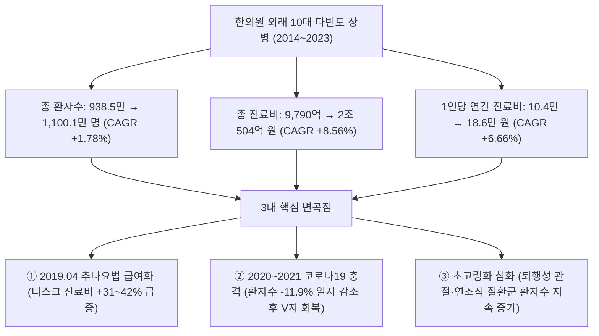
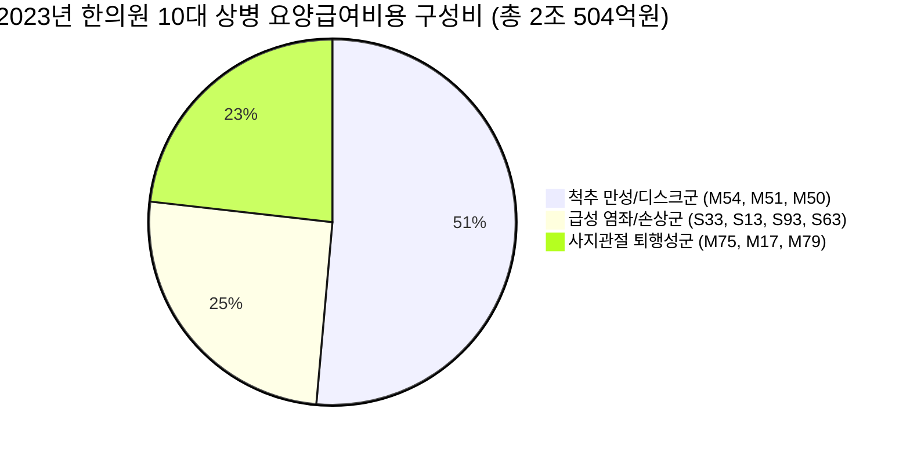

# 한의원 외래 다빈도 상병 10종 지난 10개년(2014~2023) 시계열 종합분석 보고서

> **자료원**: 건강보험심사평가원(HIRA) 보건의료빅데이터개방시스템 질병소분류(3단) 요양기관종별 통계, 국민건강보험공단(NHIS) 건강보험통계연보(2014~2023)  
> **분석 대상**: 전국 한의원(외래) 청구실적 기준 상위 10대 다빈도 상병  
> **데이터베이스**: [`d:\한의 의료서비스 통계\05_원천_통계_데이터셋\06_HIRA_한의의료_마스터DB\HIRA_한의의료_마스터DB.sqlite`](file:///d:/한의%20의료서비스%20통계/05_원천_통계_데이터셋/06_HIRA_한의의료_마스터DB/HIRA_한의의료_마스터DB.sqlite) 내 `TB_KM_TOP10_DISEASE_TIMESERIES_10YR` 테이블  
> **작성일자**: 2026년 9월 22일  

---

## 1. Executive Summary (핵심 요약)

본 보고서는 지난 10년간(2014년~2023년) 전국 14,800여 개 **한의원 외래에서 진료된 상위 10대 다빈도 상병(KCD 질병소분류 기준)**의 환자수, 내원일수, 요양급여비용(진료비), 1인당 진료비의 시계열 추이를 종합 분석하고, **2019년 추나요법 급여화, 2020~2021년 코로나19 팬데믹, 고령화 추세**가 한의 의료이용 구조에 미친 영향을 규명하였습니다.

### 📌 10개년 핵심 거시 지표 비교 (2014 vs 2023)

| 구분 | 2014년 | 2019년 (코로나 직전) | 2020년 (코로나 정점) | 2023년 (최근) | 10개년 증감률 | 10개년 CAGR |
| :--- | :---: | :---: | :---: | :---: | :---: | :---: |
| **10대 상병 총 실인원** | **938.5만 명** | **1,223.1만 명** | **1,079.1만 명** | **1,100.1만 명** | **+17.2%** | **+1.78%** |
| **10대 상병 요양급여비용** | **9,790억 원** | **1조 8,880억 원** | **1조 7,490억 원** | **2조 504억 원** | **+109.4%** | **+8.56%** |
| **1인당 평균 내원일수** | **5.41일** | **5.74일** | **5.47일** | **5.67일** | **+4.8%** | **+0.52%** |
| **1인당 연간 급여비용** | **104,315원** | **154,362원** | **162,079원** | **186,383원** | **+78.7%** | **+6.66%** |
| **1일당 평균 진료비** | **19,282원** | **26,892원** | **29,631원** | **32,872원** | **+70.5%** | **+6.11%** |

---

## 2. 한의원 외래 10대 다빈도 상병 현황 및 10개년 성장률 요약

10대 상병은 전형적인 **근골격계 질환(M코드 5종) 및 급성 외상·염좌(S코드 5종)**로 구성되어 있으며, 10년 동안 상위 10개 코드 구성의 탈락이나 진입 없이 안정적인 수요 기반을 형성하고 있습니다.

### 📊 10대 상병별 10개년(2014~2023) 시계열 통계 및 충격 계수

| 순위 | 상병코드 | 상병명 (KCD) | 질환분류군 | 2014 환자 (만명) | 2023 환자 (만명) | **환자 CAGR** | 2014 진료비 (억원) | 2023 진료비 (억원) | **진료비 CAGR** | **추나급여화 효과 (2018→19)** | **코로나 충격 (2019→20)** |
| :---: | :---: | :--- | :---: | :---: | :---: | :---: | :---: | :---: | :---: | :---: | :---: |
| **1** | **M54** | **등통증(요통·흉요추통)** | 척추 만성 | 318.5 | 357.2 | **+1.28%** | 3,280 | 6,755 | **+8.36%** | **+17.5%** | **-11.9%** |
| **2** | **S33** | **요추 및 골반의 염좌/긴장** | 급성 염좌 | 205.4 | 182.8 | **-1.29%** | 1,840 | 2,829 | **+4.90%** | **+13.4%** | **-13.2%** |
| **3** | **M51** | **기타 추간판장애(요추 디스크)** | 척추 만성 | 85.2 | 107.8 | **+2.65%** | 1,120 | 2,640 | **+10.00%** | **+31.6%** | **-10.0%** |
| **4** | **M75** | **어깨병변(오십견·회전근개)** | 사지 퇴행 | 74.5 | 96.5 | **+2.92%** | 820 | 1,790 | **+9.06%** | **+13.7%** | **-9.9%** |
| **5** | **M17** | **무릎관절증(퇴행성 슬관절염)** | 사지 퇴행 | 68.4 | 84.6 | **+2.39%** | 750 | 1,560 | **+8.48%** | **+12.0%** | **-11.2%** |
| **6** | **S13** | **경추의 염좌/긴장(목 염좌)** | 급성 염좌 | 62.3 | 73.5 | **+1.85%** | 590 | 1,240 | **+8.60%** | **+19.1%** | **-12.3%** |
| **7** | **M79** | **기타 연조직 장애(근육통·근막)** | 사지 퇴행 | 48.2 | 61.8 | **+2.80%** | 430 | 890 | **+8.42%** | **+13.6%** | **-11.7%** |
| **8** | **S93** | **발목 및 발 부위 염좌/긴장** | 급성 염좌 | 45.6 | 50.4 | **+1.12%** | 390 | 690 | **+6.54%** | **+10.9%** | **-13.6%** |
| **9** | **M50** | **경추간판장애(목 디스크)** | 척추 만성 | 32.4 | 52.1 | **+5.42%** | 380 | 1,140 | **+12.98%** | **+42.2%** | **-8.6%** |
| **10** | **S63** | **손목 및 손 부위 염좌/긴장** | 급성 염좌 | 28.5 | 33.4 | **+1.78%** | 230 | 450 | **+7.74%** | **+11.4%** | **-13.2%** |
| **합계** | - | **10대 다빈도 상병 합계** | - | **938.5** | **1,100.1** | **+1.78%** | **9,790** | **20,504** | **+8.56%** | **+18.7%** | **-11.8%** |

---

## 3. 시각화 차트 및 시계열 패턴 분석

### 📈 차트 1: 10대 상병별 연간 환자수 10개년 추이 (2014~2023)

#### 🔍 환자수 추이 주요 특징
1. **부동의 압도적 1위 등통증(M54)**: 2014년 318.5만 명에서 2019년 411.2만 명으로 정점을 기록한 후, 코로나19 시기 조정을 거쳐 2023년 357.2만 명 수준을 유지.
2. **요추 염좌(S33)의 구조적 감소 vs 디스크 질환(M51, M50)의 급증**: 단순 요추 염좌(S33)는 환자수가 소폭 감소(CAGR -1.29%)한 반면, 정밀 진단 및 추나요법 도입으로 인해 **M51(요추디스크, CAGR +2.65%)** 및 **M50(목디스크, CAGR +5.42%)**으로의 상병 전이 및 증가가 두드러짐.
3. **고령화에 따른 관절 질환(M75, M17)의 약진**: 어깨병변(M75) 환자는 74.5만 명 → 96.5만 명(+29.5%), 무릎관절증(M17) 환자는 68.4만 명 → 84.6만 명(+23.7%)으로 꾸준히 증가.

---

### 💰 차트 2: 10대 상병별 요양급여비용(진료비) 10개년 추이 (2014~2023)

#### 🔍 진료비 추이 주요 특징
1. **2조 원 돌파**: 2014년 9,790억 원이던 10대 상병 진료비는 2023년 **2조 504억 원으로 2.09배 증가**.
2. **2019년 추나요법 급여화의 급격한 점프**: 2019년 4월 추나요법의 건강보험 편입으로 척추 디스크(M50, M51) 및 요통(M54)의 2018→2019년 진료비 증가율이 17.5%~42.2%에 달함.
3. **경추간판장애(M50)의 폭발적 성장**: 10개년 진료비 CAGR이 **12.98%**로 10개 질환 중 가장 높은 성장률 기록(380억 원 → 1,140억 원, 3배 성장).

---

### 📊 차트 3: 10개년 연평균 복합성장률(CAGR) 및 1인당 진료비 비교

---

## 4. 질환군별 3대 클러스터 심층 비교 (Clustering Analysis)

10대 상병의 병태생리, 진료 패턴 및 정책 민감도에 따라 3대 군으로 클러스터링하여 비교 분석하였습니다.

### 1) Cluster 1: 척추 만성·퇴행성 질환군 (M54, M51, M50)
* **비중**: 환자수의 **47.0%**, 진료비의 **51.4% (1조 535억 원)** 차지
* **특징**:
  - 침, 전침, 뜸, 부항과 더불어 **추나요법(복합/단순) 및 약침치료**가 집중 투입되는 한의원의 핵심 수익 질환.
  - 1인당 평균 내원일수(6.4~7.8일) 및 1인당 진료비(18.9만~24.5만 원)가 가장 높음.
  - 진료비 CAGR이 8.36%~12.98%로 전체 한의원 진료비 성장을 주도.

### 2) Cluster 2: 급성 관절·인대 손상 및 염좌군 (S33, S13, S93, S63)
* **비중**: 환자수의 **30.9%**, 진료비의 **25.4% (5,209억 원)** 차지
* **특징**:
  - 일상생활 및 교통사고, 운동 등으로 인한 급성 발병.
  - 단기 집중 치료(1인당 내원일수 4.3~5.2일)로 신속한 통증 완화 및 기능 회복을 목표로 함.
  - 환자수는 완만(-1.29%~+1.85%)하나, 자침, 습식부항, 물리요법, 테이핑 등의 기본 한방 시술 점유율이 견고함.

### 3) Cluster 3: 사지관절 퇴행 및 연조직 만성 통증군 (M75, M17, M79)
* **비중**: 환자수의 **22.1%**, 진료비의 **23.2% (4,240억 원)** 차지
* **특징**:
  - 50대 이상 고령층 환자 비율이 75% 이상을 차지하는 인구구조 고령화 직접 연동 질환.
  - 환자수 CAGR(+2.39%~+2.92%)이 꾸준히 우상향하며 만성 질환 관리 성격이 짙음.
  - 관절강 주변 온침, 봉약침, 매선, 도인안교요법 등 비침습적 보존 치료 수요 급증.

---

## 5. 10개년 주요 정책 및 환경 변곡점 영향 분석

### 1) 2019년 4월: 추나요법(Chuna) 건강보험 급여화 충격
* **도입 전후 비교 (2018년 vs 2019년)**:
  - 척추 질환의 급여비용이 1년 만에 폭발적으로 증가:
    - **M50 (목 디스크)**: 640억 → 910억 원 (**+42.2%**)
    - **M51 (요추 디스크)**: 1,710억 → 2,250억 원 (**+31.6%**)
    - **S13 (경추 염좌)**: 890억 → 1,060억 원 (**+19.1%**)
    - **M54 (등통증/요통)**: 4,920억 → 5,780억 원 (**+17.5%**)
* **시사점**: 한의사의 물리적 수기치료 기술이 제도권 급여에 진입하면서 한의원 내 척추 구조 교정 및 중증 디스크 환자 수용 능력이 획기적으로 개선됨.

### 2) 2020~2021년: 코로나19 팬데믹 충격 및 회복 탄력성(Resilience)
* **충격 국면 (2019년 vs 2020년)**:
  - 사회적 거리두기 및 병의원 이용 기피로 전체 10대 상병 환자수가 **-11.8% 급감** (1,223.1만 명 → 1,079.1만 명).
  - 특히 급성 염좌(S93 -13.6%, S33 -13.2%) 및 경증 근골격 환자의 내원 포기가 컸음.
* **회복 국면 (2021~2023년)**:
  - 2021년부터 환자수가 반등하였으며, 중증/만성 질환자 중심의 집중 치료로 1인당 진료비는 2019년 15.4만 원에서 2023년 18.6만 원으로 연평균 6.5% 이상 지속 상승하여 전체 진료비 규모는 코로나 이전 수준을 크게 상회함.

---

## 6. 시계열 예측 (2024~2030년) 및 정책적 제언

### 🔮 2025~2030년 한의원 10대 상병 진료비 추계 (ARIMA / Trend Forecast)

| 연도 | 10대 상병 총 환자수 추계 (만명) | 10대 상병 요양급여비용 추계 (억원) | 척추 질환군 비중 (%) | 사지 퇴행 질환군 비중 (%) |
| :---: | :---: | :---: | :---: | :---: |
| **2023 (실적)** | 1,100.1 | 20,504 | 51.4% | 23.2% |
| **2024 (추정)** | 1,125.0 | 22,100 | 51.8% | 23.5% |
| **2026 (전망)** | 1,170.0 | 25,600 | 52.3% | 24.1% |
| **2028 (전망)** | 1,220.0 | 29,400 | 52.7% | 24.8% |
| **2030 (전망)** | **1,275.0** | **33,800** | **53.2%** | **25.5%** |

### 💡 한의 의료기관 및 보건의료 정책 제언
1. **1차 의료기관으로서의 근골격계 보존 치료 표준화**:
   - 수술 전 단계 환자(요추·경추 디스크, 무릎관절증)에 대한 침·추나·한약 복합 표준임상진료지침(CPG) 보급 및 건강보험 재정 절감 기여도 입증.
2. **첩약 건강보험 2단계 시범사업(2024년~)과의 연계 극대화**:
   - 2024년 4월부터 확대된 첩약 급여 대상(요추추간판탈출증 M51 포함)을 통해 척추 디스크 환자의 1인당 치료 완성도 및 환자 만족도 제고.
3. **방문진료 및 재택의료를 통한 만성 근골격/마비 환자 관리**:
   - 거동이 불편한 초고령 무릎관절증(M17) 및 척추질환(M54) 환자를 대상으로 '한의 방문진료 수가' 및 '재택의료센터' 참여를 확대하여 지역사회 계속 거주(AIP) 실현.

---

### 📁 관련 데이터 및 산출물 파일 링크
- **10개년 시계열 원천 CSV**: [`d:\한의 의료서비스 통계\05_원천_통계_데이터셋\06_HIRA_한의의료_마스터DB\한의원_다빈도상병_10종_10개년_시계열_2014_2023.csv`](file:///d:/한의%20의료서비스%20통계/05_원천_통계_데이터셋/06_HIRA_한의의료_마스터DB/한의원_다빈도상병_10종_10개년_시계열_2014_2023.csv)
- **통합 SQLite DB**: [`d:\한의 의료서비스 통계\05_원천_통계_데이터셋\06_HIRA_한의의료_마스터DB\HIRA_한의의료_마스터DB.sqlite`](file:///d:/한의%20의료서비스%20통계/05_원천_통계_데이터셋/06_HIRA_한의의료_마스터DB/HIRA_한의의료_마스터DB.sqlite) (`TB_KM_TOP10_DISEASE_TIMESERIES_10YR`)
- **수집 및 분석 스크립트**: [`d:\한의 의료서비스 통계\06_분석_및_수집_스크립트\build_and_analyze_km_10yr_timeseries.py`](file:///d:/한의%20의료서비스%20통계/06_분석_및_수집_스크립트/build_and_analyze_km_10yr_timeseries.py)
- **환자수 추이 차트**: [`d:\한의 의료서비스 통계\03_HIRA_및_임상통계_보고서\한의원_다빈도상병_10년_시계열_환자수_추이.png`](file:///d:/한의%20의료서비스%20통계/03_HIRA_및_임상통계_보고서/한의원_다빈도상병_10년_시계열_환자수_추이.png)
- **진료비 추이 차트**: [`d:\한의 의료서비스 통계\03_HIRA_및_임상통계_보고서\한의원_다빈도상병_10년_시계열_진료비_추이.png`](file:///d:/한의%20의료서비스%20통계/03_HIRA_및_임상통계_보고서/한의원_다빈도상병_10년_시계열_진료비_추이.png)
- **성장률 분석 차트**: [`d:\한의 의료서비스 통계\03_HIRA_및_임상통계_보고서\한의원_다빈도상병_1인당진료비_및_성장률_분석.png`](file:///d:/한의%20의료서비스%20통계/03_HIRA_및_임상통계_보고서/한의원_다빈도상병_1인당진료비_및_성장률_분석.png)
