# 최근 3~4개년 요양기관 종별 급여 및 비급여 비용 심층 비교 분석 보고서
<!-- html-subtitle: 한의원 · 한방병원 vs 의원 · 병원 (약국·치과 제외) — 건강보험 급여 진료비와 비급여 본인부담 비교 -->
<!-- html-tags: KOSIS 건강보험통계|HIRA 진료비 심사실적|NHIS 진료비 실태조사|비급여 보고자료|2021~2024 -->
> **분석 대상:** 한의원·한방병원 vs 의원·병원 (약국 및 치과 제외)  
> **공식 출처:** 통계청 국가통계포털(KOSIS), 건강보험심사평가원(HIRA), 국민건강보험공단(NHIS)  
> **기준 연도:** 2021년 ~ 2024년 (최신 확정 진료비 심사실적 및 비급여 보고자료·진료비 실태조사 연계)

---

## Executive Summary (핵심 요약)

1. **용어 및 비교 기준 정립**
   * 보건의료체계 및 건강보험법상 공식 분류 기준인 **「요양기관 종별(한의원·한방병원 vs 의원·병원)」**의 건강보험 **급여 진료비용**(건강보험 심사실적)과 **비급여 진료비용**(비급여 보고제도 및 진료비 실태조사)을 주축으로 심층 대조했습니다.
   * 아울러 질의어의 '직종별' 의미를 충실히 반영하여 보건의료인력실태조사 상의 **의료인력 직종별(의사 vs 한의사) 보수(급여)**와 비급여 수익 구조의 연관성을 보충 분석했습니다.

2. **급여 진료비 규모 (2023~2024년 기준)**
   * **의원 vs 한의원:** 의원의 건강보험 급여 진료비(2023년 24.6조 원 → 2024년 26.4조 원)는 한의원(2023년 2.76조 원 → 2024년 3.11조 원)의 **약 8.5~8.9배** 규모입니다.
   * **병원 vs 한방병원:** 병원의 급여 진료비(2023년 9.22조 원 → 2024년 10.21조 원)는 한방병원(2023년 6,883억 원 → 2024년 8,252억 원)의 **약 12.4~13.4배** 규모입니다. 단, 한방병원은 연평균 16.3%의 가파른 급여 성장세를 기록하고 있습니다.

3. **비급여 본인부담률 및 비급여 진료비 특성**
   * **한방병원 (비급여율 45.1% ~ 49.2%):** 전체 의료기관 종별 중 비급여 비중이 가장 높으며, 총 진료비 중 거의 절반이 비급여(비급여 첩약, 약침술, 상급병실료 등)로 발생합니다.
   * **병원 (비급여율 29.2% ~ 31.7%):** 도수치료, 1인실 상급병실료, 관절강내 주사 등 신규 비급여 확대로 비급여율 30% 내외를 안정적으로 유지하고 있습니다.
   * **의원 (비급여율 19.7% ~ 25.0%):** 도수치료, 백내장 다초점인공수정체, 독감 비급여 치료주사/검사 등의 유행에 따라 변동성이 크며, 2023년 23.0%로 반등했습니다.
   * **한의원 (비급여율 20.5% ~ 24.2%):** 첩약(조제한약 76.7%)과 약침(9.6%)이 비급여의 대부분을 차지하며, 추나요법 급여화 및 첩약 건강보험 시범사업 확대로 비급여율이 점진적 하향 안정세(2023년 20.5%)를 보입니다.

---

## 1. 최근 4개년 건강보험 급여 진료비 심사실적 비교 (KOSIS/HIRA)

*출처: KOSIS 국가통계포털 「건강보험통계 - 요양기관종별 진료비 심사실적(DT_LEE_02)」 (국민건강보험공단·건강보험심사평가원 공동 집계)*  
*(단위: 억 원, 만 건, 원)*

| 구분 | 연도 | 청구건수(만건) | 진료비 총액(계) | 공단부담금(급여비) | 법정 본인부담금 | 건당 진료비 | 급여비율(%) |
| :--- | :---: | :---: | :---: | :---: | :---: | :---: | :---: |
| **한의원** | **2021** | 8,916.8 | **25,371.2** | 19,202.4 | 6,168.9 | 28,453 | 75.7% |
| | **2022** | 8,683.5 | **25,793.5** | 19,530.7 | 6,262.8 | 29,704 | 75.7% |
| | **2023** | 8,827.0 | **27,635.7** | 20,882.2 | 6,753.5 | 31,308 | 75.6% |
| | **2024** | 9,290.5 | **31,141.1** | 23,397.8 | 7,743.4 | 33,520 | 75.1% |
| **의원** | **2021** | 47,094.1 | **187,709.6** | 140,903.4 | 46,806.2 | 39,858 | 75.1% |
| | **2022** | 55,394.6 | **231,198.5** | 175,566.3 | 55,632.2 | 41,737 | 75.9% |
| | **2023** | 58,967.1 | **246,495.7** | 184,804.1 | 61,691.7 | 41,802 | 75.0% |
| | **2024** | 58,932.3 | **263,830.8** | 196,384.2 | 67,446.6 | 44,768 | 74.4% |
| **한방병원** | **2021** | 445.9 | **5,250.5** | 3,705.0 | 1,545.5 | 117,759 | 70.6% |
| | **2022** | 446.7 | **5,739.3** | 4,062.2 | 1,677.1 | 128,488 | 70.8% |
| | **2023** | 446.4 | **6,882.8** | 4,926.1 | 1,956.7 | 154,193 | 71.6% |
| | **2024** | 466.5 | **8,251.7** | 5,969.2 | 2,282.5 | 176,882 | 72.3% |
| **병원** | **2021** | 6,048.2 | **82,375.1** | 60,217.0 | 22,158.1 | 136,199 | 73.1% |
| | **2022** | 7,141.5 | **90,798.6** | 66,101.0 | 24,697.6 | 127,143 | 72.8% |
| | **2023** | 6,599.6 | **92,178.2** | 67,455.0 | 24,723.2 | 139,673 | 73.2% |
| | **2024** | 6,476.7 | **102,078.0** | 75,134.4 | 26,943.6 | 157,608 | 73.6% |

> [!NOTE]
> * **급여비율**: 급여 진료비 총액 중 공단부담금 비율을 의미하며, 의원 및 한의원은 약 75% 내외, 병원 및 한방병원은 약 71~73% 수준입니다.
> * **한방병원 건당 진료비 역전**: 2024년 기준 한방병원의 건당 진료비는 **176,882원**으로 의과 병원(157,608원)을 상회했습니다. 이는 한방병원의 집중 입원 치료(자동차보험 및 한방 복합 처치) 비중 증가에 기인합니다.

---

## 2. 요양기관 종별 비급여 본인부담률 및 비급여 비용 추계

비급여 진료비는 국민건강보험공단의 **「건강보험환자 진료비 실태조사」**(환자 표본 조사)와 보건복지부·심평원의 **「비급여 보고제도」**(의료기관 전수 보고)를 통해 파악됩니다.

### (1) 연도별 비급여 본인부담률 추이 (진료비 실태조사)
*비급여 본인부담률 = 비급여 진료비 / (급여 진료비 + 비급여 진료비)*

```mermaid
%%{init: {'theme': 'base', 'themeVariables': { 'primaryColor': '#4F46E5', 'secondaryColor': '#06B6D4', 'tertiaryColor': '#F59E0B'}}}%%
xychart-beta
    %% series: 2021년|2022년|2023년
    title "요양기관 종별 비급여 본인부담률 추이 (2021~2023, %)"
    x-axis ["한의원", "한방병원", "의원", "병원"]
    y-axis "비급여 본인부담률 (%)" 0 --> 55
    bar [23.8, 48.8, 25.0, 29.6]
    bar [24.2, 49.2, 19.7, 29.2]
    bar [20.5, 45.1, 23.0, 31.7]
```



| 요양기관 종별 | 2021년 | 2022년 | 2023년 | 3개년 평균 | 비급여 발생 특성 |
| :--- | :---: | :---: | :---: | :---: | :--- |
| **한의원** | 23.8% | 24.2% | **20.5%** | **22.8%** | 첩약(보약 및 일부 치료용), 약침술 위주 |
| **한방병원** | 48.8% | 49.2% | **45.1%** | **47.7%** | 첩약, 약침술, 상급병실료, 비급여 물리요법 |
| **의원** | 25.0% | 19.7% | **23.0%** | **22.6%** | 도수치료, 비급여 주사(영양·독감), 백내장 검사 등 |
| **병원** | 29.6% | 29.2% | **31.7%** | **30.2%** | 상급병실료, 도수치료, 신규 관절강 주사, 재료대 |

### (2) 급여 및 비급여 비용 통합 시장 규모 추정 (2023년 확정 기준)
*급여 진료비 심사실적에 비급여 본인부담률을 역산 적용하여 산출한 총 진료비 규모*  
*(단위: 조 원)*

| 종별 | 급여 총 진료비 (A) | 비급여 본인부담률 (B) | 추정 비급여 진료비 (C) | 총 의료비 시장 규모 (A + C) | 비급여 비중 |
| :--- | :---: | :---: | :---: | :---: | :---: |
| **한의원** | 2.76조 원 | 20.5% | **약 0.71조 원** | **3.47조 원** | 20.5% |
| **한방병원** | 0.69조 원 | 45.1% | **약 0.57조 원** | **1.26조 원** | 45.1% |
| **[한의계 소계]** | **3.45조 원** | - | **약 1.28조 원** | **4.73조 원** | **27.1%** |
| **의원** | 24.65조 원 | 23.0% | **약 7.36조 원** | **32.01조 원** | 23.0% |
| **병원** | 9.22조 원 | 31.7% | **약 4.28조 원** | **13.50조 원** | 31.7% |
| **[의과 소계]** | **33.87조 원** | - | **약 11.64조 원** | **45.51조 원** | **25.6%** |

---

## 3. HIRA 비급여 보고제도로 본 핵심 비급여 항목 비교

보건복지부와 건강보험심사평가원이 시행한 **2024년 비급여 보고자료(1,068개 항목 전수 분석)**에 나타난 종별 비급여 품목 구성의 질적 차이는 다음과 같습니다.

### (1) 2024년 3월(1개월분) 종별 비급여 진료비 발생액
* **의원급 (의과):** **4,316억 원** (전체 비급여 보고액의 22.9%)
* **병원급 (의과):** **2,616억 원** (전체 비급여 보고액의 13.9%)
* **한의원:** **1,417억 원** (전체 비급여 보고액의 7.5%)
* **한방병원:** **약 530억 ~ 580억 원** (병원급 내 한방병원 비중 약 7.7%)

### (2) 의과 vs 한의과 대표 비급여 상위 항목 대조

| 구분 | 한의과 (한의원·한방병원) | 의과 (의원·병원) |
| :--- | :--- | :--- |
| **1위 항목** | **한약 첩약** (한의 비급여의 **76.7%** 점유) | **도수치료** (의과 외래 비급여 압도적 1위) |
| **2위 항목** | **약침술 (경혈약침)** (한의 비급여의 **9.6%** 점유) | **상급병실료 (1인실)** (병원 입원 비급여 1위) |
| **3위 항목** | **한약 기타 제제** (한의 비급여의 **8.1%** 점유) | **비급여 주사료** (독감 페라미비르, 영양주사제) |
| **주요 비급여** | 1인실 병실료(한방병원), 특수 추나요법, 매선요법 | 관절강내 주사(골수흡입농축물), 백내장 검사, 체외충격파 |
| **비급여 성격** | 제도적 급여 미등재(약제) 중심의 필수·보완 치료재 | 실손보험 연계형 처치·시술 및 신의료기술 팽창형 |

> [!TIP]
> **비급여의 성격 차이:**
> * **한의의료의 비급여**: 한약(첩약)이 건강보험 급여 항목으로 전면 진입하지 못해 발생하는 **‘구조적 비급여’**(환자 수요는 높으나 급여 인정 범위가 협소)의 성격이 강합니다. (첩약 건보 시범사업 추진 중)
> * **의과의료의 비급여**: 물리치료(도수치료), 정밀검사(MRI/초음파 비급여 잔여분), 신의료기술 주사제 등 **실손의료보험과 결합하여 파생된 ‘확장형 비급여’**의 비중이 큽니다.

---

## 4. 보충 분석: 의료인력 직종별(의사 vs 한의사) 보수(급여) 및 비급여 연계

'직종별 급여'를 의료인력의 근로/사업 소득(임금 급여) 관점에서 볼 때, 비급여 진료 수익 구조는 직종별 평균 보수 격차에 직접적인 영향을 미치고 있습니다.

*출처: 보건복지부 「보건의료인력실태조사」*

| 의료인력 직종 | 요양기관 종별 | 연평균 임금·보수(세전) | 비급여 및 진료 수익 연계 구조 |
| :--- | :--- | :---: | :--- |
| **의사** | **의원** | **약 2억 6,900만 원** | 실손보험 연계 비급여(정형외과, 안과, 피성 등) 다빈도 과목의 초과 수익 |
| | **병원** | **약 2억 2,800만 원** | 수술/시술 행위료 및 입원 병상 관리 기반 고정·성과급 체계 |
| **한의사** | **한의원** | **약 1억 800만 원** | 침구·부항 등 표준 행위 급여 위주, 첩약 비급여 시장 위축에 따른 안정형 소득 |
| | **한방병원** | **약 9,600만 ~ 1억 200만 원** | 봉직의(페이드터) 중심 구조, 야간·당직 및 자보/비급여 입원 관리 수당 |

* **직종 간 보수 격차:** 의사 평균 보수는 한의사 평균 보수의 약 **2.3~2.5배** 수준으로 나타나며, 이는 의과의 압도적인 급여 총액 규모(진료량) 및 고수익성 비급여 시술(도수치료, 비급여 주사, 고가 검사) 포트폴리오의 차이에서 비롯됩니다.

---

## 5. 결론 및 종합 비교 매트릭스

```
┌────────────────────────────────────────────────────────────────────────────────────────┐
│                               종합 비교 요약 매트릭스                                   │
├─────────────┬────────────────────────────┬─────────────────────────────────────────────┤
│   구 분     │     한의원 & 한방병원      │                의원 & 병원                  │
├─────────────┼────────────────────────────┼─────────────────────────────────────────────┤
│ 급여 진료비 │ 3.94조 원 (2024년 기준)    │ 36.59조 원 (2024년 기준)                    │
│   규 모     │ - 한의원: 3.11조 원        │ - 의원: 26.38조 원                          │
│             │ - 한방병원: 0.83조 원      │ - 병원: 10.21조 원                          │
├─────────────┼────────────────────────────┼─────────────────────────────────────────────┤
│ 비급여율    │ - 한의원: 20.5% (하향 안정)│ - 의원: 23.0% (변동성 큼, 2023년 반등)      │
│ (본인부담률)│ - 한방병원: 45.1% (최고치) │ - 병원: 31.7% (30%대 지속 유지)             │
├─────────────┼────────────────────────────┼─────────────────────────────────────────────┤
│ 핵심 비급여 │ - 첩약 (76.7%)             │ - 도수치료 (외래 비급여 압도적 1위)         │
│   항 목     │ - 경혈약침술 (9.6%)        │ - 상급병실료 1인실 (병원 입원 1위)          │
│             │ - 1인실 병실료(한방병원)   │ - 독감/영양주사, 관절강내 주사 등           │
├─────────────┼────────────────────────────┼─────────────────────────────────────────────┤
│ 건당 진료비 │ - 한의원: 3.1만 ~ 3.4만 원 │ - 의원: 4.1만 ~ 4.5만 원                    │
│   특 성     │ - 한방병원: 15.4만 ~ 17.7만│ - 병원: 12.7만 ~ 15.8만 원                  │
│             │   (한방병원이 병원 상회)   │                                             │
└─────────────┴────────────────────────────┴─────────────────────────────────────────────┘
```

1. **외래 중심 의원급 비교 (한의원 vs 의원):**
   * 의원은 급여 규모(26조 원)와 비급여 규모(약 7조 원) 모두에서 한의원(급여 3.1조, 비급여 약 0.7조)을 압도합니다.
   * 의원은 호흡기 감염병 유행, 실손보험 청구형 비급여 처치에 따라 비급여율 변동이 큰 반면, 한의원은 침구 급여 처치 중심의 균일한 내원 패턴과 첩약 중심의 고정적 비급여 구조를 보입니다.

2. **입원·전문 중심 병원급 비교 (한방병원 vs 병원):**
   * 의과 병원은 수술, 검사, 처치가 결합된 10조 원대 급여 시장과 30%대 비급여율을 유지합니다.
   * 한방병원은 급여 총액(8,252억 원)은 상대적으로 작으나, **45.1%에 달하는 극히 높은 비급여 본인부담률**과 입원 집중형 진료로 인해 건당 진료비가 의과 병원을 추월(건당 17.7만 원)하는 독특한 성장 모델을 나타냅니다.
