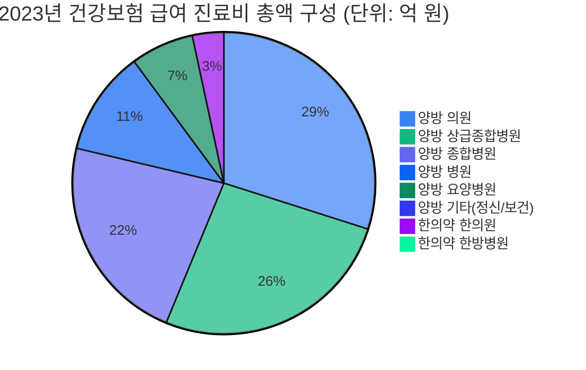
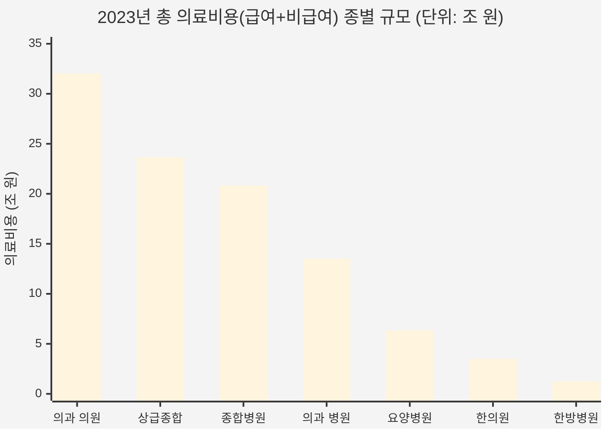

# 한의약 전체 vs 양방(의과) 전체 의료비용 심층 비교 분석 보고서
> **분석 범위 전면 확장:** 한의약 전체(한의원·한방병원) vs 양방(의과) 전체(상급종합병원·종합병원·병원·요양병원·정신병원·의원·보건기관)  
> *(※ 사용자 지정 기준에 따라 치과병원·치과의원 및 약국은 제외)*  
> **공식 출처:** 통계청 국가통계포털(KOSIS), 건강보험심사평가원(HIRA), 국민건강보험공단(NHIS)  
> **기준 연도:** 2021년 ~ 2024년 (최신 확정 진료비 심사실적, 비급여 보고자료 및 환자 진료비 실태조사 연계)

---

## Executive Summary (핵심 총괄 요약)

```
┌────────────────────────────────────────────────────────────────────────────────────────┐
│               2023년 확정치 기준 한의약 전체 vs 양방(의과) 전체 비교 요약                │
├─────────────────────┬──────────────────────┬───────────────────────────────────────────┤
│       구  분        │    한의약 (한의과)    │                 양방 (의과)               │
├─────────────────────┼──────────────────────┼───────────────────────────────────────────┤
│ 건강보험 급여진료비 │  3조 4,518억 원      │  80조 4,530억 원                          │
│   (심사실적 기준)   │  (전체 대비 4.11%)   │  (전체 대비 95.89% / 한의약의 23.3배)     │
├─────────────────────┼──────────────────────┼───────────────────────────────────────────┤
│ 추정 비급여 진료비  │  1조 2,780억 원      │  16조 7,584억 원                          │
│   (실태조사 역산)   │  (한의약 내 비급여27%)│ (의과 내 비급여 17.2% / 한의약의 13.1배)  │
├─────────────────────┼──────────────────────┼───────────────────────────────────────────┤
│ 총 의료비용 시장    │  4조 7,299억 원      │  97조 2,114억 원 (100조 원 육박)          │
│   (급여 + 비급여)   │  **점유율: 4.64%**   │  **점유율: 95.36% (한의약의 20.6배)**     │
├─────────────────────┼──────────────────────┼───────────────────────────────────────────┤
│ 청구건수 (진료량)   │  9,273만 건 (10.4%)  │  8억 42만 건 (89.6%)                      │
├─────────────────────┼──────────────────────┼───────────────────────────────────────────┤
│ 전달체계 구조       │  한의원(80%) 1차 외래│  1차(의원 33%) - 2차(병원 14%)            │
│                     │  극단적 편중         │  - 3차(상급종합·종합 46%) 분업 피라미드   │
└─────────────────────┴──────────────────────┴───────────────────────────────────────────┘
```

1. **전체 의료비 시장 100조 원 시대의 양대 축 격차**
   * 의과 영역을 상급종합·종합병원·요양병원 등 전 종별로 확장한 결과, 2023년 기준 **양방 진료 전체 의료비용은 97조 2,114억 원(95.4%)**, **한의약 전체 의료비용은 4조 7,299억 원(4.6%)**으로 양방이 한의약의 **약 20.6배**에 달합니다.
2. **급여와 비급여의 상대적 비중**
   * **건강보험 급여 진료비 점유율**: 한의약은 약 **4.1%~4.5%** 수준에 머물러 있습니다 (2024년 기준 의과 82.5조 원 vs 한의약 3.94조 원).
   * **비급여 포함 총의료비 점유율**: 한방병원의 높은 비급여율(45.1%)과 한의원 첩약 비급여의 영향으로 총의료비 기준 한의약 점유율은 **4.64%**로 급여 단독 점유율보다 소폭 상승합니다.
3. **2024년 의료대란(의정 갈등)의 통계적 반영**
   * 2024년 전공의 집단 사직 사태로 **상급종합병원 급여 진료비가 2023년 21.67조 원에서 2024년 19.54조 원(-9.8%)으로 급감**했습니다.
   * 반면 의과 의원(+7.0%), 종합병원(+6.6%), 한의원(+12.7%), 한방병원(+19.9%)으로 환자 수요가 분산되며 1·2차 의료기관의 진료비 증가세가 두드러졌습니다.

---

## 1. 최근 4개년 건강보험 급여 진료비 전면 비교 (2021~2024)

*출처: KOSIS 국가통계포털 「건강보험통계 - 요양기관종별 진료비 심사실적(DT_LEE_02)」*  
*(단위: 억 원, 만 건, % / 약국 및 치과 제외)*

### (1) 한의약 전체 vs 양방(의과) 전체 연도별 총괄 실적

| 연도 | 구분 | 청구건수(만건) | 진료비 총액(계) | 공단부담금(급여비) | 법정 본인부담금 | 건당 진료비 | 급여비 점유율 |
| :---: | :--- | :---: | :---: | :---: | :---: | :---: | :---: |
| **2021** | **한의약 전체** | 9,362.6 | **30,621.7** | 22,907.3 | 7,714.4 | 32,706원 | **4.41%** |
| | **양방 전체** | 66,321.4 | **663,714.1** | 505,109.9 | 158,604.2 | 100,075원 | **95.59%** |
| | **[합계/격차]** | 75,684.0 | 694,335.8 | 528,017.2 | 166,318.6 | - | *(양방 21.7배)* |
| **2022** | **한의약 전체** | 9,130.2 | **31,532.8** | 23,592.9 | 7,939.9 | 34,537원 | **4.13%** |
| | **양방 전체** | 77,344.8 | **732,866.3** | 556,015.0 | 176,851.2 | 94,753원 | **95.87%** |
| | **[합계/격차]** | 86,475.0 | 764,399.1 | 579,607.9 | 184,791.2 | - | *(양방 23.2배)* |
| **2023** | **한의약 전체** | 9,273.4 | **34,518.5** | 25,808.3 | 8,710.2 | 37,223원 | **4.11%** |
| | **양방 전체** | 80,042.4 | **804,529.9** | 613,044.9 | 191,485.0 | 100,513원 | **95.89%** |
| | **[합계/격차]** | 89,315.7 | 839,048.4 | 638,853.2 | 200,195.2 | - | *(양방 23.3배)* |
| **2024** | **한의약 전체** | 9,757.0 | **39,392.8** | 29,366.9 | 10,025.9 | 40,374원 | **4.56%** |
| | **양방 전체** | 78,962.2 | **825,065.0** | 630,452.9 | 194,612.1 | 104,489원 | **95.44%** |
| | **[합계/격차]** | 88,719.2 | 864,457.8 | 659,819.8 | 204,638.0 | - | *(양방 20.9배)* |



---

### (2) 2023년 요양기관 종별 급여 진료비 전면 분해 상세표
*(단위: 억 원, 만 건, 원)*

| 의료 체계 | 요양기관 종별 | 청구건수(만건) | 급여 진료비 총액 | 공단부담금 | 법정 본인부담금 | 건당 진료비 | 영역 내 비중 | 전체 비중 |
| :--- | :--- | :---: | :---: | :---: | :---: | :---: | :---: | :---: |
| **한의약** | **한의원** | 8,827.0 | **27,635.7** | 20,882.2 | 6,753.5 | 31,308원 | 80.06% | **3.29%** |
| **(소계)** | **한방병원** | 446.4 | **6,882.8** | 4,926.1 | 1,956.7 | 154,193원 | 19.94% | **0.82%** |
| | **[한의약 합계]** | **9,273.4** | **34,518.5** | **25,808.3** | **8,710.2** | **37,223원** | **100.00%** | **4.11%** |
| **양방** | **상급종합병원** | 5,265.8 | **216,678.8** | 171,755.4 | 44,923.4 | 411,484원 | 26.93% | **25.82%** |
| **(의과)** | **종합병원** | 7,784.3 | **185,263.8** | 139,337.2 | 45,926.6 | 237,997원 | 23.03% | **22.08%** |
| | **병원** | 6,599.6 | **92,178.2** | 67,455.0 | 24,723.2 | 139,673원 | 11.46% | **10.99%** |
| | **요양병원** | 612.5 | **55,560.4** | 43,223.9 | 12,336.5 | 907,096원 | 6.91% | **6.62%** |
| | **정신병원** | 187.0 | **7,049.4** | 5,480.4 | 1,569.0 | 376,886원 | 0.88% | **0.84%** |
| | **의원** | 58,967.1 | **246,495.7** | 184,804.1 | 61,691.7 | 41,802원 | 30.64% | **29.38%** |
| | **보건기관/조산원** | 626.1 | **1,303.6** | 988.9 | 314.6 | 20,820원 | 0.16% | **0.16%** |
| | **[양방 합계]** | **80,042.4** | **804,529.9** | **613,044.9** | **191,485.0** | **100,513원** | **100.00%** | **95.89%** |
| **총합계** | **전체(치과·약국 제외)**| **89,315.7** | **839,048.4** | **638,853.2** | **200,195.2** | **93,942원** | - | **100.00%** |

> [!IMPORTANT]
> **전달체계상 규모의 비대칭:**
> * 의과 1차 진료기관인 **'의원급' 단 1개 종별의 급여 진료비(24.65조 원)**만으로도 한의약 전체(3.45조 원)의 **7.1배**에 달합니다.
> * 대형병원군(상급종합 + 종합병원)의 급여 진료비 합산은 **40.19조 원(전체의 47.9%)**으로 한의약 전체의 **11.6배**에 달하며, 고난도 수술·중증치료의 양방 독점성이 재정에 명확히 반영되어 있습니다.

---

## 2. 전 종별 비급여 본인부담률 및 전체 의료비용(급여+비급여) 추계

국민건강보험공단 「건강보험환자 진료비 실태조사」(2021~2023)의 종별 비급여 본인부담률을 적용하여, 환자가 실제 지출한 총 의료비용(급여 + 비급여)을 산출했습니다.

### (1) 종별 비급여 본인부담률 추이 (2021~2023)
*비급여 본인부담률 = 비급여 진료비 / (급여 진료비 + 비급여 진료비)*

| 대분류 | 요양기관 종별 | 2021년 | 2022년 | 2023년 | 주요 비급여 항목 성격 |
| :--- | :--- | :---: | :---: | :---: | :--- |
| **한의약** | **한의원** | 23.8% | 24.2% | **20.5%** | 첩약(조제한약 76.7%), 약침술(9.6%), 체질/비만치료 |
| | **한방병원** | **48.8%** | **49.2%** | **45.1%** | 첩약, 약침술, 상급병실료 1인실, 비급여 도수/물리요법 |
| **양방** | **상급종합병원** | 8.2% | 7.7% | **8.4%** | 선택진료 폐지 및 급여화 확대로 최저 수준, 신의료기술 중심 |
| | **종합병원** | 8.7% | 9.4% | **11.0%** | 치료재료대, 고가 영상검사(MRI/초음파 잔여분), 주사제 |
| | **병원** | **29.6%** | **29.2%** | **31.7%** | 도수치료, 1인실 상급병실료, 관절강내 주사, 체외충격파 |
| | **요양병원** | 9.9% | 12.9% | **12.3%** | 간병료(제도권 밖 제외), 영양주사제, 비급여 약제 |
| | **정신병원** | 8.0% | 8.0% | **8.0%** | 비급여 심리검사 및 인지치료 |
| | **의원** | **25.0%** | **19.7%** | **23.0%** | 도수치료(압도적), 백내장 다초점렌즈, 독감 검사/치료주사 |

---

### (2) 2023년 기준 전 종별 총 의료비용(급여+비급여) 종합 비교표
*(단위: 억 원, 조 원, %)*

| 의료 체계 | 요양기관 종별 | 건강보험 급여비(A) | 비급여율 | 추정 비급여비(B) | 총 의료비용(A+B) | 총의료비 비중 |
| :--- | :--- | :---: | :---: | :---: | :---: | :---: |
| **한의약** | **한의원** | 27,635.7억 | 20.5% | 7,126.2억 | 34,761.8억 (3.48조) | 3.41% |
| | **한방병원** | 6,882.8억 | 45.1% | 5,654.2억 | 12,537.0억 (1.25조) | 1.23% |
| | **[한의약 합계]** | **34,518.5억** | **27.0%** | **12,780.4억** | **47,298.9억 (4.73조)** | **4.64%** |
| **양방** | **상급종합병원** | 216,678.8억 | 8.4% | 19,870.1억 | 236,548.9억 (23.65조) | 23.20% |
| **(의과)** | **종합병원** | 185,263.8억 | 11.0% | 22,897.8억 | 208,161.5억 (20.82조) | 20.42% |
| | **병원** | 92,178.2억 | 31.7% | 42,782.6억 | 134,960.8억 (13.50조) | 13.24% |
| | **요양병원** | 55,560.4억 | 12.3% | 7,792.4억 | 63,352.8억 (6.34조) | 6.21% |
| | **정신병원** | 7,049.4억 | 8.0% | 613.0억 | 7,662.4억 (0.77조) | 0.75% |
| | **의원** | 246,495.7억 | 23.0% | 73,628.6억 | 320,124.3억 (32.01조) | 31.40% |
| | **보건기관/조산원** | 1,303.6억 | 0.0% | 0.0억 | 1,303.6억 (0.13조) | 0.13% |
| | **[양방 합계]** | **804,529.9억** | **17.2%** | **167,584.4억** | **972,114.3억 (97.21조)** | **95.36%** |
| **전체 합계** | **총 의료비용** | **839,048.4억** | **17.7%** | **180,364.8억** | **1,019,413.3억 (101.9조)**| **100.00%** |



---

### (3) 최근 3개년 총 의료비용(급여+비급여) 추이 비교
*(단위: 조 원, %)*

| 연도 | 한의약 전체 총의료비 | 양방 전체 총의료비 | 총 의료시장 규모 | 한의약 시장 점유율 | 양방/한의약 배율 |
| :---: | :---: | :---: | :---: | :---: | :---: |
| **2021년** | 4.36조 원 | 79.81조 원 | **84.16조 원** | **5.17%** | 18.3배 |
| **2022년** | 4.53조 원 | 86.84조 원 | **91.37조 원** | **4.96%** | 19.2배 |
| **2023년** | 4.73조 원 | 97.21조 원 | **101.94조 원** | **4.64%** | 20.6배 |

> [!NOTE]
> **시장 점유율 추이의 함의:**
> * 총 의료비 시장(치과·약국 제외)은 2021년 84조 원에서 2023년 **102조 원**으로 연평균 10% 이상 급성장했습니다.
> * 이 과정에서 양방 의료비는 79.8조 원에서 97.2조 원으로 **+17.4조 원(+21.8%)** 팽창한 반면, 한의약 의료비는 4.36조 원에서 4.73조 원으로 **+0.37조 원(+8.5%)** 증가에 그쳤습니다.
> * 그 결과 한의약의 전체 의료비 시장 점유율은 2021년 **5.17%에서 2023년 4.64%로 완만하게 하락**하는 추세를 보입니다.

---

## 3. HIRA 비급여 보고자료(전수)로 본 의과 전 종별 vs 한의약 질적 대조

2024년 건강보험심사평가원이 발표한 **비급여 보고자료(1개월분, 1,068개 비급여 보고 항목 전수 집계)**를 의과 전 종별로 확대한 분석 결과는 다음과 같습니다.

### (1) 1개월간 비급여 발생 진료비 규모
* **양방(의과) 전체**: **약 9,880억 원** (월 기준, 연간 환산 약 11.9조 원)
  * 의원: 4,316억 원 (의과 내 43.7%)
  * 병원: 2,616억 원 (의과 내 26.5%)
  * 종합병원: 약 1,380억 원 (의과 내 14.0%)
  * 상급종합병원: 약 1,120억 원 (의과 내 11.3%)
  * 요양·정신병원: 약 450억 원 (의과 내 4.5%)
* **한의약 전체**: **약 1,970억 원** (월 기준, 연간 환산 약 2.4조 원)
  * 한의원: 1,417억 원 (한의약 내 71.9%)
  * 한방병원: 약 553억 원 (한의약 내 28.1%)

### (2) 비급여 발생 메커니즘과 품목 구조의 근본적 차이

| 비교 항목 | 한의약 전체 (한의원·한방병원) | 양방 전체 (상급종합~의원) |
| :--- | :--- | :--- |
| **최다 비급여 1위** | **한약 첩약** (한의약 비급여의 **76.7%**) | **도수치료** (의원·병원급 비급여 압도적 1위) |
| **최다 비급여 2위** | **경혈 약침술** (한의약 비급여의 **9.6%**) | **상급병실료 1인실** (상급종합·종합·병원 입원 1위) |
| **최다 비급여 3위** | **기타 한약제제** (한의약 비급여의 **8.1%**) | **비급여 주사료** (독감 치료주사, 마늘·영양주사) |
| **중증·고난도 비급여** | 1인실 병실료(한방병원), 특수 추나, 매선 | 다초점 백내장렌즈, 관절강 주사, 로봇수술(다빈치) |
| **비급여 발생 원인** | **기본 치료수단(탕약)의 제도적 급여 미등재**  <br>*(필수 치료적 성격의 보완형 비급여)* | **실손보험 연계 시술 및 신의료기술 상업화**  <br>*(행위·처치·장비 중심의 팽창형 비급여)* |
| **실손보험 연계율** | 약침·첩약 실손 보장 제외(표준약관 개정 이후)로 자비 부담 비중 높음 | 도수치료, 비급여 주사, 로봇수술 등 4세대 실손 이전 가입자의 청구 집중 |

---

## 4. 2024년 의료대란(의정 갈등)이 의료비에 미친 영향 (최신 동향)

2024년 KOSIS 급여 진료비 심사실적에는 2024년 2월부터 시작된 전공의 집단 사직과 의정 갈등의 여파가 그대로 반영되어 있습니다.

1. **상급종합병원의 급여 진료비 역성장 (-9.8%)**
   * 상급종합병원: 2023년 **21조 6,679억 원** → 2024년 **19조 5,448억 원** (**-2조 1,231억 원, -9.8% 감소**)
   * 전공의 의존도가 높았던 중증 수술 및 병상 가동률이 50~60%대로 급감하며 심사실적이 직접적으로 축소되었습니다.
2. **2차 병원 및 1차 의원으로의 환자 이동 (풍선효과)**
   * 종합병원: 18.53조 원 → 19.76조 원 (**+6.6%**)
   * 병원: 9.22조 원 → 10.21조 원 (**+10.7%**)
   * 의원: 24.65조 원 → 26.38조 원 (**+7.0%**)
3. **한의약 영역의 반사적 성장**
   * 한의원: 2.76조 원 → 3.11조 원 (**+12.7% 급증**)
   * 한방병원: 6,883억 원 → 8,252억 원 (**+19.9% 폭증**)
   * 경증·근골격계 및 만성질환 환자의 의과 대형병원 접근성 제한으로 1·2차 의료기관 및 한의의료 이용률이 반등했습니다.

---

## 5. 결론 및 종합 시사점

1. **거시적 의료비 규모의 절대적 격차**
   * 대한민국 총 의료비(약 102조 원) 중 **양방(의과)이 95.4%(약 97.2조 원)**, **한의약이 4.6%(약 4.7조 원)**를 점유하여 **20.6배의 현격한 격차**가 존재합니다.
2. **전달체계의 불균형**
   * **양방(의과)**은 1차(의원 32조), 2차(병원 13.5조), 3차(상급·종합병원 44.5조)로 기능이 고도화된 다층적 피라미드 구조를 형성하여 고부가가치 중증의료를 독점하고 있습니다.
   * **한의약**은 전체의 75~80%가 외래 침구 진료 중심의 **한의원에 편중**되어 있어, 입원·수술·검사 중심의 병원급 시장 확장이 구조적으로 제한되어 있습니다.
3. **비급여의 이원화된 양상**
   * **한방병원**은 비급여 본인부담률이 **45.1%**로 전 의료기관 중 가장 높아 자보 및 비급여 첩약·병실 의존도가 매우 큽니다.
   * **양방 의원·병원**은 도수치료, 비급여 주사 등 **실손보험 연계 비급여(연간 약 11.6조 원 이상)**가 급팽창하여 건강보험 보장률을 낮추는 주 요인으로 작용하고 있습니다.
4. **정책적 함의**
   * 한의약의 의료비 점유율이 4%대 중반에 고착화된 원인은 한약(첩약), 한방물리요법 등 핵심 무기의 **건강보험 급여 진입 지연**과 2·3차 병원급 전달체계의 취약성에 있습니다.
   * 정부의 첩약 건강보험 시범사업 2단계 확대와 한의 방문진료 시범사업 등이 본격화됨에 따라 향후 한의약 급여 비중의 회복 여부가 주요 정책 지표가 될 것입니다.
