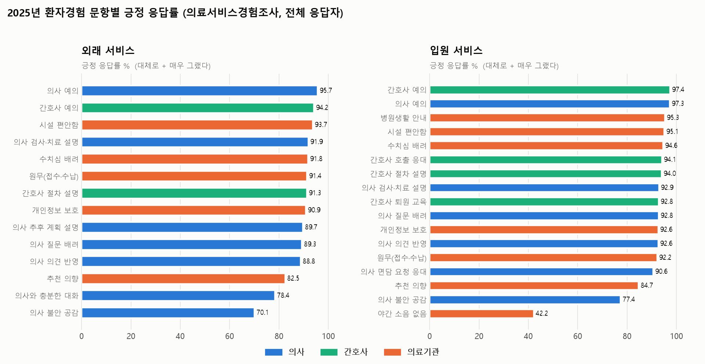
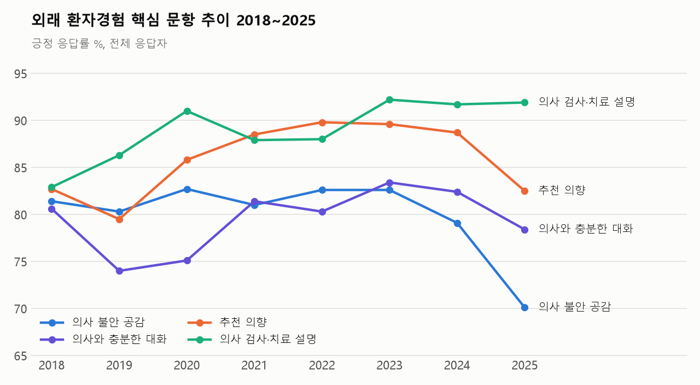
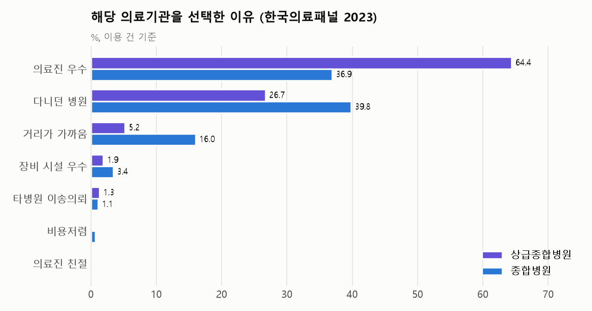
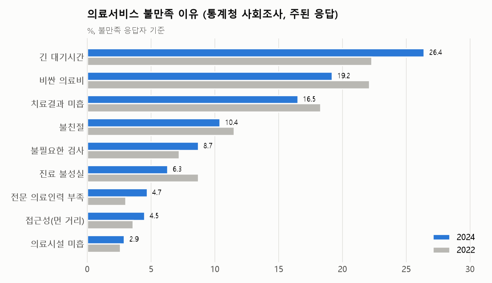

# 환자경험 만족도 분석 및 환자가 중시하는 요소 우선순위 10 보고서

<!-- html-subtitle: 의사 서비스 · 간호사 서비스 · 의료기관 이용 경험 (2017~2025) -->
<!-- html-tags: 의료서비스경험조사|한국의료패널|통계청 사회조사|한방의료이용실태조사 -->

> **분석 대상**: 의사 서비스 경험, 간호사 서비스 경험, 의료기관 이용 경험(외래·입원)
> **주 자료원**: 보건복지부 「의료서비스경험조사」(KOSIS 117/DT_117099_A002_2018·A003·A004_2018) — korea-stats MCP 수집
> **보조 자료원**: 한국의료패널 「의료기관 선택 이유」(KOSIS 331/DT_920012N_1035, MCP 수집), 통계청 「2024년 사회조사」 의료서비스 불만족 이유(보도자료 통계표 전사), 보건복지부 「2024년 한방의료이용 실태조사」(보도자료 전사)
> **원자료**: `05_원천_통계_데이터셋/08_의료서비스경험조사/` (CSV 4종)
> **만족도 정의**: 5점 척도에서 '대체로 그랬다' + '매우 그랬다' 응답 비율(긍정 응답률). 부정 문항(입원 중 야간 소음)은 '그러지 않았다' 쪽을 긍정으로 뒤집었다.
> **작성일자**: 2026년 10월 30일

---

## 1. 핵심 요약

1. **기본 응대는 90% 이상으로 높다.** 2025년 의사·간호사의 예의는 외래 94~96%, 입원 97%다. 시설, 원무, 개인정보, 수치심 배려도 91~95%다. 2018년보다 8~18%p 올랐다.
2. **가장 약한 고리는 '공감'과 '충분한 대화'다.** 2025년 외래 긍정률이 가장 낮은 두 문항이 의사의 불안 공감(70.1%)과 의사와 충분한 대화(78.4%)다. 입원에서도 의사 공감(77.4%)이 소음 문항을 빼면 가장 낮다.
3. **공감과 추천 의향이 2025년에 함께 떨어졌다.** 외래 의사 공감은 2023년 82.6%에서 2025년 70.1%로 12.5%p 하락했다. 외래 추천 의향도 2024년 88.7%에서 2025년 82.5%로, 입원 추천 의향은 93.2%에서 84.7%로 내려갔다. 반면 설명, 예의, 시설 문항은 그대로였다. 다만 2025년 조사는 의료서비스 이용률도 크게 바뀌어 조사 방식 변경 가능성이 있다(6절 ②).
4. **입원 환자의 42.5%가 밤 소음으로 불쾌감을 겪었다.** 입원 환경에서 개선 여지가 가장 큰 항목이다.
5. **환자가 의료기관을 고르는 1순위 기준은 '의료진 실력'이다.** 2023년 상급종합병원 이용의 64.4%, 종합병원 이용의 36.9%가 의료진이 우수해서 그 기관을 골랐다. 한방의료를 고르는 이유도 치료효과가 42.5%로 1위다.
6. **불만의 1순위는 '긴 대기시간'이다.** 2024년 사회조사에서 의료서비스 불만족 이유는 긴 대기시간(26.4%), 비싼 의료비(19.2%), 치료결과 미흡(16.5%), 불친절(10.4%) 순이다. 대기시간 불만은 2022년보다 4.1%p 늘었고, 의료비 불만은 2.9%p 줄었다.

---

## 2. 의사 서비스 경험

| 서비스 | 문항 | 2018 | 2020 | 2022 | 2023 | 2024 | **2025** | 2018→2025 |
| :--- | :--- | ---: | ---: | ---: | ---: | ---: | ---: | ---: |
| 외래 | 예의를 갖추어 대함 | 83.7 | 95.1 | 92.3 | 95.5 | 93.4 | **95.7** | +12.0 |
| 외래 | 검사·치료의 이유와 효과·부작용 설명 | 82.9 | 91.0 | 88.0 | 92.2 | 91.7 | **91.9** | +9.0 |
| 외래 | 추후 치료 계획·주의사항 설명 | – | – | 90.2 | 91.4 | 89.7 | **89.7** | (2021 89.8) |
| 외래 | 질문·관심사를 말하도록 배려 | 81.3 | 88.6 | 87.3 | 91.0 | 88.1 | **89.3** | +8.0 |
| 외래 | 검사·치료 선택에 의견 반영 | 82.3 | 87.5 | 88.0 | 90.0 | 88.2 | **88.8** | +6.5 |
| 외래 | 충분한 대화 | 80.6 | 75.1 | 80.3 | 83.4 | 82.4 | **78.4** | −2.2 |
| 외래 | 건강 상태 불안에 공감 | 81.4 | 82.7 | 82.6 | 82.6 | 79.1 | **70.1** | **−11.3** |
| 입원 | 예의를 갖추어 대함 | 82.9 | 94.0 | 92.7 | 94.2 | 95.9 | **97.3** | +14.4 |
| 입원 | 검사·치료의 이유와 효과·부작용 설명 | 78.8 | 91.8 | 89.5 | 94.3 | 96.2 | **92.9** | +14.1 |
| 입원 | 질문·관심사를 말하도록 배려 | 82.4 | 90.0 | 84.2 | 89.2 | 92.4 | **92.8** | +10.4 |
| 입원 | 검사·치료 선택에 의견 반영 | 80.4 | 86.3 | 85.6 | 91.5 | 90.1 | **92.6** | +12.2 |
| 입원 | 면담 요청에 잘 응함 | 77.7 | 84.6 | 88.1 | 91.4 | 88.9 | **90.6** | +12.9 |
| 입원 | 건강 상태 불안에 공감 | 82.0 | 83.3 | 77.4 | 82.8 | 77.4 | **77.4** | −4.6 |

*단위: 긍정 응답률(%), 전체 응답자. 2019·2021년 값은 원자료 CSV에 있다.*

- 의사가 '무엇을 왜 하는지' 설명하고 예의를 갖추는 부분은 8년간 꾸준히 좋아졌다.
- 반면 '불안에 공감'과 '충분한 대화'는 제자리이거나 뒷걸음질했다. 외래에서 '매우 그랬다'라는 강한 긍정도 공감 19.5%, 대화 21.7%로 가장 낮다. 같은 해 검사·치료 설명은 35.8%다.
- 정보 전달은 개선됐지만, 환자의 불안을 들어 주는 시간과 정서적 소통은 개선되지 않았다고 요약할 수 있다.

---

## 3. 간호사 서비스 경험

| 서비스 | 문항 | 2017 | 2018 | 2020 | 2022 | 2023 | 2024 | **2025** |
| :--- | :--- | ---: | ---: | ---: | ---: | ---: | ---: | ---: |
| 외래 | 예의를 갖추어 대함 | 88.5 | 84.5 | 93.5 | 89.3 | 93.5 | 92.6 | **94.2** |
| 외래 | 진료 절차를 알기 쉽게 설명 | 84.7 | 83.3 | 91.8 | 88.7 | 91.8 | 91.1 | **91.3** |
| 입원 | 예의를 갖추어 대함 | 91.8 | 79.1 | 94.4 | 90.2 | 94.6 | 96.4 | **97.4** |
| 입원 | 진료 절차를 알기 쉽게 설명 | 87.9 | 77.0 | 92.4 | 88.3 | 93.8 | 94.9 | **94.0** |
| 입원 | 호출(콜)에 바로 응대 | 85.6 | 76.9 | 87.5 | 84.1 | 91.1 | 93.1 | **94.1** |
| 입원 | 퇴원 후 주의사항 상세 설명 | 91.7 | 82.6 | 89.6 | 89.1 | 93.3 | 93.6 | **92.8** |

*단위: 긍정 응답률(%), 전체 응답자.*

- 간호사 서비스는 6개 문항 모두 2025년 91~97%로 환자경험 영역 가운데 가장 높고 고르다.
- 입원 호출 응대는 2018년 76.9%에서 2025년 94.1%로 17.2%p 올라 개선 폭이 가장 컸다.
- 2018년은 모든 문항이 함께 낮아 그해 조사의 특이값으로 보인다.

---

## 4. 의료기관 이용 경험



| 서비스 | 문항 | 2018 | 2020 | 2022 | 2023 | 2024 | **2025** |
| :--- | :--- | ---: | ---: | ---: | ---: | ---: | ---: |
| 외래 | 시설이 편안함 | 81.4 | 89.0 | 93.7 | 94.5 | 94.5 | **93.7** |
| 외래 | 원무(접수·수납) 서비스 만족 | 81.7 | 92.1 | 88.2 | 92.3 | 91.8 | **91.4** |
| 외래 | 신체 노출 수치심 배려 | 83.3 | 88.6 | 88.6 | 91.9 | 89.1 | **91.8** |
| 외래 | 개인정보 노출 주의 | 82.8 | 88.0 | 89.9 | 90.6 | 89.6 | **90.9** |
| 외래 | **추천 의향** | 82.7 | 85.8 | 89.8 | 89.6 | 88.7 | **82.5** |
| 입원 | 시설이 편안함 | 77.5 | 90.8 | 91.6 | 92.5 | 97.3 | **95.1** |
| 입원 | 원무(접수·수납) 서비스 만족 | 78.2 | 90.6 | 82.5 | 91.2 | 94.1 | **92.2** |
| 입원 | 병원 생활 안내 | 82.4 | 91.7 | 88.4 | 91.3 | 94.9 | **95.3** |
| 입원 | 신체 노출 수치심 배려 | 79.6 | 87.2 | 89.0 | 93.9 | 94.6 | **94.6** |
| 입원 | 개인정보 노출 주의 | 79.1 | 89.8 | 87.0 | 92.0 | 92.6 | **92.6** |
| 입원 | 야간 소음으로 불쾌감 **없음** | 21.6 | 43.5 | 31.1 | 40.7 | 40.1 | **42.2** |
| 입원 | **추천 의향** | 80.7 | 81.3 | 83.8 | 88.0 | 93.2 | **84.7** |

*단위: 긍정 응답률(%). 야간 소음 문항은 '그러지 않았다' 응답 비율이다. 2025년 입원 환자의 42.5%는 소음으로 불쾌감을 느꼈다고 답했다.*

- 시설, 원무, 사생활 보호 같은 '기관 차원의 기본 요건'은 2018년 78~83%에서 2025년 91~95%로 크게 개선됐다.
- 추천 의향은 2025년 외래 82.5%, 입원 84.7%로 기본 요건보다 10%p가량 낮고, 2024년보다 6~9%p 떨어졌다. 시설과 원무 만족이 그대로인데 추천만 떨어진 점은, 추천을 결정하는 요인이 기관 환경보다 진료 과정(공감, 대화)에 있음을 시사한다(5절).

### 4-1. 2025년 응답자 특성별 차이



| 특성 | 의사 외래 평균 | 의사 입원 평균 | 간호사 외래 평균 | 외래 추천 | 입원 추천 |
| :--- | ---: | ---: | ---: | ---: | ---: |
| 전체 | – | – | – | 82.5 | 84.7 |
| 30~39세 | 85.4 | 88.8 | 92.1 | 80.4 | 82.1 |
| 60세 이상 | 87.2 | 90.1 | 93.5 | 85.1 | 86.1 |
| 동 지역 | 86.0 | 90.2 | 92.5 | 81.9 | 83.6 |
| 읍·면 지역 | 87.8 | 90.2 | 93.8 | 85.7 | 88.3 |
| 소득 1분위 | 86.7 | 89.7 | 94.6 | 84.9 | 83.4 |
| 소득 5분위 | 88.1 | 89.3 | 93.8 | 83.7 | 81.9 |
| 국민건강보험 | 86.2 | 90.3 | 92.7 | 82.4 | 85.4 |
| **의료급여** | 89.9 | **86.9** | 95.2 | 90.6 | **70.2** |

*의사·간호사 평균은 해당 영역 문항의 긍정 응답률 단순 평균이다(추천 문항 제외).*

- 나이가 많을수록, 읍·면 거주자일수록 대체로 긍정적이다. 30대의 외래 추천 의향(80.4%)이 가장 낮은 축이다.
- **의료급여 수급자의 입원 경험이 두드러지게 낮다.** 입원 추천 의향이 70.2%로 건강보험 가입자(85.4%)보다 15.2%p 낮고, 의사 입원 평균도 3.4%p 낮다. 외래에서는 오히려 건강보험보다 높다. 의료급여 입원 응답자 수가 적어 오차가 클 수 있으므로 원자료 표본 규모를 확인한 뒤 해석해야 한다.
- 소득 분위에 따른 일관된 차이는 보이지 않는다.

---

## 5. 환자가 중시하는 요소 우선순위 10

### 5-1. 근거 자료

KOSIS에는 '무엇이 가장 중요한가'를 직접 묻는 통계가 없다. 그래서 성격이 다른 세 가지 근거를 교차해 순위를 정했다.

| 근거 | 자료 | 읽는 법 |
| :--- | :--- | :--- |
| ① 선택 이유 | 한국의료패널 2023(상급종합·종합병원), 한방의료이용 실태조사 2024 | 환자가 기관을 고를 때 무엇을 보는가 |
| ② 불만족 이유 | 통계청 사회조사 2022·2024 | 무엇이 틀어지면 불만이 되는가 |
| ③ 추천과의 연관 | 의료서비스경험조사 2024·2025 특성별 자료 | 어떤 경험이 좋을 때 추천 의향도 높은가(파생 중요도) |





**③ 추천 의향과 일관되게 함께 움직이는 경험**: 응답자 특성 집단(29개) 사이에서 각 문항의 긍정률과 추천 의향의 상관을 2024년과 2025년에 따로 계산했다. 두 해 모두 상관계수 0.6 이상인 문항만 골랐다.

| 서비스 | 문항 | r 2024 | r 2025 |
| :--- | :--- | ---: | ---: |
| 외래 | 간호사의 진료 절차 설명 | 0.86 | 0.87 |
| 외래 | 간호사의 예의 | 0.91 | 0.80 |
| 외래 | 의사의 질문 배려 | 0.72 | 0.68 |
| 입원 | 의사의 불안 공감 | 0.66 | 0.69 |
| 입원 | 간호사의 퇴원 후 주의사항 교육 | 0.64 | 0.70 |

*집단 평균 사이의 상관이라 개인 단위의 인과관계를 뜻하지 않는다. 의사의 설명·의견 반영·충분한 대화는 2025년에만 0.6을 넘어 보조 근거로만 쓴다.*

### 5-2. 우선순위 10

| 순위 | 요소 | 핵심 근거 | 현재 수준 |
| :---: | :--- | :--- | :--- |
| **1** | **의료진의 전문성과 치료 결과** | ① 선택 이유 1위: 상급종합 64.4%, 종합 36.9%. 한방은 치료효과 42.5%와 질환 특화 16.0% ② 불만 3위: 치료결과 미흡 16.5%, 전문인력 부족 4.7% | 경험조사에 직접 문항 없음 |
| **2** | **짧은 대기, 제때 받는 진료** | ② 불만 1위: 긴 대기시간 26.4%(2022년 22.3%에서 상승) | 악화 추세 |
| **3** | **감당할 수 있는 의료비** | ② 불만 2위: 비싼 의료비 19.2%(2022년 22.1%에서 하락). 한방 이용자도 진료비 만족이 상대적으로 낮다고 공표됨 | 다소 완화 |
| **4** | **알기 쉬운 설명** (검사·치료 이유, 향후 계획, 절차, 퇴원 교육) | ③ 외래 간호사 절차 설명(r 0.86~0.87), 입원 퇴원 교육(r 0.64~0.70) | 외래 의사 설명 91.9%, 입원 92.9% |
| **5** | **불안에 대한 공감과 충분한 대화** | ③ 입원 의사 공감(r 0.66~0.69). 경험조사에서 가장 낮고 하락 중 | **외래 공감 70.1%, 대화 78.4%: 가장 큰 격차** |
| **6** | **질문할 기회와 치료 결정 참여** | ③ 외래 의사 질문 배려(r 0.68~0.72) | 외래 질문 배려 89.3%, 의견 반영 88.8% |
| **7** | **친절과 존중** | ② 불만 4위: 불친절 10.4% ③ 외래 간호사 예의(r 0.80~0.91) | 94~97%로 높음: 지켜야 할 기본 |
| **8** | **성실하고 적정한 진료** (과잉 검사 없음) | ② 불필요한 검사 8.7%(2022년 7.2%에서 상승), 진료 불성실 6.3% | 과잉 검사 불만 증가 |
| **9** | **진료의 연속성** (다니던 곳, 아는 의사) | ① 다니던 병원: 종합병원 39.8%, 상급종합 26.7% | – |
| **10** | **가까운 거리와 접근성** | ① 거리가 가까움: 종합병원 16.0% ② 접근성 불만 4.5%, 농어촌에서는 11.6% | 농어촌 취약 |

**순위를 정한 방식**
- 근거 ①과 ②에서 응답 비중이 큰 요소(전문성, 대기, 비용)를 상위에 두었다. 환자가 스스로 밝힌 이유이기 때문이다.
- 근거 ③과 경험조사의 현재 수준이 뒷받침하는 소통 요소(설명, 공감, 참여)를 그다음에 두었다.
- 비중이 작은 요소를 하위에 두었다.
- 시설, 장비, 안전, 사생활은 선택 이유(장비·시설 우수 1.9~3.4%)와 불만 이유(의료시설 미흡 2.9%) 모두에서 비중이 작아 10위 밖으로 뺐다. 다만 만족도가 이미 91~95%라 '없으면 불만이 되는 기본 요건'으로 봐야 한다. 입원 환경의 야간 소음(불쾌 경험 42.5%)은 예외적으로 큰 개선 과제다.

### 5-3. 시사점

1. **진료 시간 안의 소통 품질이 다음 과제다.** 예의, 설명, 시설은 이미 90%를 넘었다. 반면 공감과 충분한 대화는 70%대에 머물고 2025년에 더 떨어졌으며, 같은 해 추천 의향도 함께 하락했다.
2. **대기시간은 불만 1위이면서 악화되고 있다.** 예약제, 대기 안내, 진료 동선처럼 기관이 바로 손댈 수 있는 영역이다.
3. **한의 의료기관에 주는 함의**: 한방의료 선택 이유가 치료효과(42.5%)와 질환 특화 진료(16.0%)에 집중돼 있다. 이는 전체 의료에서 1순위인 '전문성과 치료 결과'와 같은 축이다. 비교적 긴 진료 시간을 활용한 공감과 설명은 5~6순위 요소에서 차별화 지점이 될 수 있다. 다만 의료서비스경험조사는 의료기관 종별로 나뉘지 않아, 한의 의료기관의 환자경험 수준 자체는 이 자료로 평가할 수 없다.

---

## 6. 자료 해석상 유의점

1. **중요도는 간접 추정이다.** 직접 중요도를 묻는 국가통계가 없어 선택 이유, 불만족 이유, 추천과의 연관으로 추정했다. 순위는 근거의 비중을 종합한 판단이며 통계적 가중치로 계산한 점수가 아니다.
2. **2025년 의료서비스경험조사는 비교에 주의가 필요하다.** 같은 조사의 외래 이용률이 2024년 62.6%에서 2025년 85.6%로 급변해 조사 방식 변경 가능성이 있다. 2025년의 공감·추천 하락이 실제 변화인지는 보건복지부 조사 개요로 확인해야 한다.
3. **추천과의 상관은 집단 평균 단위다.** 응답자 특성 29개 집단의 집계값이라 응답 성향(관대한 집단은 모든 문항을 높게 답함)이 섞인다. 연도마다 결과가 크게 달라 두 해 모두 일관된 문항만 근거로 썼다.
4. **사회조사와 한방실태조사는 MCP로 받지 못했다.** 2년 주기 통계표라 korea-stats MCP 서버가 처리하지 못했다. 그래서 보도자료에서 값을 옮겨 적었다(`공표자료_전사_…csv`, 쪽 번호 기재). 한방 선택 이유는 상위 3개 항목만 공표됐다.
5. **한국의료패널 선택 이유**는 상급종합병원과 종합병원 이용 건만 있다. 의원급과 한의 의료기관의 선택 이유는 포함되지 않는다.
6. **표본이 작은 집단**(15~19세, 학생, 의료급여 입원 등)은 값이 크게 흔들린다. 활동상태 '기타'는 분석에서 뺐다.

---

## 7. 재현 방법

```bash
# 1) 의료서비스경험조사 수집 (문항 × 연도 단위, 약 10분)
python 06_분석_및_수집_스크립트/patient_experience_kosis_mcp.py
# 2) 그림 생성
python 06_분석_및_수집_스크립트/plot_patient_experience.py
# 3) HTML 생성
python 06_분석_및_수집_스크립트/build_hospital_finance_html.py 04_의료기관_경영_및_환자경험/환자경험_및_환자중시요소/환자경험_만족도_분석_및_환자중시요소_우선순위_보고서.md
```

| 자료 | 기관/통계표 | 수집 |
| :--- | :--- | :--- |
| 의사 서비스 경험 | 117 / DT_117099_A002_2018 (2018~2025) | MCP |
| 간호사 서비스 경험 | 117 / DT_117099_A003 (2017~2025) | MCP |
| 의료기관 이용 경험 | 117 / DT_117099_A004_2018 (2018~2025) | MCP |
| 의료기관 선택 이유 | 331 / DT_920012N_1035 (2019~2023) | MCP |
| 의료서비스 불만족 이유 | 통계청 「2024년 사회조사 결과」 보도자료 통계표 26-2 | 전사 |
| 한방의료 선택 이유·만족도 | 보건복지부 「2024년 한방의료이용 실태조사 결과」 보도자료 | 전사 |
