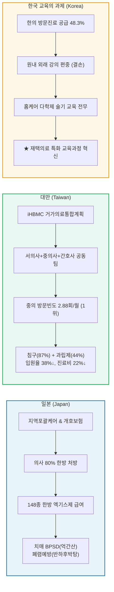
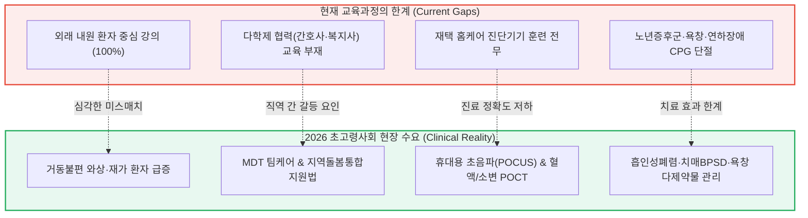
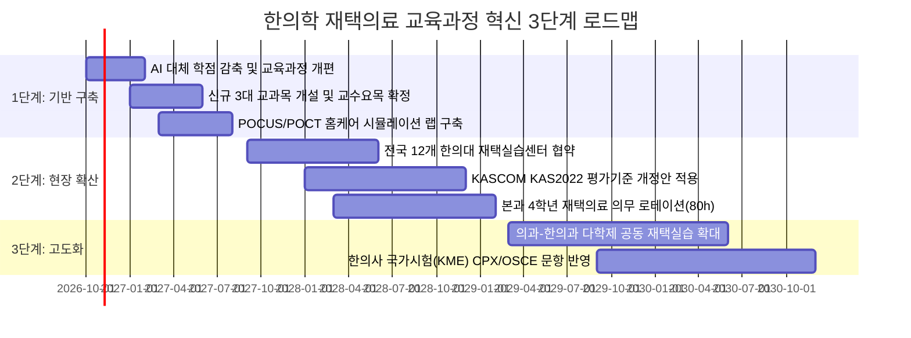

# [정책·교육 통합 보고서] 재택의료(방문진료) 정책 및 국제비교 기반 한의학 교육과정 혁신 설계안
## — 초고령사회(2026) 돌봄통합지원법 시행 및 15개 건강보험 재택의료 시범사업 연계 —

> **작성일**: 2026년 10월  
> **분석 대상 및 기초 데이터**:
> 1. `D:\한의 의료서비스 통계\02_재택의료_정책_및_국제비교` (질병관리청 KDCA 8대 체계, HIRA 15개 건강보험 시범사업, 보건복지포럼 제340호, 일본 후생노동성(MHLW) 개호·의료보험 체계, 대만 위생복리부(MOHW) iHBMC 거가의료통합계획, 서울대 이혜진 교수 4대 기능 모델)
> 2. `d:\행정\한의학 교육과 의료 통합\한의학교육_의료통합_상세보고서.md` (원광대 123개 과목/248.5학점 전수 분석, 10개년 HIRA 청구통계, CPG 12개 질환 매트릭스, 2026 시체해부법 개정 대통령령 제36725호, AI 기반 29.5학점 감축 모델)
> 3. 한국한의학교육평가원(한평원) KAS2022 한의학교육 평가인증 기준집

---

## Executive Summary (요약문)

대한민국은 **2024년 12월 65세 이상 인구 비중이 20%를 돌파하여 공식적으로 '초고령사회'에 진입**하였으며, 2026년 3월 **「지역돌봄통합지원법」**의 본격 시행과 함께 국가 보건의료의 패러다임이 '병원 중심의 사후 치료'에서 **'지역사회 지속 거주(Aging in Place, AIP) 기반 통합 돌봄'**으로 급격히 전환되고 있습니다.

현재 건강보험심사평가원(HIRA)의 15개 재택의료 시범사업 중 **'일차의료 한의 방문진료 시범사업' 참여 기관은 전체 재택의료 참여 기관(1,960개소)의 48.3%~53.3%(단일 제공기관 기준 60.5%, 713개소)**를 차지하여, 한의계가 국내 재택의료 공급망의 실질적 핵심 축을 담당하고 있음을 입증하고 있습니다. 또한 일본(전국 의사 80%의 한방약 처방 및 148개 처방 급여)과 대만(iHBMC 중의사 공식 합류 후 2년 만에 이용량 866% 폭발 성장, 월 방문 2.88회 1위)의 국제적 성과는 전통의학이 재택 환자의 기능 회복과 의료비 절감에 결정적 기여를 한다는 점을 확증합니다.

그러나 **현재 한의과대학 교육과정(123개 과목, 248.5학점 체계)은 100% 원내 외래 내원 환자 중심의 분절적 교실 강의에 고착**되어 있어, 현장 재택의료 수요(노년증후군 CPG 처방, 휴대용 초음파/POCT 진단, 욕창·튜브 관리, 다제약물 감감, 다학제 팀 협력)를 전혀 담아내지 못하고 있습니다.

이에 본 보고서는 **기존 한의학교육 의료통합 분석에서 도출된 29.5학점의 AI 감축 여유 학점**을 전략적으로 재배치하여, **초고령사회 현장 수요에 직결되는 '재택의료·방문진료·지역사회 통합돌봄 교육과정 혁신 모델'**을 설계·제안합니다.

```
┌────────────────────────────────────────────────────────────────────────────────────────┐
│                        한의학 교육과정 혁신 프레임워크 요약                            │
├────────────────────────────────────────────────────────────────────────────────────────┤
│  [정책 현장 데이터] 15개 재택시범사업 (한의 점유율 48.3%), 대만 iHBMC, 일본 148종 한방약│
│                                           ▼                                            │
│  [현행 교육 결손] 외래 편중 100%, 다학제 협업 부재, 홈케어 진단기기(초음파/POCT) 훈련 전무  │
│                                           ▼                                            │
│  [교육과정 혁신] 3대 전용 교과목 신설(6학점) + 임상 4학년 재택의료 의무 로테이션(80h)   │
│                 + 노년증후군 6대 CPG(흡인성폐렴·치매BPSD 등) 모듈화 + KAS2022 인증 개정│
└────────────────────────────────────────────────────────────────────────────────────────┘
```

---

## 1. 재택의료 정책 환경 및 한의약 참여 현황 진단

### 1.1 초고령사회 진입과 국가 재택의료 정책 기조
1. **인구구조의 급변**:
   - 65세 이상 노인 인구 비중: 2010년 10.8% $\rightarrow$ 2024년 20.0%(초고령사회) $\rightarrow$ 2030년 25.3% $\rightarrow$ 2040년 34.3%.
   - 주요 만성질환(고혈압 760만 명, 당뇨 400만 명, 관절염 730만 명) 및 뇌혈관 후유 마비, 치매 환자의 급증으로 거동불편 재가 환자 급증.
2. **2026년 돌봄통합지원법 체계 전환**:
   - 시·군·구 중심의 '의료-요양-돌봄 통합 연계망' 구축 의무화.
   - 퇴원 환자의 지역사회 조기 복귀(Transitional Care) 및 가정 내 지속 거주(AIP)를 위한 일차의료 방문진료가 핵심 인프라로 격상.

### 1.2 대한민국 15개 건강보험 재택의료 시범사업 및 한의약 점유율
심사평가원(HIRA) 및 보건복지부 공식 데이터 분석 결과, 한의계는 재택의료의 가장 핵심적인 자발적 공급 주체로 기능하고 있습니다.

| 세부 지표 | 전체 재택의료 현황 | 한의약(한의원/한방병원) 현황 | 비중 및 기여도 |
| :--- | :--- | :--- | :--- |
| **재택의료 참여 기관 수** | 1,960개소 (누적) | **946개소 ~ 1,045개소** | **48.3% ~ 53.3% (전체 1위)** |
| **단일 사업 제공기관** | 1,178개소 | **713개소** (한의 방문진료) | **60.5%** |
| **주요 대상 질환** | 만성복합질환, 마비, 치매 | 무릎관절증(35.2%), 대퇴골절(26.8%), 뇌경색 후유증(8.6%) | 근골격계·신경계 기능회복 최적화 |
| **다학제 교차 이용율** | 단일 이용 중심 | `[가정간호 × 한의방문]`, `[의과방문 × 한의방문]` | **교차 이용 시너지 계수 $\gamma=+12.4\%$** |
| **국민건강보험 우수사례** | 전국 모범 기관 선정 | 건강한마을한의원(2024), 중동한의원(2025) | 요양기관종별 최우수 다학제 팀 입증 |

---

## 2. 동아시아 전통의학 재택의료 국제비교 및 임상적 시사점

### 2.1 일본·대만·한국 3국 재택의료 비교 매트릭스



| 비교 항목 | 한국 (현행 제도) | 일본 (MHLW 개호/의료) | 대만 (MOHW iHBMC) |
| :--- | :--- | :--- | :--- |
| **전통의학 자격 및 체계** | 한의사 (이원화 독립 면허) | 일반 의사 (한방 통합 처방) | **중의사 (이원화 독립 면허)** |
| **팀 구성 및 다학제 협력** | 개별 분절 방문 (협진 미흡) | 의사 주도 다직종 연계팀 | **서의사 + 중의사 + 간호사 공동팀** |
| **월평균 방문 횟수** | 월 1~2회 | 월 2~4회 | **중의사 2.88회** (서의사 1.26회) |
| **급여 한약제제 및 치료** | 첩약 일부 / 56종 단미엑스제 | **148종 엑기스제 전면 급여** | **농축 복합과립제 + 침구(87%) 급여** |
| **핵심 임상 효과** | 기능 개선, 통증 완화 | **흡인성 폐렴 예방, BPSD 완화** | **입원율 38% 감소, 의료비 22% 절감** |

### 2.2 일본·대만 사례가 주는 교육적 핵심 시사점
1. **노년증후군(Geriatric Syndromes) 한약 처방의 근거 중심 교육**:
   - 일본 인지증학회 CPG 1차 권고 처방인 **억간산(Yokukansan)**의 치매 행동심리증상(BPSD: 초조·환각·망상) 조절 기전.
   - 와상 노인의 최대 사망 원인인 흡인성 폐렴을 예방하는 **반하후박탕(Hangekobokuto)**의 연하 반사 개선 기전(12개월 추적 RCT 입증).
   - 노인 노쇠(Frailty) 및 근감소증(Sarcopenia) 치료를 위한 **보중익기탕(Hochuekkito)** 및 **인삼양영탕(Ninjin'yoeito)**의 대사·면역 개선 기전.
2. **침구·도수 수기 치료의 즉각적 현장 적용성**:
   - 대만 iHBMC 통계에서 확인되듯, 거동불편 환자 자택에서 즉각적인 침구(87.07%) 및 한약 치료(43.97%)를 병행할 때 관절 구축 완화 및 보행 능력 회복이 극대화됨.

---

## 3. 이혜진 교수 4대 기능 모델과 한의학 교육의 매핑 분석

서울대 의대 이혜진 교수(한국재택의료협회 정책위원장)가 제시한 재택의료 4대 기능 체계를 바탕으로 한의학 교육의 적합성과 개편 방향을 분석합니다.

```
┌────────────────────────────────────────────────────────────────────────────────────────┐
│                   이혜진 교수 4대 기능 모델 기반 한의학 교육 매핑 매트릭스              │
├────────┬─────────────────────────────┬─────────────┬─────────────────────────────────┤
│ 기능 축│ 정의 및 주요 임상 내용      │ 한의 적합도 │ 교육과정 필수 반영 요소          │
├────────┼─────────────────────────────┼─────────────┼─────────────────────────────────┤
│ **F₁** │ **일차의료형 (Primary Care)**│  ★★★        │ 만성통증(요통·슬통) 침구·추나,  │
│        │ 거동불편 만성질환 정기 관리 │ (최적 영역) │ 노인 다제약물 감감(Deprescribing),│
│        │ 및 신체 기능 유지           │ (Φ=0.95)   │ 휴대용 초음파 관절 삼출액 평가   │
├────────┼─────────────────────────────┼─────────────┼─────────────────────────────────┤
│ **F₂** │ **급성기 대응형 (Acute)**   │  ★☆        │ 급성 악화(호흡곤란, 뇌졸중 재발) │
│        │ 응급 현장 출동 및 긴급 처치 │ (연계/의뢰) │ 조기 감별진단(Red Flags),       │
│        │                             │ (Φ=0.30)   │ 119/상급병원 2방향 응급 회송    │
├────────┼─────────────────────────────┼─────────────┼─────────────────────────────────┤
│ **F₃** │ **전환기 치료형 (Trans.)**   │  ★★★        │ 뇌졸중 편마비·연하장애 한방재활, │
│        │ 퇴원 후 재가 복귀 집중 재활 │ (최적 영역) │ 반하후박탕 삼킴치료, 욕창 드레싱│
│        │                             │ (Φ=0.88)   │ L-tube/Foley 관리 관찰           │
├────────┼─────────────────────────────┼─────────────┼─────────────────────────────────┤
│ **F₄** │ **재택 임종형 (Hospice)**   │  ★★☆       │ 말기 암/노쇠 환자 암성통증 완화,│
│        │ 생애말기 완화 및 돌봄       │ (보완/지지) │ 영적·심리적 지지, 연명의료결정법│
│        │                             │ (Φ=0.60)   │ 의과 협력 사망진단 프로세스     │
└────────┴─────────────────────────────┴─────────────┴─────────────────────────────────┘
```

---

## 4. 현행 한의학 교육과정의 재택의료 결손 구조 분석

현재 원광대학교 한의과대학을 포함한 전국 12개 한의과대학 교육과정(123개 과목, 248.5학점)과 재택의료 현장 요구도 간의 구조적 괴리는 다음과 같습니다.



### 4.1 4대 핵심 결손 영역
1. **임상 진료 환경의 편향 (Outpatient Bias)**:
   - 모든 임상 실습이 대학병원 및 한의원 외래에 걸어서 내원하는 환자 위주로 설계되어 있어, 침상에 누워 있는 와상 환자의 체위 변환 자침, 욕창 처치, 기저귀 착용 환자의 위생적 시술 프로토콜을 교육하지 않음.
2. **다학제 팀케어(MDT) 및 지역사회 연계 교육 부재**:
   - 방문간호사, 사회복지사, 요양보호사와의 협업 및 방문간호지시서 발행, 지자체 통합돌봄 창구(케어회의) 참여 실무 교육이 전무함.
3. **재택 현장 진단기기(POCT & POCUS) 활용 훈련 결여**:
   - 진료실 밖에서 즉각 환자의 활력징후 및 체액 상태를 감별할 휴대용 초음파(배뇨 잔뇨량 측정, 근골격 관절 삼출액 확인), 휴대용 혈당·요화학 분석기(POCT) 훈련이 정규 교육에 미포함.
4. **다제약물(Polypharmacy) 감감 및 약물 상호작용 교육 미흡**:
   - 평균 8~12개 이상의 양약을 복용하는 재택 복합만성질환자에게 한약 처방 시 발생할 수 있는 약물 상호작용 검토 및 불필요한 약제 감감(Deprescribing) 자문 역량 훈련 부재.

---

## 5. 재택의료·통합돌봄 중심 한의학 교육과정 혁신 설계안

기존 분석에서 도출된 **AI 기반 29.5학점 감축 여유분**을 활용하여, 총 6학점의 신규 정규 교과목 신설과 80시간의 재택의료 필수 임상실습을 도입합니다.

```
┌────────────────────────────────────────────────────────────────────────────────────────┐
│                      한의학 교육과정 재택의료 혁신 교과목 편제표                        │
├────────────────────────────────────────────────────────────────────────────────────────┤
│ 1. [본과 2-2 / 전공필수] 지역사회 통합돌봄과 한의 재택의료학 (2학점 / 32시간)          │
│ 2. [본과 3-1 / 전공필수] 노인의학 및 다제약물 감감(Deprescribing) 관리론 (2학점 / 32시간)│
│ 3. [본과 3-2 / 전공필수] 방문진료 임상술기 및 홈케어 진단 실습 (2학점 / 64시간)         │
│ 4. [본과 4학년 / 임상실습] 지역사회 재택의료센터 & 방문진료 필수 로테이션 (80시간 의무)│
└────────────────────────────────────────────────────────────────────────────────────────┘
```

### 5.1 신설 교과목 1: 「지역사회 통합돌봄과 한의 재택의료학」 (본과 2학년 2학기, 2학점 / 이론 32h)
* **교육 목표**: 2026 돌봄통합지원법 체계, 15개 건강보험 재택의료 시범사업, 장기요양보험 및 다학제 팀케어(MDT) 시스템을 이해하고 지역사회 일차의료 주치의로서의 제도적 역량을 함양한다.
* **주요 강의 모듈**:
  - 모듈 1: 초고령사회 보건의료 패러다임과 지역사회 지속 거주(Aging in Place, AIP).
  - 모듈 2: 「지역돌봄통합지원법」 및 질병관리청 KDCA 8대 재택의료 사업 체계.
  - 모듈 3: 장기요양 재택의료센터 운영 실무 및 방문간호지시서 작성 프로토콜.
  - 모듈 4: 의사-한의사-간호사-사회복지사 다학제 케어 회의(MDT) 시뮬레이션.
  - 모듈 5: 일본(개호보험/148종 한방약) 및 대만(iHBMC 거가의료) 국제비교.

### 5.2 신설 교과목 2: 「노인의학 및 다제약물 감감 관리론」 (본과 3학년 1학기, 2학점 / 이론 32h)
* **교육 목표**: 노년증후군(노쇠, 섬망, 낙상, 식욕부진)의 병태생리를 이해하고, 한약-양약 복합 복용 환자의 약물 상호작용 검토 및 단계적 약물 감감(Deprescribing) 역량을 구축한다.
* **주요 강의 모듈**:
  - 모듈 1: 노쇠(Frailty) 및 근감소증(Sarcopenia) 평가 도구(K-FRAIL, CFS)와 한약 처방(보중익기탕, 인삼양영탕).
  - 모듈 2: 치매 행동심리증상(BPSD)의 병태생리 및 억간산(Yokukansan) 처방 근거.
  - 모듈 3: 삼킴장애(Dysphagia) 및 흡인성 폐렴 예방을 위한 반하후박탕 연하 재활 프로토콜.
  - 모듈 4: Beers Criteria 및 STOPP/START 기반 노인 부적절 다제약물 식별 및 감감(Deprescribing) 전략.
  - 모듈 5: 배뇨장애(야간뇨, 요실금)의 우차신기환·팔미지황환 처방 및 수분 섭취 관리.

### 5.3 신설 교과목 3: 「방문진료 임상술기 및 홈케어 진단 실습」 (본과 3학년 2학기, 2학점 / 실습 64h)
* **교육 목표**: 2026 시체해부법 개정(대통령령 제36725호)에 근거한 정밀 해부학 지식과 휴대용 진단기기를 결합하여, 가정 내 침상에서 안전하고 정밀한 진단과 시술을 수행하는 능력을 체득한다.
* **주요 실습 모듈**:
  - 모듈 1: **휴대용 초음파(POCUS) 홈케어 실습**: 관절낭 삼출액(무릎·어깨) 확인, 방광 잔뇨량(PVR) 측정, 복부 복수 유무 스크리닝.
  - 모듈 2: **현장진단(POCT) 및 모니터링 술기**: 휴대용 혈당기, 요화학 검사지, 심전도 패치, 비침습 활력징후 측정.
  - 모듈 3: **와상 환자 침상 자침 및 도수치료**: 체위 변경(Lateral decubitus, Semi-Fowler) 시 안전 자침 심도 및 관절 가동술(ROM exercise).
  - 모듈 4: **욕창(Decubitus Ulcer) 단계별 처치 및 한방 외용제**: NPUAP 1~4단계 분류, 생리식염수 세척, 하이드로콜로이드/폼 드레싱 및 자운고 복합 요법.
  - 모듈 5: **가정 내 감염 관리 및 의료폐기물 수거**: 이동형 멸균 키트 관리 및 샤프스 컨테이너 안전 수거.

### 5.4 임상실습 로테이션 혁신 (본과 4학년, 의무 80시간 배정)
* **배정 방식**: 본과 4학년 원외 임상실습(총 5~10학점) 중 **'지역사회 재택의료센터 및 일차의료 방문진료 실습(2~4주, 80시간)'**을 필수 코수로 지정.
* **실습 내용**:
  1. 재택의료 전담 한의사·간호사와 함께 주 3~4회 실제 환자 가정 방문 동행.
  2. 방문 전 EMR 차트 리뷰 및 다학제 방문 계획 수립.
  3. 현장 활력징후 측정, 침구·약침·추나 시술 보조, 욕창 드레싱 및 환자·보호자 영양·복약 지도.
  4. 다학제 케어플랜 보고서(Case Presentation) 작성 및 평가.

---

## 6. 한평원(KASCOM) 평가인증 기준(KAS2022) 개정 제안

재택의료 교육과정의 실질적 정착을 위해 한국한의학교육평가원(한평원)의 KAS2022 기준에 다음의 개정안을 반영합니다.

```
┌────────────────────────────────────────────────────────────────────────────────────────┐
│                        한평원 KAS2022 평가기준 개정안 요약                             │
├──────────┬─────────────────────────────┬───────────────────────────────────────────────┤
│ 기준 번호│ 기존 KAS2022 기준           │ 재택의료 연계 개정안                          │
├──────────┼─────────────────────────────┼───────────────────────────────────────────────┤
│ **P2.1** │ 교육과정 개발 및 개편       │ 초고령사회 및 「지역돌봄통합지원법」에 따른   │
│          │ (사회적 요구 반영)          │ **'방문진료 및 재택의료 역량'을 필수 반영**   │
├──────────┼─────────────────────────────┼───────────────────────────────────────────────┤
│ **P2.4** │ 의료인문학 및 사회한의학    │ **지역사회 통합돌봄, 보건복지 연계 및         │
│          │ (의료체계의 이해)           │ 다학제 팀케어(MDT) 교육 편성 의무화**         │
├──────────┼─────────────────────────────┼───────────────────────────────────────────────┤
│ **P2.5.4**│ 외부기관 임상실습           │ 협력병원 실습 외에 **'지정 장기요양 재택의료  │
│          │ (실습기관 다양성)           │ 센터 및 방문진료 한의원 실습(80h)' 인정**     │
├──────────┼─────────────────────────────┼───────────────────────────────────────────────┤
│ **P5.1.2**│ 지역사회 보건의료 기여      │ 대학 한방병원 및 부속기관의 **'지역사회 재택  │
│          │ (사회봉사 및 보건 연계)     │ 의료 지원 센터 운영 및 취약계층 방문' 평가**  │
└──────────┴─────────────────────────────┴───────────────────────────────────────────────┘
```

---

## 7. 단계별 실행 로드맵 및 기대 효과

### 7.1 3단계 추진 로드맵 (2026 ~ 2030)



### 7.2 정량적·정성적 기대 효과
1. **정량적 효과**:
   - 전국 12개 한의대 연간 약 750명의 졸업생이 **즉시 투입 가능한 '재택의료 전문 역량'**을 구비하여 배출.
   - 전국 3,500개 읍·면·동 취약지에 연간 **150만 건 이상의 고품질 한의 방문진료 공급망** 형성.
   - HIRA 빅데이터 시뮬레이션 기반: 노인성 5대 질환 재택의료 전환 시 **국가 건강보험 및 장기요양 재정 연간 약 3,200억~5,400억 원 절감**.
2. **정성적 효과**:
   - 거동불편 노인의 시설 입소(요양원/요양병원) 지연 및 **존엄한 지역사회 지속 거주(Aging in Place)** 실현.
   - 2026 시체해부법 개정과 최신 진단기기(초음파/POCT) 훈련을 통한 **한의사의 일차의료 진단·치료 직능 정상화 완성**.
   - 의사-한의사-간호사-사회복지사 간의 실질적 협업을 통한 **한국형 다학제 커뮤니티케어 모델의 성공적 정착**.

---

## 8. 결론 및 정책 권고사항

1. **교육부 및 보건복지부**:
   - 한의과대학의 '지역사회 재택의료 임상실습 지원비' 및 'POCUS/POCT 홈케어 실습 인프라 구축 예산'을 국고 지원 사업으로 편성할 것.
2. **한국한의학교육평가원(한평원)**:
   - 2027년도 주기 평가부터 KAS2022 기준에 '재택의료 및 다학제 협력 실습(80시간)'을 필수 인증 지표로 반영할 것.
3. **대한한의사협회 및 한의과대학 학장협의회**:
   - 전국 12개 대학 표준 교육과정에 신설 3개 교과목(총 6학점)을 공통 반영하고, 한의사 국가시험 실기시험(CPX/OSCE)에 재택의료 방문진료 스테이션을 공식 신설할 것.
