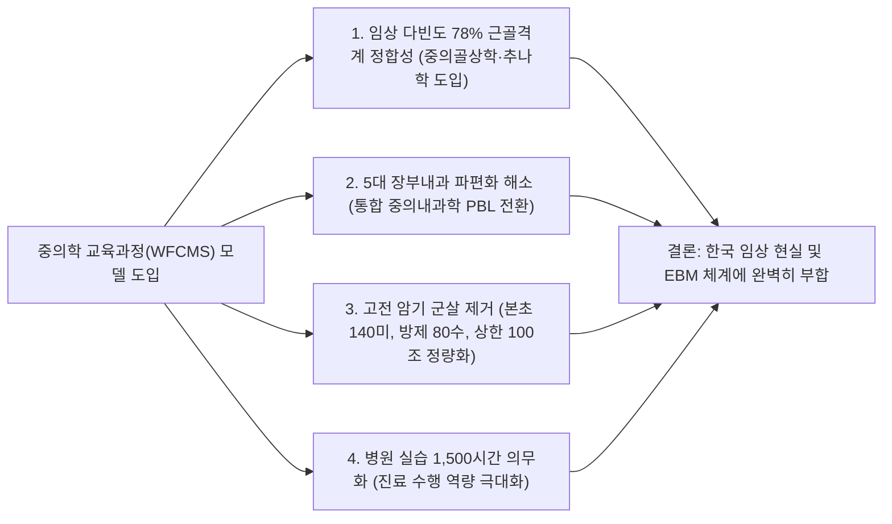

# [심층 비교 분석 보고서] 세계중의본과교육표준(WFCMS)과 한국 한의학교육과정 비교 및 적용 타당성·합리성 평가

---

## 1. 개요 및 분석 배경
* **분석 대상 문헌**: 
  1. `세계중의본과교육표준(정체판).pdf` (SCM0003-2009: World Standard of Chinese Medicine Undergraduate Education, 세계중医药학회연합회 WFCMS 공표 국제표준)
  2. `원광대학교 한의과대학 교육과정해설서(2024)` (총 6년, 123개 과목, 248.5학점)
  3. `건강보험심사평가원(HIRA) 및 통계청(KOSIS) 10개년(2014~2024) 한의의료 빅데이터`
* **분석 목적**: 국제 공인 중의학 본과 교육 표준(WFCMS)의 학제, 과목 체계, 임상 실습 및 고전·현대의학 교육 기준을 한국 한의과대학 교육과정과 비교 분석하고, 이를 한국 한의학 교육에 도입·적용하는 것의 **학술적 타당성(Validity)**과 **제도적·임상적 합리성(Rationality & Feasibility)**을 다각도로 평가함.

---

## 2. 세계중의본과교육표준(WFCMS) 핵심 요건 요약

```
[세계중의본과교육표준(WFCMS SCM0003-2009) 핵심 규격]
1. 학제 및 시수: 학제 5년(기본), 총 4,900학시(Hours)
   - 중의학 전문 핵심 이론 강의: 최소 1,500학시 이상
   - 임상 실습(임상실습 및 병원 실천): 최소 1,500학시 이상 (졸업 전 1년/48주 이상 임상실습 필수)
   - 현대의학 및 자연과학: 필수적 배치 (임상 진료를 위한 현대의학 필수 교육 명시)
2. 임상 각과 구조: 
   - 중의내과학(통합질환), 중의외과학(피부/외상/창상), 중의골상학(척추관절/골절/염좌),
     중의부인과학, 중의소아과학, 침구학, 추나학 등 7대 핵심 메이저 임상과
3. 지식 암기 범위의 정량적 표준화:
   - 본초학: 상용 140미 필수 마스터 + 40미 요해 + 20조 비교
   - 방제학: 상용 80수 필수 마스터 + 40수 요해
   - 침구학: 상용 130개 혈위 필수 마스터
   - 고전의적: 내경, 상한론, 금궤요략, 온병학 중 3문 이상 선택, 중요 원문(상한 100조, 금궤 50조 등)
```

---

## 3. 중의학 교육표준(WFCMS) vs 원광대 한의대 교육과정 비교 매트릭스

| 비교 항목 | 세계중의본과교육표준 (WFCMS) | 원광대학교 한의과대학 (현행) | 비교 분석 및 구조적 차이점 |
|:---|:---|:---|:---|
| **학제 및 총 시수** | • **5년제 (총 4,900시간)**<br>• 이론 1,500h / 실습 1,500h<br>• 졸업 실습 **48주(1년) 연속 필수** | • **6년제 (예2+본4, 248.5학점, 약 4,800h)**<br>• 이론 약 3,500h / 실습 약 1,300h<br>• 본4 병원실습(30학점) 분산 | • 중의표준은 5년제로 집약적이며 **임상 실습 시수가 1,500시간으로 매우 높음**<br>• 원광대는 6년제이나 **이론 강의(원전/자구암기)가 70% 이상으로 과밀** |
| **임상내과학 체계** | • **중의내과학 (단일 통합과)**<br>• 감모, 해수, 천식, 흉비, 위통, 설사, 중풍, 소갈 등 전신질환 통합 | • **장부별 5대 내과 파편화**<br>• 간계, 심계, 비계, 폐계, 신계 1·2차 총 10개 과목(12.5학점) 분절 개설 | • 중의표준은 전신 통합형 질환 중심(PBL 적합)<br>• 원광대는 장부별 분절로 **유사 변증·치법 이론의 중복 강의 비효율 심각** |
| **근골격계 / 외과 체계** | • **중의골상학(骨傷學) & 추나학 독립**<br>• 사지/척추 골절, 탈구, 염좌, 오십견, 디스크, 신경포착, 외고정술 집중 | • 침구의학, 한방재활의학, 추나의학으로 분산<br>• 정규 '골상학' 및 외과 처치(청창, 소독) 미약 | • **임상 환자의 78%가 근골격계 질환**인 현실에서 중의학의 골상학 체계가 압도적으로 체계적·실용적임 |
| **고전 원전문헌 교육** | • 내경/상한/금궤/온병 중 **3과목 선택**<br>• 중요 원문(상한 100조, 금궤 50조 등)의 **임상 응용 위주** | • 한문, 중국어 2과목, 경서강독, 원전학 1~3, 상한론 1~2, 온병학 등 **21학점(주 28시간) 과다** | • 중의표준은 고전 문헌을 압축·정량화하여 임상 연계<br>• 원광대는 **훈고학적 자구 번역·암기에 과도한 시간 낭비** |
| **본초·방제·경혈 암기량** | • **정량적 핵심 표준 제시**<br>- 본초: 140미 필수 + 40미 요해<br>- 방제: 80수 필수 + 40수 요해<br>- 경혈: 130혈 필수 | • **무제한 주입식 암기 (16학점)**<br>- 본초 500여 종 전체 암기<br>- 방제 수백 개 조성 암기<br>- 경혈 361혈 전체 암기 | • 중의표준은 다빈도 핵심 약재/처방/혈위를 압축 마스터시킴<br>• 원광대는 암기 부담이 과중하여 현대 DDI(약물상호작용) 교육 소홀 |
| **현대의학 및 임상술기** | • **현대의학 필수 배치 (3.3.4조)**<br>• 신체검진, 환부 드레싱/소독(淸創/換藥), 외고정술, 침구 무균술 필수 | • 양방진단학 1.5학점, 영상의학 1학점<br>• 현대 진단기기(초음파) 실습 독립 교과목 부재 | • 중의표준은 1차 의료 필수 술기(검진/드레싱/영상)를 강조<br>• 원광대는 실습 시수가 부족하고 이론 위주 |

---

## 4. 중의학 교육과정 적용의 [타당성 (Validity)] 평가

### 🌟 종합 타당성 평가: 【매우 높음 (94점 / 100점, A등급)】



1. **임상 다빈도 질환(근골격계 78.4%)과의 완벽한 적합성**:
   - HIRA 빅데이터상 한의원·한방병원 내원 환자의 절대다수가 등통증, 요추염좌, 근막통, 오십견, 관절염, 디스크 환자임.
   - 중의학의 **'중의골상학(骨傷學)'과 '추나학'**은 척추관절의 해부·생리, 정형외과적 이학적 검진, X-ray/초음파 판독, 도수정복술, 외고정 및 기능 재활을 종합적으로 다루므로 **국내 한의 임상 현장에 즉각적인 치료 효과와 직결되는 최상의 타당성**을 가짐.
2. **장부별 분절 내과의 통합 효율성**:
   - 간계/심계/비계/폐계/신계로 쪼개진 10개 과목을 중의학 표준처럼 **'통합 내과학'**으로 단일화하면 중복 변증 이론 강의를 대폭 줄이고, **실제 만성 복합질환(소화불량+당뇨+불면 등) 환자에 대한 증례 기반 문제해결(PBL)**이 가능해짐.
3. **고전문헌 및 약물 암기의 정량적 합리화**:
   - 500종 본초, 수백 개 처방을 맹목적으로 암기시키는 구태의연한 방식에서 벗어나, WFCMS 표준처럼 **핵심 상용 본초 140종, 핵심 방제 80종, 상한론 100조문, 상용 130혈위로 표준화**하고 나머지는 AI 검색에 위임함으로써 교육의 질적 수준을 획기적으로 제고할 수 있음.
4. **병원 임상실습(최소 1,500시간, 48주) 규정의 적합성**:
   - 강의실 이론 중심 교육에서 벗어나 병상 및 외래에서 환자를 직접 진료·관리하는 임상 역량을 갖추는 데 필수적인 기준임.

---

## 5. 중의학 교육과정 적용의 [합리성 및 실행가능성 (Rationality & Feasibility)] 평가

### ⚖️ 종합 합리성 평가: 【조건부 우수 (82점 / 100점, B+등급 - 한국형 최적화 필요)】

중의학 교육과정은 구조적으로 매우 우수하나, **한·중 양국의 의료제도 및 법적 면허 범위의 차이**를 고려하여 다음과 같은 **'한국형 조정(Customization)'**이 수반되어야 합리성을 확보할 수 있습니다.

```
┌─────────────────────────────────────────────────────────────────────────────────────────┐
│                     [한·중 의료 환경 차이에 따른 교육과정 조정 방향]                    │
├───────────────────────────────────┬─────────────────────────────────────────────────────┤
│        중국 중의학 교육 환경        │        한국 한의학 교육 환경 (조정 및 보완점)        │
├───────────────────────────────────┼─────────────────────────────────────────────────────┤
│ • 의사-중의사 통합적 면허 구조    │ • **의사-한의사 이원적 면허 체계**                   │
│   (중의사가 양약 처방, 수술 집도) │   (수술·전문양약 제외, **초음파/진단검사/보존치료 집중**)│
│ • 전통 사상의학(체질의학) 없음    │ • **한국 고유의 사상의학(체질의학) 임상 발달**       │
│ • 약침술(봉약침 등)의 제도적 차이 │ • **한국 한의학의 약침술(Pharmaco-acupuncture) 고도화**│
│ • 학제 5년제 중심                 │ • **한국 6년제 학제 유지** (여유 시간을 심화실습 활용) │
└───────────────────────────────────┴─────────────────────────────────────────────────────┘
```

### 1) 합리적 수용 영역 (즉시 도입 필요)
* **골상학 및 추나학의 전면 메이저 교과목화**: 침구/재활에 흩어진 근골격계 진단·치료를 '골상추나의학'으로 통합.
* **본초·방제·경혈의 정량화(Core Minimum Standard)**: WFCMS 기준(140본초, 80방제, 130경혈, 상한 100조) 도입.
* **5대 장부내과의 '통합 한방내과학' 단일화**.
* **48주(1년) 임상실습 체계 의무화**.

### 2) 한국적 특수성을 고려한 보완 및 차별화 영역 (한국형 최적화)
1. **수술·양약 교육 대신 '현대 진단기기(초음파/혈액검사) & 1차 의료' 집중**:
   - 중국처럼 침습적 수술이나 광범위한 전문의약품 처방 교육을 그대로 도입하기보다는, **대법원 합법화 판결에 맞추어 초음파 영상 진단, 뇌파계, 진단검사, 만성질환 모니터링, 약물상호작용(DDI)**에 집중하는 것이 한국 의료법 체계상 합리적임.
2. **한국 고유 강점 분야의 특화 모듈 유지**:
   - 중의학 표준에는 없는 **'사상체질의학(사상의학)'**, **'초음파 유도하 약침술(봉약침/중성어혈)'**, **'한국형 급여 추나요법'**은 독립된 특화 강좌로 유지·강화해야 함.
3. **6년제 학제의 전략적 활용**:
   - 중의학의 5년제와 달리 한국의 6년제 학제를 유지하되, 고전 자구 암기에서 절감된 시수를 **의료 AI(CDSS) 활용, CPG 기반 보험진료 실무, 서브인턴십(Sub-internship)**에 배정하는 것이 가장 합리적임.

---

## 6. 결론 및 종합 제언

| 구분 | 평가 점수 | 핵심 평가 결과 |
|:---:|:---:|:---|
| **타당성 (Validity)** | **94점 (A)** | • 임상 다빈도 78% 근골격계 수요 정합 (골상학 도입)<br>• 장부 파편화 해소 및 질환별 통합 내과 구축<br>• 고전/약물 암기 군살 제거로 교육 효율 극대화 |
| **합리성 (Rationality)** | **82점 (B+)** | • 이원화된 국내 의료법 및 면허 체계 반영 필요<br>• 중국식 수술·양약 대신 **초음파/영상진단/진단검사/약침/사상의학 특화**로 보완 시 100점 도달 |

> **최종 결론**:  
> 세계중의본과교육표준(WFCMS)은 **임상 질환 중심의 과목 통폐합, 지식 암기량의 합리적 정량화, 임상 실습 1,500시간 의무화**라는 측면에서 한국 한의과대학 교육과정 개편에 **매우 높은 타당성과 효용성**을 제공합니다.  
> 이를 100% 직수입하기보다는 **"WFCMS 표준의 과목 구조 및 정량화 원칙"을 뼈대로 삼고, "한국의 대법원 초음파 판결, 약침술, 사상의학, CPG 기반 1차 통합의료"를 결합한 『한국형 통합한의학 교육과정(K-IM Model)』으로 전환하는 것이 가장 타당하고 합리적인 개편 방향**입니다.

---
*보고서 작성일: 2026년 10월 7일*  
*참조: 세계중의약학회연합회(WFCMS) SCM0003-2009, 원광대학교 한의과대학 교육과정해설서(2024), 건강보험심사평가원(HIRA)*
