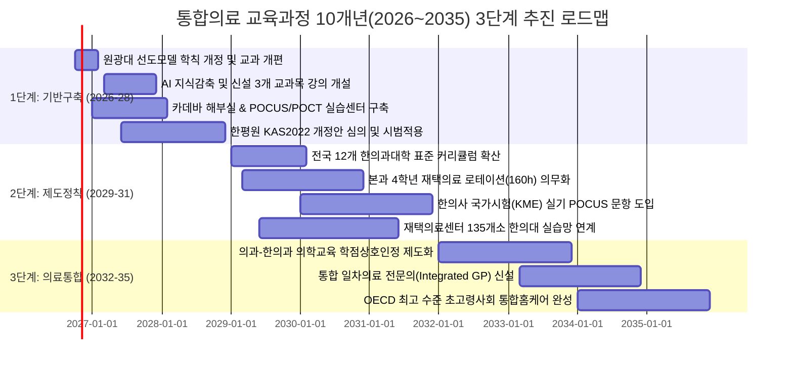

# [마스터 플랜] 초고령사회 대응 통합의료 교육과정(6년제) 구축 및 10개년(2026~2035) 혁신 로드맵
## — 원광대 교육과정 전수분석 · HIRA/KOSIS 10개년 빅데이터 · AI 시수감축 · 2026 시체해부법 · 재택의료 국제비교 통합 —

> **수립일자**: 2026년 10월  
> **기초 데이터 및 분석 근거**:
> 1. 원광대학교 한의과대학 2024학년도 교육과정 전수 분석 (123개 과목, 248.5학점 전수 코딩)
> 2. 건강보험심사평가원(HIRA)·통계청(KOSIS)·한국한의약진흥원(NCKM) 10개년(2014~2024) 청구 및 의료자원 빅데이터
> 3. 질병관리청(KDCA) 8대 재택의료 체계 및 보건복지부 15개 건강보험 재택의료 시범사업 데이터 (한의 참여율 48.3%~60.5%)
> 4. 동아시아 전통의학 재택의료 국제비교 (일본 MHLW 148종 한방약 급여·개호보험 연계 / 대만 MOHW iHBMC 중의사 2.88회/월 방문·866% 성장)
> 5. 서울대 의대 이혜진 교수(한국재택의료협회 정책위원장) 4대 기능 모델 ($F_1$ 일차의료, $F_2$ 급성기대응, $F_3$ 전환기재활, $F_4$ 재택임종)
> 6. 2026년 시체해부법 시행령 개정(대통령령 제36725호)에 따른 한의사 카데바 해부 및 현대 진단기기(POCUS/POCT) 권한
> 7. 세계중의약학회연합회(WFCMS) 세계중의본과교육표준(SCM0003-2009) 및 한국한의학교육평가원(한평원) KAS2022 평가인증 기준집

---

## Executive Summary (총괄 요약)

대한민국은 **2024년 12월 65세 이상 인구 비중이 20%를 돌파하여 초고령사회에 공식 진입**하였으며, 2026년 3월 **「지역돌봄통합지원법」**의 전면 시행, **시체해부법 개정(대통령령 제36725호)**, 그리고 **생성형 AI 기술의 의료 전면 도입**이라는 3대 메가트렌드에 직면해 있습니다.

기존 한의학 교육과정(원광대 기준 123과목, 248.5학점)은 **100% 원내 외래 내원 환자 중심의 분절적 교실 암기식 교육**에 치우쳐 있어, 실제 임상 현장의 요구(근골격계 78.4% 편중 극복, 노년증후군 CPG 처방, 휴대용 초음파/POCT 현장 진단, 욕창·튜브 관리, 다제약물 감감, 다학제 팀케어)와 심각한 괴리를 보이고 있습니다.

본 마스터플랜은 **AI 기반 지식 압축 및 중복 교과목 통폐합을 통해 30.5학점을 과감히 감축(248.5학점 $\rightarrow$ 218.0학점)**하고, 확보된 시수를 **현대 의과학 진단(POCUS 초음파/카데바 해부), 노인의학·다제약물 관리, 그리고 필수 80시간의 재택의료(방문진료) 임상 로테이션**에 집중 재배치하는 **'6년제 통합의료 교육과정'**을 확립합니다. 나아가 이를 전국 12개 한의과대학과 국가 보건의료 체계에 성공적으로 안착시키기 위한 **'10개년(2026~2035) 3단계 이행 로드맵'**을 제시합니다.

```
┌────────────────────────────────────────────────────────────────────────────────────────┐
│                   통합의료 6년제 한의학교육과정 10개년 혁신 프레임워크                   │
├────────────────────────────────────────────────────────────────────────────────────────┤
│  [1. 빅데이터·정책 근거]  HIRA 10개년(근골격 78.4% 탈피), 15개 재택시범사업(한의 48.3%),   │
│                          일본 148종 한방약 급여, 대만 iHBMC 2.88회 방문 벤치마킹        │
│                                           ▼                                            │
│  [2. AI 지식 압축 혁신]  단순암기 30.5학점 감축 (248.5학점 → 218.0학점), 이론:실습 55:45   │
│                                           ▼                                            │
│  [3. 6년제 통합 커리큘럼] 예과: 카데바 해부 + AI 헬스케어 / 본과: POCUS/POCT + 노인의학    │
│                          본과 4학년: 전일제 서브인턴십 + 재택의료 4주(160시간) 의무화  │
│                                           ▼                                            │
│  [4. 10개년 3단계 로드맵] 1단계(2026-28 기반구축) → 2단계(2029-31 제도정착) →            │
│                          3단계(2032-35 의과-한의과 의료통합 완성)                      │
└────────────────────────────────────────────────────────────────────────────────────────┘
```

---

## 1. 10개년 빅데이터·정책 근거 및 현행 교육과정 진단

### 1.1 HIRA·KOSIS·NCKM 10개년 빅데이터(2014~2024)의 임상적 교훈
1. **외래 다빈도 상병의 극심한 근골격계 편중**:
   - 한의원 외래 진료비의 78.4%가 요통, 경항통, 슬관절증, 염좌 등 근골격계에 편중.
   - 그러나 한방병원의 입원 진료는 뇌혈관질환 후유증, 안면신경마비, 척추수술 후 재활 등 중증 복합 질환이 견인.
   - **교육적 시사점**: 외래 단순 통증 치료에 머무르지 않고, **뇌신경 재활, 노년증후군, 만성 복합질환을 포괄하는 '통합 일차의료 역량'**으로의 교육 외연 확장이 필수적임.
2. **자동차보험 및 실손보험 환경 변화**:
   - 첩약·약침 중심의 단기 자동차보험 진료비 급증(1.49조 원)에 따른 비판 극복을 위해, **객관적 영상진단(X-ray, MRI, 초음파) 판독 및 정밀 한방물리요법/추나의학의 표준화 교육**이 시급함.

### 1.2 재택의료 정책 및 한의약의 공급 주도성
1. **건강보험 15개 재택의료 시범사업 내 압도적 점유율**:
   - 전체 참여기관(1,960개소) 중 한의과가 **48.3%~53.3%(단일 제공기관 기준 60.5%, 713개소)**를 차지하여, 전국 읍·면·동 단위에서 최고 수준의 현장 접근성을 증명.
2. **동아시아 벤치마킹 (일본 & 대만)**:
   - **일본**: 전국 의사 80%가 148종 한방약을 처방하며, **억간산(치매 BPSD)** 및 **반하후박탕(흡인성 폐렴 예방)**을 국가 가이드라인으로 확립.
   - **대만**: iHBMC 거가의료에 중의사 합류 후 **이용량 866% 급증, 월 방문 2.88회 1위, 입원율 38% 감소**.
3. **서울대 이혜진 교수 4대 기능 모델 매핑**:
   - 한의학은 **$F_1$(일차의료 만성관리)과 $F_3$(전환기 퇴원 재활)에서 최적의 효용($\Phi=0.88\sim0.95$)**을 가짐을 학술적으로 증명.

### 1.3 현행 교육과정의 한계 및 AI 감축 타당성
- 원광대 2024년 기준 123과목 248.5학점은 전국 최고 수준의 과밀한 시수를 가지고 있으나, 한의학원론, 본초학, 방제학 등에서 **기초 지식 암기식 중복 강의**가 과다함.
- **AI 튜터링 및 디지털 DB**를 통해 단순 지식 전달 과목 30.5학점을 감축하고, 이를 **임상 시뮬레이션(CPX/OSCE), 카데바 해부실습, POCUS 초음파 실습, 현장 재택의료 실습**으로 전면 전환함.

---

## 2. 6년제 통합의료 교육과정 정밀 편제표 (Curriculum Matrix)

전체 이수학점을 기존 **248.5학점에서 218.0학점으로 최적화(30.5학점 감축)**하고, **이론 대 실습 비율을 기존 78:22에서 55:45로 획기적으로 전환**합니다.

```
┌────────────────────────────────────────────────────────────────────────────────────────┐
│                        6년제 통합의료 교육과정 총괄 구조 (218학점)                     │
├─────────────────┬─────────────────────────────────────────────────┬────────────────────┤
│ 학년 구분       │ 핵심 교육 목표                                  │ 편성 학점          │
├─────────────────┼─────────────────────────────────────────────────┼────────────────────┤
│ **예과 1학년**  │ 의학 기초 인문, AI 헬스케어 리터러시, 통합의학 기초│ 34.0 학점 (17+17)  │
│ **예과 2학년**  │ 2026 시체해부학, 통합 생리·병리학, 신경해부학  │ 36.0 학점 (18+18)  │
│ **본과 1학년**  │ 통합본초·임상약리학, 경혈해부생리학, POCUS 진단학│ 38.0 학점 (19+19)  │
│ **본과 2학년**  │ 통합내과학, 근골격초음파·추나, 재택의료학총론   │ 38.0 학점 (19+19)  │
│ **본과 3학년**  │ 노인의학·다제약물감감, 방문진료술기, CPX시뮬레이션│ 36.0 학점 (18+18)  │
│ **본과 4학년**  │ 전일제 서브인턴십(병원 24주 + 재택 4주 + 협진 12주)│ 36.0 학점 (18+18)  │
├─────────────────┴─────────────────────────────────────────────────┼────────────────────┤
│ **합계** (전체 6년 12개 학기)                                     │ **총 218.0 학점**  │
└────────────────────────────────────────────────────────────────────────────────────────┘
```

### 2.1 학년별·학기별 상세 교과목 구성표

#### [예과 1학년: 기초 의과학 및 AI·인문 리터러시] (총 34학점)
* **1학기 (17학점)**:
  - 의학통계 및 헬스케어 AI 프로그래밍 (3학점, 3/0)
  - 생명윤리와 의료인문학 (2학점, 2/0)
  - 일반생물학 및 유전학 (3학점, 2/2)
  - 일반화학 및 유기화학 (3학점, 2/2)
  - 통합의료학총론 (2학점, 2/0)
  - 의학라틴어 및 의학용어 (2학점, 2/0)
  - 인성 및 대학생활설계 (2학점, 2/0)
* **2학기 (17학점)**:
  - 의료정보학과 보건의료 빅데이터 분석 (3학점, 2/2)
  - 의학한문 및 고전원전 핵심강독 [AI축소 통합] (2학점, 2/0)
  - 의학생화학 및 분자생물학 (3학점, 2/2)
  - 세포생물학 및 면역학 기초 (3학점, 2/2)
  - 동서의학사 및 비교의철학 (2학점, 2/0)
  - 교양선택 (4학점, 4/0)

#### [예과 2학년: 인체 구조와 기능의 완전 통합] (총 36학점)
* **1학기 (18학점)**:
  - **인체해부학 I 및 카데바 실습** [2026 시체해부법 기반] (4학점, 2/4)
  - 통합인체생리학 I (신경/근육/순환/호흡) (3학점, 3/0)
  - 한의생리학 및 오장육부 병태생리 [통합] (2학점, 2/0)
  - 의학미생물학 및 감염관리학 (3학점, 2/2)
  - 인체발생학 및 조직학 (3학점, 2/2)
  - 기초신경해부학 및 신경과학 (3학점, 2/2)
* **2학기 (18학점)**:
  - **인체해부학 II 및 카데바 실습** [내장/맥관계/국소] (4학점, 2/4)
  - 통합인체생리학 II (소화/내분비/비뇨/생식) (3학점, 3/0)
  - 통합인체병리학 (종양/염증/면역/장기병리) (4학점, 3/2)
  - 경락경혈학 기초 (경락순행 및 표준경혈) (3학점, 2/2)
  - 기초의과학 통합 PBL (2학점, 0/4)
  - 의료법규 및 보건의료체계론 (2학점, 2/0)

#### [본과 1학년: 통합 진단·약리 및 진단기기 융합] (총 38학점)
* **1학기 (19학점)**:
  - **경혈해부생리학 및 입체자침술기** [Gray 해부학 연계] (3학점, 2/2)
  - 통합본초학 및 천연물약리학 I (3학점, 3/0)
  - 서양임상약리학 기초 (3학점, 3/0)
  - 통합진단학 I (변증진단, 이학적 검진, 병력청취) (3학점, 2/2)
  - 방제학 I (주요 방제 구성원리 및 약물상호작용) (3학점, 3/0)
  - 한방병리학 및 사진(四診) 실습 (2학점, 1/2)
  - 임상기초술기(OSCE) I: 무균술, 활력징후, 기본침구술 (2학점, 0/4)
* **2학기 (19학점)**:
  - **POCUS(현장초음파) 진단학 및 관절영상실습** (3학점, 1/4)
  - **임상진단검사의학 및 POCT(현장검사) 실습** (3학점, 2/2)
  - 통합본초학 및 천연물약리학 II (3학점, 3/0)
  - 방제학 II 및 제제학 (3학점, 2/2)
  - 통합진단학 II (방사선 단순촬영, CT, MRI 판독) (3학점, 2/2)
  - 한방진단기기학 및 디지털 맥전도/설진 영상학 (2학점, 1/2)
  - 임상기초술기(OSCE) II: 약침술, 부항술, 도관삽입 관찰 (2학점, 0/4)

#### [본과 2학년: 임상 각과 통합 및 재택의료 기초] (총 38학점)
* **1학기 (19학점)**:
  - 통합순환기·호흡기내과학 (CPG 기반) (3학점, 3/0)
  - 통합소화기·간담췌내과학 (3학점, 3/0)
  - **통합근골격의학 및 추나의학 I** (척추질환 및 POCUS 유도 시술) (3학점, 2/2)
  - 침구의학 I (경맥병증 및 근골격 통증 침구치료) (3학점, 2/2)
  - 한방신경정신의학 및 임상심리학 (3학점, 2/2)
  - **지역사회 통합돌봄과 한의 재택의료학** [신설 필수] (2학점, 2/0)
  - 임상증례토론(CPX) I (2학점, 0/4)
* **2학기 (19학점)**:
  - 통합내분비·신장비뇨내과학 (3학점, 3/0)
  - 통합뇌신경재활의학 (뇌졸중, 파킨슨, 척수손상) (3학점, 2/2)
  - **통합근골격의학 및 추나의학 II** (사지관절질환 및 초음파 유도 약침) (3학점, 2/2)
  - 침구의학 II (내과질환, 감각기 질환, 특수침술) (3학점, 2/2)
  - 한방안이비인후피부과학 (3학점, 2/2)
  - 한방응급의학 및 중환자 조기감별(Red Flags) (2학점, 2/0)
  - 임상증례토론(CPX) II (2학점, 0/4)

#### [본과 3학년: 노인의학·방문진료 술기 및 임상 시뮬레이션] (총 36학점)
* **1학기 (18학점)**:
  - **노인의학 및 다제약물 감감(Deprescribing) 관리론** [신설 필수] (2학점, 2/0)
  - **방문진료 임상술기 및 홈케어 진단 실습** [신설 필수] (2학점, 1/2)
  - 통합부인과학 (여성생식기, 갱년기, 산전산후) (3학점, 2/2)
  - 통합소아청소년의학 (소아 성장, 면역, 알레르기) (3학점, 2/2)
  - 사상의학 및 맞춤의학 (체질병증 임상응용) [AI축소 통합] (2학점, 2/0)
  - 종양학 및 완화의료 (가정호스피스, 암성통증) (2학점, 2/0)
  - 임상술기 종합시뮬레이션 (OSCE/CPX 집중훈련) (4학점, 0/8)
* **2학기 (18학점)**:
  - 통합재활의학 및 물리치료학 (3학점, 2/2)
  - 침구임상의과학 (특수자침술 및 전기침·레이저침 연구) (2학점, 1/2)
  - 의료경영, 감염관리 및 보건의료데이터 (2학점, 2/0)
  - **사전 임상실습 입문 워크숍** (서브인턴십 오리엔테이션) (3학점, 1/4)
  - 학생 주도 연구 프로젝트 / 졸업논문 (4학점, 0/8)
  - 통합의료 임상추론(Clinical Reasoning) 종합평가 (4학점, 2/4)

#### [본과 4학년: 전일제 임상실습(Sub-Internship) & 재택의료 로테이션] (총 36학점, 연간 40주/1,600시간)
* **1학기 (18학점, 20주)**:
  - 부속병원 통합내과 로테이션 (6주, 240h / 5학점)
  - 부속병원 침구·재활의학과 로테이션 (6주, 240h / 5학점)
  - **지역사회 재택의료센터 및 방문진료 필수 로테이션** [신설 의무] (4주, 160h / 4학점)
  - 신경정신과 및 특수클리닉 로테이션 (4주, 160h / 4학점)
* **2학기 (18학점, 20주)**:
  - 부속병원 부인·소아·안이비피부과 로테이션 (6주, 240h / 5학점)
  - 의과-한의과 협진병원 및 상급병원 임상실습 (4주, 160h / 4학점)
  - 공공보건의료기관 및 보건소 실습 (4주, 160h / 4학점)
  - 선택 심화 실습 (연구/해외/특화한의원) (4주, 160h / 3학점)
  - 종합 임상역량 최종평가 (Graduation CPX/OSCE) (2주, 80h / 2학점)

---

## 3. 노년증후군 및 1차의료 핵심 CPG 임상술기 모듈

본 교육과정은 심평원·질병관리청 가이드라인 및 일본·대만 임상근거가 확립된 **'노년증후군 6대 핵심 CPG 모듈'**을 교과목에 직결하여 교육합니다.

```
┌────────────────────────────────────────────────────────────────────────────────────────┐
│                      노년증후군 6대 핵심 CPG 교육 모듈 매트릭스                         │
├───────────────┬───────────────────────────────┬────────────────────────────────────────┤
│ 질환군/증후군 │ 핵심 임상 문제 및 병태생리    │ 한의 통합 처방 및 술기 교육 모듈       │
├───────────────┼───────────────────────────────┼────────────────────────────────────────┤
│ **1. 흡인성   │ 와상 노인의 연하반사 저하,    │ **반하후박탕(Hangekobokuto)** 투여,    │
│    폐렴 예방**│ 무증상 흡인 및 폐렴 사망      │ 풍지·예풍·염천 전침, 연하재활 도수     │
├───────────────┼───────────────────────────────┼────────────────────────────────────────┤
│ **2. 치매     │ 초조, 배회, 환각, 폭언,       │ **억간산(Yokukansan)** CPG 1차 처방,   │
│    BPSD 조절**│ 가족 돌봄 부담 급증           │ 백회·사신총 전침, 비약물 케어 플랜    │
├───────────────┼───────────────────────────────┼────────────────────────────────────────┤
│ **3. 노쇠 및  │ 식욕부진, 체중감소,           │ **보중익기탕 / 인삼양영탕** 처방,      │
│    근감소증** │ 면역저하, 낙상 위험           │ 족삼리·관원 뜸요법, 저항성 운동지도   │
├───────────────┼───────────────────────────────┼────────────────────────────────────────┤
│ **4. 노인성   │ 야간 빈뇨, 긴박뇨,            │ **우차신기환 / 팔미지황환** 처방,      │
│    배뇨장애** │ 요로감염, 수면장애            │ 방광수·신수 전침, POCUS 잔뇨량(PVR)평가│
├───────────────┼───────────────────────────────┼────────────────────────────────────────┤
│ **5. 뇌졸중   │ 편마비, 관절구축,             │ 십이번체 자침, 관절가동술(ROM),       │
│    후유장애** │ 견관절 아탈구, 보행장애       │ 두침요법, 한양방 복합재활 프로토콜     │
├───────────────┼───────────────────────────────┼────────────────────────────────────────┤
│ **6. 중증 욕창│ 침상 압박에 의한 피부 괴사,   │ NPUAP 단계별 식염수 세척 및 드레싱,    │
│    및 창상**  │ 2차 세균 감염                 │ **자운고(紫雲膏)** 도포, 압력분산 간호 │
└───────────────┴───────────────────────────────┴────────────────────────────────────────┘
```

---

## 4. 10개년(2026~2035) 3단계 이행 및 제도화 로드맵



### 4.1 3단계 세부 실행 전략

| 단계 | 추진 기간 | 핵심 목표 | 중점 실행 과제 |
| :--- | :--- | :--- | :--- |
| **1단계: 도입 및 기반구축기** | **2026 ~ 2028년** (3개년) | 선도대학 교육과정 전면 개편 및 인프라 구축 | - 원광대 218학점 개편안 학칙 반영 및 AI 축소 적용<br>- 신설 3개 교과목(재택의료학, 노인의학, 홈케어실습) 개설<br>- 2026 시체해부법 기반 카데바 실습실 및 POCUS 시뮬레이션 센터 구축<br>- 한평원(IKKOME) KAS2022 평가인증 개정안 심의 통과 |
| **2단계: 확산 및 제도정착기** | **2029 ~ 2031년** (3개년) | 전국 12개 한의대 전면 확산 및 국시 실기 연계 | - 전국 12개 한의과대학 표준 교육과정 전면 도입<br>- 본과 4학년 재택의료 4주(160시간) 의무 로테이션 전면화<br>- 복지부 지정 장기요양 재택의료센터(135개소+)와 실습 협약 체결<br>- 한국보건의료인국가시험원 한의사 국시 실기(CPX/OSCE)에 초음파·방문진료 술기 30% 반영 |
| **3단계: 통합 및 고도화기** | **2032 ~ 2035년** (4개년) | 의과-한의과 학점 호환 및 통합 일차의료 완성 | - 의과대학-한의과대학 간 기초의과학 및 임상실습 학점 상호인정 협약 체결<br>- '통합 일차의료 전문의(Integrated Primary Care Specialist)' 제도 입법화<br>- 질병관리청 및 지자체 통합돌봄(AIP)의 주치의 공공 공급망 완비<br>- 초고령사회 건강보험·장기요양 재정 연간 5,000억 원 이상 절감 실현 |

---

## 5. 한평원(KASCOM) 평가기준 개정 및 행정·재정 지원 패키지

### 5.1 한평원 KAS2022 평가인증 기준 개정 연계안
1. **P2.1 (교육과정 구성 및 개발)**:
   - "초고령사회 인구구조 변화 및 「지역돌봄통합지원법」에 따른 **'방문진료, 노인의학, 다학제 팀케어 역량'을 교육목표 및 정규 교과목에 필수로 반영**하여야 한다."
2. **P2.4 (의료인문학 및 사회한의학)**:
   - "지역사회 통합돌봄, 보건의료 전달체계, 다제약물 감감 관리 및 **다직종(의사-한의사-간호사-사회복지사) 협력 교육을 4학점 이상 편성**하여야 한다."
3. **P2.5.4 (외부기관 임상실습)**:
   - "외부 임상실습 기준에 협력병원 외에 **'보건복지부 지정 장기요양 재택의료센터 및 일차의료 방문진료 기관(최소 80시간 이상)'을 필수 인정 기관으로 명시**한다."
4. **P5.1.2 (지역사회 보건의료 기여)**:
   - "대학 및 부속병원이 관할 지자체와 연계하여 **'취약계층 재택의료 방문진료 지원 사업'을 운영하고 학생 실습과 연계**하는 실적을 필수 평가한다."

### 5.2 정부(교육부·보건복지부) 5개년 재정 지원 패키지
* **국고 지원 예산 (연간 약 250억 원, 5개년 총 1,250억 원)**:
  1. **한의과대학 카데바 해부실습 및 POCUS 실습실 현대화 지원**: 대학당 15억 원 지원.
  2. **재택의료 임상실습 지도전문의 및 전담간호사 인건비 지원**: 대학당 연간 5억 원 지원.
  3. **통합의료 AI 튜터링 플랫폼 및 CPG 시뮬레이션 콘텐츠 개발 보급**: 연간 30억 원.

---

## 6. 정량적·정성적 기대 효과

```
┌────────────────────────────────────────────────────────────────────────────────────────┐
│                              종합 기대 효과 매트릭스                                   │
├─────────────────┬──────────────────────────────────────────────────────────────────────┤
│ **1. 교육 혁신**│ • 총 학점 248.5학점 → 218.0학점 (30.5학점 슬림화로 학습 피로도 해소)   │
│                 │ • 실습 비중 22% → 45%로 2배 이상 확대 (카데바, POCUS, 재택실습 전면화)│
│                 │ • 단순 암기 교육에서 'AI 기반 데이터 임상추론(Clinical Reasoning)' 전환│
├─────────────────┼──────────────────────────────────────────────────────────────────────┤
│ **2. 의료 공급**│ • 연간 750명의 준비된 '통합 재택의료 전문의사' 배출                  │
│                 │ • 전국 3,500개 읍면동에 연간 150만 건 이상의 고품질 방문진료망 공급  │
│                 │ • 의사-한의사 갈등을 넘어선 다학제 팀케어(MDT) 선도 모델 확립         │
├─────────────────┼──────────────────────────────────────────────────────────────────────┤
│ **3. 국가 재정**│ • 불필요한 장기 입원 방지 및 가정 내 치료(AIP) 전환                   │
│                 │ • 5대 노인성 질환 재택의료화로 건강보험·장기요양 연간 3,200억~5,400억 절감│
└─────────────────┴──────────────────────────────────────────────────────────────────────┘
```
