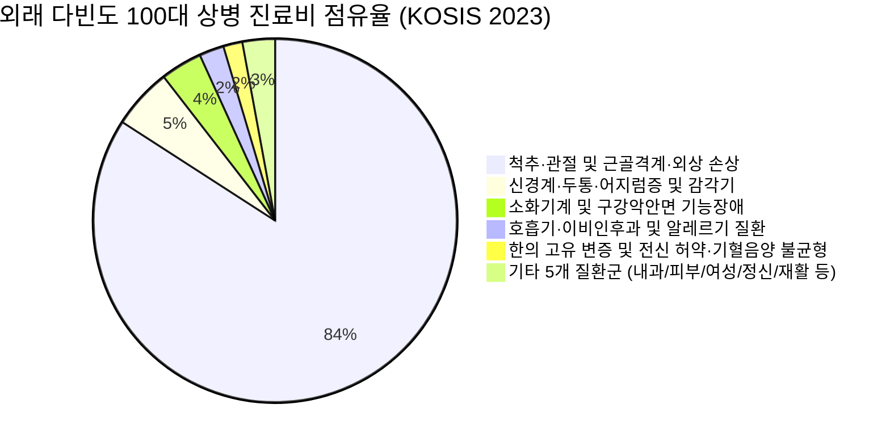
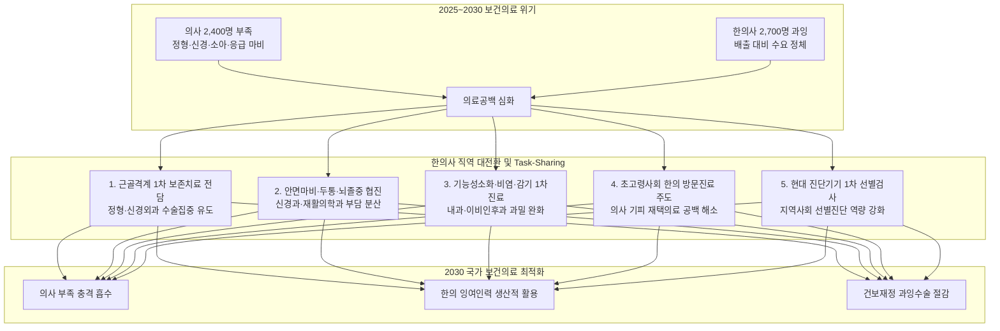

# HIRA·KOSIS 데이터 기반 한의 의료서비스 현황 분석 및 의사 인력 수급 불균형 배경 속 한의사 상위 100대 KCD 상병별 직역·역할 제안

> **작성 기준일:** 2026년 10월 26일  
> **연구 배경:** `의사 vs 한의사 인력 수급 시뮬레이션 (2021~2030)` 보고서 기반 보건의료 인력 위기 대응 전략  
> **데이터 출처:** 통계청 국가통계포털(KOSIS) 건강보험통계(DT_35001_A182111 한방 외래 다빈도 100대 상병 전수 분석), 건강보험심사평가원(HIRA) 비급여 보고제도 및 심사실적, 국민건강보험공단 진료비 실태조사  

---

## 📌 Executive Summary: 인력 수급 위기와 한의사 직역 대전환의 필연성

### 1. 인력 수급의 비대칭적 모순 (2021~2030 시뮬레이션 핵심)
* **2030년 의사 2,400명 부족 (-1.9%, 시나리오별 최대 5,400명 부족):** 2024년 전공의 집단 사직과 의대 휴학 사태로 의료기관 근무 의사가 4.7%(약 5,400명) 급감한 이후, 복귀 및 신규 배출이 이루어져도 고령화에 따른 의료 수요 증가(연 1.6%)를 따라잡지 못해 만성적 부족이 고착화됩니다.
* **2030년 한의사 2,700명 과잉 (+11.6%, 시나리오별 최대 3,500명 과잉):** 연간 750명 입학정원에서 순증하는 약 480명의 한의사 인력이 연간 진료 수요 증가율(1.0%, 약 220명)을 2배 이상 초과하여 매년 약 250명씩 누적 과잉이 발생합니다.
* **정원 정책의 시차(Time-lag)와 단기 정책의 유일한 출구:** 2027학년도 의대 증원은 2033년 이후, 한의대 정원 감축은 2032년 이후에나 배출에 영향을 미치므로, **2025~2030년 구간의 대응 수단은 오직 '기존 인력의 배치·활용·업무 분담(Task-sharing)'과 '한의 서비스 수요 측 확대(첩약·약침 급여화, 방문진료, 만성질환 관리)'뿐입니다.**

### 2. KOSIS·HIRA 실증 데이터로 본 한의 외래 상위 100대 상병 구조
* **외래 다빈도 100대 상병 총량:** 연간 실인원 **17,064,449명**, 총 진료비 **2조 7,360억 원** (2조 7,360억 원), 건강보험 급여비 **2조 434억 원** (2조 434억 원), 평균 급여율 **74.7%**.
* **근골격계 질환의 압도적 편중과 한계:** 척추·관절 및 근골격계 질환(42개 상병)이 환자수의 **82.3%**, 진료비의 **84.2%**(2조 3,041억 원)를 점유하고 있습니다. 반면 내과계(소화기 3.7%, 호흡기 2.2%), 신경계(5.4%), 여성의학(0.9%), 피부(0.6%), 정신(0.3%) 등은 고도의 임상 효능에도 불구하고 급여 인정 범위 협소로 인해 위축되어 있습니다.
* **급여 vs 비급여의 구조적 왜곡:** 한의 비급여는 환자 수요가 높으나 급여 미등재된 **'구조적 비급여(한약 첩약 76.7%, 약침술 9.6%)'**가 대부분입니다. 의과의 '실손보험 연계 확장형 비급여(도수치료, 비급여 주사 등)'와 질적으로 다르며, 첩약·약침 급여화 시 즉각적인 공공의료 보장성 강화와 의과 과밀 해소 효과를 창출할 수 있습니다.

### 3. 직역 재정의 및 역할 분담(Task-Sharing) 5대 전략 방향
1. **[근골격계] 정형외과·신경외과 의사 부족 완화:** 침·부항·추나·약침 기반의 비수술 보존치료 1차 게이트키퍼(Gatekeeper) 역할을 확립하여 불필요한 과잉 수술 및 비급여 도수치료를 억제하고 수술 전문의의 과밀을 해소.
2. **[신경·뇌혈관·재활] 신경과·재활의학과 협진 강화:** 안면신경마비(G51) 골든타임 협진, 뇌졸중 후유증(I69) 조기 침구재활 및 회복기 관리, 만성 난치성 두통(G43, G44) 비약물 조절을 통해 신경계 전문의 공백 보완.
3. **[호흡기·소화기·피부] 내과·이비인후과 경증 환자 분담:** 기능성 소화불량(K30), 급성 비인두염(J00), 알레르기 비염(J30), 아토피(L20) 환자 대상 근거 기반 한약·침구 치료로 항생제·스테로이드 남용 방지 및 일차의료 분산.
4. **[초고령사회 재택의료] 한의 방문진료 및 통합돌봄 주도:** 의사의 방문진료 기피로 인한 거동불편 노인 의료 공백을 한의사 2,700명의 잉여 인력으로 흡수, 가정 및 요양시설 방문 침구·첩약·재활 집중 제공.
5. **[제도·진단 혁신] 현대 진단기기 및 혈액검사 활용 합법화 연계:** 대법원 전원합의체 판결(초음파, 뇌파계)에 따라 한의원의 1차 영상·생화학적 스크리닝을 제도화하여 의과 부족 지역에서의 선별 진단 역량 대폭 확충.

---

## 1. HIRA·KOSIS 통계 기반 한의 의료서비스 제공 현황 총괄

### (1) 10대 임상 질환군별 다빈도 상병 진료 실적 및 점유율
| 질환군 분류 | 상병수 | 2023 실인원 (명) | 환자 비중 | 총 진료비 규모 | 진료비 비중 | 급여비 규모 | 급여율 | 연계 의과 진료과목 |
| :--- | :---: | :---: | :---: | :---: | :---: | :---: | :---: | :--- |
| **척추·관절 및 근골격계·외상 손상** | 42개 | 14,043,093명 | 82.3% | 2조 3,041억 원 | 84.2% | 1조 7,151억 원 | 74.4% | 정형외과·신경외과·재활의학과 |
| **신경계·두통·어지럼증 및 감각기** | 12개 | 776,661명 | 4.6% | 1,470.6억 원 | 5.4% | 1,142.9억 원 | 77.7% | 신경과·신경외과·이비인후과 |
| **소화기계 및 구강악안면 기능장애** | 7개 | 822,942명 | 4.8% | 1,009.8억 원 | 3.7% | 768.0억 원 | 76.1% | 소화기내과·가정의학과·치과(턱관절) |
| **호흡기·이비인후과 및 알레르기 질환** | 7개 | 550,589명 | 3.2% | 599.2억 원 | 2.2% | 446.4억 원 | 74.5% | 이비인후과·호흡기내과·소아청소년과 |
| **한의 고유 변증 및 전신 허약·기혈음양 불균형** | 14개 | 335,743명 | 2.0% | 459.9억 원 | 1.7% | 350.2억 원 | 76.1% | 통합의학·가정의학과·노인의학 |
| **여성의학·비뇨생식기 및 하복부 골반통** | 3개 | 200,275명 | 1.2% | 239.2억 원 | 0.9% | 172.0억 원 | 71.9% | 산부인과·비뇨의학과 |
| **기타 전신 증상 및 대사·기능성 장애** | 6개 | 180,986명 | 1.1% | 212.4억 원 | 0.8% | 157.6억 원 | 74.2% | 일차의료·가정의학과 |
| **피부면역 및 알레르기 피부염** | 4개 | 75,488명 | 0.4% | 162.0억 원 | 0.6% | 115.9억 원 | 71.6% | 피부과·알레르기내과 |
| **정신건강·신체형 장애 및 자율신경실조** | 3개 | 50,584명 | 0.3% | 90.8억 원 | 0.3% | 69.1억 원 | 76.2% | 정신건강의학과·가정의학과 |
| **뇌혈관질환 후유증 재활 및 순환기 기능장애** | 2개 | 28,088명 | 0.2% | 74.9억 원 | 0.3% | 60.2억 원 | 80.3% | 재활의학과·신경과·순환기내과 |
| **[합계/전체]** | **100개** | **17,064,449명** | **100.0%** | **2조 7,360억 원** | **100.0%** | **2조 434억 원** | **74.7%** | **보건의료 전 직역 협력 체계** |

### (2) 현행 한의 의료서비스의 급여 및 비급여 포트폴리오 구조
| 구분 | 건강보험 급여 항목 (Covered) | 비급여 항목 (Non-covered) | 구조적 특성 및 한계 |
| :--- | :--- | :--- | :--- |
| **침구 및 부항술** | 경혈침술, 전침술, 복합침술, 온침술, 직접구, 간접구, 건식부항, 습식(사혈)부항 | 비급여 특수침(도침술, 매선요법, 화침 등 일부 비급여 인정) | 급여화율 95% 이상으로 한의 임상의 기본 근간. 행위료 수가가 원가 대비 낮아 다빈도 시술 의존. |
| **수기 및 물리요법** | 추나요법(단순·복잡·특수, 연 20회 한도), 온열·한랭요법, 경피경근온열(하이드로콜레이터) | 비급여 수기요법, 특수 교정 매트리스, 비급여 체외충격파 등 | 추나요법의 연간 20회 급여 제한 및 본인부담률(50~80%)이 높아 환자의 지속적 치료 접근성 제한. 의과 물리치료(ICT, TENS, 견인 등)의 한의 급여 미등재. |
| **약제 (한약)** | 56종 단미엑스산제 혼합제제, 첩약 건강보험 1·2단계 시범사업 (안면마비, 뇌혈관, 월경통, 디스크, 비염, 소화불량) | 맞춤형 조제 첩약 (비급여의 76.7%), 약침술(9.6%), 공진단·경옥고 등 전통 환제·고제 | 한약의 본체인 '맞춤형 첩약'이 시범사업 단계에 머물러 있어 환자 본인부담 과다. 약침술의 비급여 존치로 임상적 우수성에도 불구하고 문턱 존재. |
| **방문진료 및 돌봄** | 일차의료 한의 방문진료 수가 시범사업 (포괄진료료 등) | 가정 방문 비급여 첩약 조제료, 사설 간병 연계 | 초고령사회 거동불편 환자에게 필수적이나 의과 대비 참여기관 수 제한 및 수가 현실화 요구. |

---

## 2. 『의사 vs 한의사 인력 수급 시뮬레이션(2021~2030)』 배경과 정책적 함의

### (1) 2030년 의료인력 수급 시뮬레이션 주요 지표 대조
| 비교 항목 | 의사 (MD) | 한의사 (KMD) | 국가 보건의료 종합 시사점 |
| :--- | :---: | :---: | :--- |
| **2023년 의료기관 근무인원** | 112,443명 | 22,423명 | 2차 보건의료인력 실태조사 기준 |
| **2024년 인력 변동률** | **-4.7% (약 5,400명 급감)** | **+2.3% (정상 증가)** | 전공의 집단 사직으로 인한 의과 필수의료 진료 마비 발생 |
| **연간 신규 순증 인원** | 복귀 후 연 약 2,000명 순증 | 연 약 480명 순증 (배출 600명) | 한의사는 연 배출 규모 대비 국내 은퇴율 낮아 누적 공급 급증 |
| **연간 의료 수요 증가율** | **기본 1.6%** (1.3% ~ 1.9%) | **기본 1.0%** (0.5% ~ 1.5%) | 고령화에 따라 의과 수요 급증하나, 한의는 첩약 미급여로 수요 정체 |
| **2030년 예상 공급** | 약 121,400명 | 약 25,800명 | 현행 배출 경로 지속 시 공급 총량 |
| **2030년 예상 수요** | 약 123,800명 | 약 23,100명 | 성·연령별 의료이용 추세 반영 |
| **2030년 수급 격차 (기본)** | **약 2,400명 부족 (-1.9%)** | **약 2,700명 과잉 (+11.6%)** | **두 직역의 수급 방향이 정반대이며 한의사 과잉률(11.6%)이 심각** |
| **수급 차 범위 (시나리오)** | 500명 과잉 ~ **5,400명 부족** | **1,900명 ~ 3,500명 과잉** | 전공의 미복귀 시 의사 부족은 3,900~5,400명으로 폭증 |
| **2035년 장기 전망** | 1,535~4,923명 부족 (추계위) | 3,362~3,578명 과잉 (보사연) | 구조적 불균형이 10년 이상 장기 지속됨 |
| **정원 조정 효과 발현 시점** | **2033년 이후 (효과 없음)** | **2032년 이후 (효과 없음)** | **2025~2030년 단기 대응은 정원이 아닌 '인력 활용 및 재배치'가 유일** |

### (2) 핵심 정책 시사점 및 직역 분담의 타당성
1. **의대 정원 증원의 시차 한계:** 2025~2027학년도 의대 정원을 증원하더라도 인턴·레지던트 수련을 거쳐 전문의가 배출되는 시점은 2033년 이후입니다. 2025~2030년 동안 필수의료 및 지역 1차의료 공백을 메우는 유일한 방법은 **'기존 의사의 업무를 분담(Task-sharing)할 수 있는 가용 전문인력인 한의사의 전격 투입'**입니다.
2. **한의사 2,700명 과잉의 생산적 전환:** 한의대 정원을 즉시 축소해도 2032년까지는 과잉 인력이 매년 250명씩 쏟아져 나옵니다. 이 유휴 전문인력을 방치하면 과당 경쟁과 비급여 팽창 등 자원 낭비가 초래되므로, **정부의 수요 측 정책(건강보험 급여화, 방문진료, 만성질환 관리 참여)을 통해 의사 부족 영역에 재배치**해야 합니다.
3. **진료 영역의 중첩성과 보완성:** 한의 외래 상위 100대 상병의 80% 이상은 의과의 정형외과, 신경외과, 재활의학과, 내과, 이비인후과 진료와 직접적으로 중첩됩니다. 이들 영역에서 한의사가 1차 진료와 보존적 치료를 전담하면, 의사는 중증·응급·수술 중심의 고난도 필수의료에 집중할 수 있어 보건의료 체계 전체의 효율성이 극대화됩니다.

---

## 3. 10대 임상 질환군별 한의 의료서비스 현황 및 직역 역할 제안

### 1. 척추·관절 및 근골격계·외상 손상 (총 42개 상병)
* **진료 규모:** 2023년 실인원 **14,043,093명** (전체의 82.3%), 총 진료비 **2조 3,041억 원** (84.2%), 급여율 **74.4%**
* **연계 의과 진료과:** 정형외과·신경외과·재활의학과
* **주요 포함 상병:** M54(등통증), S33(요추), M79(달리), M62(기타), S13(목), M25(달리) 등 42개 상병
* **현행 의료서비스 제공 현황:**
  - **급여:** 경혈침술, 전자침/전침술, 간접구/직접구, 건식/습식(사혈)부항, 추나요법(단순/복잡), 한방물리요법(경피경근온열/경피적외선)
  - **비급여:** 경혈약침술(소염/중성어혈/봉약침), 도침술(연조직 유착박리), 맞춤 첩약(독활기생탕/치요통방), 비급여 물리치료(추나매트 등)
* **의사 인력 수급 불균형 배경 속 한의사 직역 및 역할 제안:**
  - 근골격계 일차 진료 게이트키퍼: 불필요한 과잉 영상검사·스테로이드 주사·수술을 억제하고 침·추나·약침 중심의 비수술 보존치료 전담. 정형·신경외과 전문의의 수술 집중 유도 및 과밀 해소.
* **제도 개선 및 급여화 정책 과제:**
  - 추나요법 연간 20회 급여 제한 완화, 경혈약침술 건강보험 정규 급여 등재, 한방 물리치료 급여 항목(ICT/TENS 등) 확대.

### 2. 신경계·두통·어지럼증 및 감각기 (총 12개 상병)
* **진료 규모:** 2023년 실인원 **776,661명** (전체의 4.6%), 총 진료비 **1,470.6억 원** (5.4%), 급여율 **77.7%**
* **연계 의과 진료과:** 신경과·신경외과·이비인후과
* **주요 포함 상병:** R51(두통), G51(안면신경장애), G43(편두통), G44(기타), U23(신경계통의), R42(현기) 등 12개 상병
* **현행 의료서비스 제공 현황:**
  - **급여:** 경혈침술, 전자침/전침술, 간접구/직접구, 건식/습식(사혈)부항, 전침술(저주파자극), 온구술, 보험 엑스제제(반하백출천마탕, 오약순기산)
  - **비급여:** 두경부 약침술, 맞춤 첩약(청상견통탕), 경추 추나요법
* **의사 인력 수급 불균형 배경 속 한의사 직역 및 역할 제안:**
  - 만성 난치성 두통의 비약물 일차 조절: 진통제 오남용(약물과용두통) 환자 대상 경추 추나, 후두부 자침, 엑스제제를 통해 중추 감작 완화 및 신경과 진료 대기 분산.
* **제도 개선 및 급여화 정책 과제:**
  - 만성 두통 한의 CPG 기반 표준 수가 신설, 복합 엑스제제 급여 인정 확대.

### 3. 소화기계 및 구강악안면 기능장애 (총 7개 상병)
* **진료 규모:** 2023년 실인원 **822,942명** (전체의 4.8%), 총 진료비 **1,009.8억 원** (3.7%), 급여율 **76.1%**
* **연계 의과 진료과:** 소화기내과·가정의학과·치과(턱관절)
* **주요 포함 상병:** K30(소화불량), K29(위염), K59(기타), U28(소화계통의), K07(치아얼굴이상[부정교합포함]), K92(소화계통의) 등 7개 상병
* **현행 의료서비스 제공 현황:**
  - **급여:** 경혈침술, 전자침/전침술, 간접구/직접구, 건식/습식(사혈)부항, 복부 경혈침술(중완/족삼리), 복부 온구(뜸치료), 보험 엑스제제(반하사심탕, 평위산, 이진탕), 첩약 시범사업(2단계 기능성 소화불량 요양급여)
  - **비급여:** 복부 약침술, 맞춤 첩약(보중익기탕/향사육군자탕), 온열 고주파/뜸 특수요법
* **의사 인력 수급 불균형 배경 속 한의사 직역 및 역할 제안:**
  - 기능성 위장관 질환의 생활습관 및 위장관 운동 조절: 내시경적 기질적 이상이 없는 만성 소화불량·과민대장 환자를 전담 진료하여 소화기내과 과밀 해소 및 위장약 장기복용 방지.
* **제도 개선 및 급여화 정책 과제:**
  - 기능성 소화불량 첩약 시범사업 활성화 및 보험한약제제 복합처방(연조엑스제) 보장성 강화.

### 4. 호흡기·이비인후과 및 알레르기 질환 (총 7개 상병)
* **진료 규모:** 2023년 실인원 **550,589명** (전체의 3.2%), 총 진료비 **599.2억 원** (2.2%), 급여율 **74.5%**
* **연계 의과 진료과:** 이비인후과·호흡기내과·소아청소년과
* **주요 포함 상병:** J00(급성), J30(혈관운동성), J31(만성), R05(기침), H93(달리), J06(다발성) 등 7개 상병
* **현행 의료서비스 제공 현황:**
  - **급여:** 경혈침술, 전자침/전침술, 간접구/직접구, 건식/습식(사혈)부항, 폐경/대장경 자침(영향/합곡), 보험 엑스제제(소청룡탕, 삼소음, 형개연교탕)
  - **비급여:** 은교산/갈근탕 맞춤제제, 항염증 한약
* **의사 인력 수급 불균형 배경 속 한의사 직역 및 역할 제안:**
  - 경증 상기도감염(감기) 및 만성 알레르기 비염의 면역 조절 일차의료: 항생제·항히스타민제 남용을 방지하고 소청룡탕·형개연교탕 등 근거 기반 한약 처방으로 이비인후과·소아과 진료 분담.
* **제도 개선 및 급여화 정책 과제:**
  - 비염 첩약 시범사업 정착, 소아·청소년 호흡기 보험한약 본인부담 경감.

### 5. 한의 고유 변증 및 전신 허약·기혈음양 불균형 (총 14개 상병)
* **진료 규모:** 2023년 실인원 **335,743명** (전체의 2.0%), 총 진료비 **459.9억 원** (1.7%), 급여율 **76.1%**
* **연계 의과 진료과:** 통합의학·가정의학과·노인의학
* **주요 포함 상병:** ZZ(한방기타), U68(비병증(脾病證)), U60(기병증(氣病證)), U67(심실증(心實證)), U65(간실증(肝實證)), U78(장부겸병증(臟腑兼病證)) 등 14개 상병
* **현행 의료서비스 제공 현황:**
  - **급여:** 경혈침술, 전자침/전침술, 간접구/직접구, 건식/습식(사혈)부항, 변증별 사암침/오행침, 체질 침구술, 단미혼합 엑스제제(56종 중 변증 맞춤)
  - **비급여:** 공진단/경옥고/녹용대보탕 등 체질 맞춤 첩약, 자하거/산삼약침, 미병(未病) 예방 관리
* **의사 인력 수급 불균형 배경 속 한의사 직역 및 역할 제안:**
  - 노인 복합만성질환·허약(Frailty) 및 미병(未病) 예방 관리: 질병 전단계(기허, 혈허 등) 조기 개입으로 중증 이환을 방지하고 지역사회 커뮤니티케어 통합돌봄 주치의 수행.
* **제도 개선 및 급여화 정책 과제:**
  - 노인 노쇠(Frailty) 한의 중재 급여화, 지역사회 통합돌봄 한의 주치의제도 공식화.

### 6. 여성의학·비뇨생식기 및 하복부 골반통 (총 3개 상병)
* **진료 규모:** 2023년 실인원 **200,275명** (전체의 1.2%), 총 진료비 **239.2억 원** (0.9%), 급여율 **71.9%**
* **연계 의과 진료과:** 산부인과·비뇨의학과
* **주요 포함 상병:** R10(복부), N94(여성), U32(여성비뇨생식기) 등 3개 상병
* **현행 의료서비스 제공 현황:**
  - **급여:** 경혈침술, 전자침/전침술, 간접구/직접구, 건식/습식(사혈)부항, 하복부 관원/삼음교 자침, 온구술(하초 온열치료), 보험 엑스제제(궁귀조혈음, 당귀작약산)
  - **비급여:** 하복부 온경약침, 자궁보온 맞춤 첩약(조경환/온경탕/생화탕)
* **의사 인력 수급 불균형 배경 속 한의사 직역 및 역할 제안:**
  - 가임기 월경통 및 난임·산후관리 일차 전담: 진통제 반복 투여 환자의 자궁 골반 혈류 개선 및 호르몬 균형 회복을 통해 산부인과 부족 지역의 여성건강 공백 메움.
* **제도 개선 및 급여화 정책 과제:**
  - 월경통 첩약 본사업 전환 및 지자체 한의난임치료 국가 지원사업 통합.

### 7. 기타 전신 증상 및 대사·기능성 장애 (총 6개 상병)
* **진료 규모:** 2023년 실인원 **180,986명** (전체의 1.1%), 총 진료비 **212.4억 원** (0.8%), 급여율 **74.2%**
* **연계 의과 진료과:** 일차의료·가정의학과
* **주요 포함 상병:** S23(흉곽의), R60(달리), R07(목구멍), R61(다한증), R68(기타), R63(음식) 등 6개 상병
* **현행 의료서비스 제공 현황:**
  - **급여:** 경혈침술, 전자침/전침술, 간접구/직접구, 건식/습식(사혈)부항, 증상 완화 경혈자침, 온열 부항치료, 보험 한약제제
  - **비급여:** 원기회복 맞춤 첩약, 체질 약침치료
* **의사 인력 수급 불균형 배경 속 한의사 직역 및 역할 제안:**
  - 지역사회 일차의료 다빈도 증상 선별 및 일차 진료: 거주지 밀착형 한의원이 만성 통증, 피로, 부종 등 일상 증상을 1차 케어하고 고위험군을 상급병원으로 회송.
* **제도 개선 및 급여화 정책 과제:**
  - 일차의료 만성질환관리제 한의과 참여, 기본 진찰료 체계 개편.

### 8. 피부면역 및 알레르기 피부염 (총 4개 상병)
* **진료 규모:** 2023년 실인원 **75,488명** (전체의 0.4%), 총 진료비 **162.0억 원** (0.6%), 급여율 **71.6%**
* **연계 의과 진료과:** 피부과·알레르기내과
* **주요 포함 상병:** L30(기타), L20(아토피), L50(두드러기), L21(지루피부염) 등 4개 상병
* **현행 의료서비스 제공 현황:**
  - **급여:** 경혈침술, 전자침/전침술, 간접구/직접구, 건식/습식(사혈)부항, 사혈부항, 황련해독탕 등 소염 엑스제제, 침구 온열치료
  - **비급여:** 천연 한방 외용제/연고(자운고), 체질 맞춤 면역조절 첩약(소풍산/형개연교탕), 약침술(소염약침)
* **의사 인력 수급 불균형 배경 속 한의사 직역 및 역할 제안:**
  - 아토피·만성 습진의 스테로이드 저감 통합 관리: 장기 스테로이드 리바운드 위험 환자의 체질 개선 및 천연 외용제 치료로 피부과 진료 보완.
* **제도 개선 및 급여화 정책 과제:**
  - 한방 외용제제(자운고 등) 건보 급여화, 아토피 CPG 기반 한의치료 패키지화.

### 9. 정신건강·신체형 장애 및 자율신경실조 (총 3개 상병)
* **진료 규모:** 2023년 실인원 **50,584명** (전체의 0.3%), 총 진료비 **90.8억 원** (0.3%), 급여율 **76.2%**
* **연계 의과 진료과:** 정신건강의학과·가정의학과
* **주요 포함 상병:** F45(신체형), U22(정신), R57(달리) 등 3개 상병
* **현행 의료서비스 제공 현황:**
  - **급여:** 경혈침술, 전자침/전침술, 간접구/직접구, 건식/습식(사혈)부항, 이정변기요법(지지/인식요법), 사암침법(심비경 조절), 보험 엑스제제(시호가용골모려탕, 가미소요산)
  - **비급여:** 자하거/우황 약침술, 맞춤 첩약(귀비탕/분심기음), 한의 명상 및 바이오피드백
* **의사 인력 수급 불균형 배경 속 한의사 직역 및 역할 제안:**
  - 신체형 장애 및 화병·불안의 문턱 낮은 일차 심신의학 치료: 정신과 낙인감(Stigma)으로 진료를 기피하는 환자의 신체화 증상을 침구·이정변기요법으로 조기 치유.
* **제도 개선 및 급여화 정책 과제:**
  - 한의 지지요법 및 정신요법 급여 기준 현실화, 일차의료 마음건강 통합프로그램 연계.

### 10. 뇌혈관질환 후유증 재활 및 순환기 기능장애 (총 2개 상병)
* **진료 규모:** 2023년 실인원 **28,088명** (전체의 0.2%), 총 진료비 **74.9억 원** (0.3%), 급여율 **80.3%**
* **연계 의과 진료과:** 재활의학과·신경과·순환기내과
* **주요 포함 상병:** R00(심장박동), I69(뇌혈관질환의) 등 2개 상병
* **현행 의료서비스 제공 현황:**
  - **급여:** 경혈침술, 전자침/전침술, 간접구/직접구, 건식/습식(사혈)부항, 두침/체침 복합자침, 신경근 전기자극, 추나관절가동, 첩약 시범사업(1·2단계 뇌혈관 후유증 요양급여)
  - **비급여:** 우황청심원, 녹용보혈 맞춤첩약(보양환오탕), 신경재생 약침술, 방문 재택재활
* **의사 인력 수급 불균형 배경 속 한의사 직역 및 역할 제안:**
  - 지역사회 일차의료 다빈도 증상 선별 및 일차 진료: 거주지 밀착형 한의원이 만성 통증, 피로, 부종 등 일상 증상을 1차 케어하고 고위험군을 상급병원으로 회송.
* **제도 개선 및 급여화 정책 과제:**
  - 일차의료 만성질환관리제 한의과 참여, 기본 진찰료 체계 개편.

---

## 4. KCD 상위 100대 상병별 현황 및 한의사 직역·역할 전수 매트릭스

> *본 매트릭스는 통계청 KOSIS 건강보험통계(2023년 한방 외래 다빈도 상병 진료현황) 및 심평원 심사실적을 1위부터 100위까지 100% 전수 수록하였습니다.*  
> *(단위: 순위, 코드, 환자수-명, 진료비 규모)*

| 순위 | KCD 코드 | 상병명 (한국표준질병사인분류) | 질환분류 | 2023 환자수 | 2023 진료비 | 급여율 | 현행 급여 및 비급여 서비스 요약 | 의사인력 부족 대응 한의사 직역 및 역할 제안 |
| :---: | :---: | :--- | :--- | :---: | :---: | :---: | :--- | :--- |
| **1** | `M54` | **등통증** | 척추·관절 및 근골격계·외상 손상 | 3,545,680명 | 6,781.1억 원 | 76.0% | **[급여]** 경혈침술, 전자침/전침술, 간접구/직접구, 건식/습식(사혈)부항... **[비급여]** 경혈약침술(소염/중성어혈/봉약침), 도침술(연조직 유착... | 근골격계 일차 진료 게이트키퍼: 불필요한 과잉 영상검사·스테로이드 주사·수술을 억제하고 침·추나·약침 중심의 비수술 보존치료 전담. 정형·신경외과 전문의의 수술 집중 유도 및 과밀 해소. |
| **2** | `S33` | **요추 및 골반의 관절 및 인대의 탈구 염좌 및 긴장** | 척추·관절 및 근골격계·외상 손상 | 1,818,950명 | 2,835.2억 원 | 70.5% | **[급여]** 경혈침술, 전자침/전침술, 간접구/직접구, 건식/습식(사혈)부항... **[비급여]** 경혈약침술(소염/중성어혈/봉약침), 도침술(연조직 유착... | 근골격계 일차 진료 게이트키퍼: 불필요한 과잉 영상검사·스테로이드 주사·수술을 억제하고 침·추나·약침 중심의 비수술 보존치료 전담. 정형·신경외과 전문의의 수술 집중 유도 및 과밀 해소. |
| **3** | `M79` | **달리 분류되지 않은 기타 연조직 장애** | 척추·관절 및 근골격계·외상 손상 | 1,737,540명 | 2,720.0억 원 | 77.2% | **[급여]** 경혈침술, 전자침/전침술, 간접구/직접구, 건식/습식(사혈)부항... **[비급여]** 경혈약침술(소염/중성어혈/봉약침), 도침술(연조직 유착... | 근골격계 일차 진료 게이트키퍼: 불필요한 과잉 영상검사·스테로이드 주사·수술을 억제하고 침·추나·약침 중심의 비수술 보존치료 전담. 정형·신경외과 전문의의 수술 집중 유도 및 과밀 해소. |
| **4** | `M62` | **기타 근육 장애** | 척추·관절 및 근골격계·외상 손상 | 1,147,785명 | 1,799.3억 원 | 74.5% | **[급여]** 경혈침술, 전자침/전침술, 간접구/직접구, 건식/습식(사혈)부항... **[비급여]** 경혈약침술(소염/중성어혈/봉약침), 도침술(연조직 유착... | 근골격계 일차 진료 게이트키퍼: 불필요한 과잉 영상검사·스테로이드 주사·수술을 억제하고 침·추나·약침 중심의 비수술 보존치료 전담. 정형·신경외과 전문의의 수술 집중 유도 및 과밀 해소. |
| **5** | `S13` | **목 부위의 관절 및 인대의 탈구 염좌 및 긴장** | 척추·관절 및 근골격계·외상 손상 | 827,198명 | 1,212.7억 원 | 67.3% | **[급여]** 경혈침술, 전자침/전침술, 간접구/직접구, 건식/습식(사혈)부항... **[비급여]** 경혈약침술(소염/중성어혈/봉약침), 도침술(연조직 유착... | 근골격계 일차 진료 게이트키퍼: 불필요한 과잉 영상검사·스테로이드 주사·수술을 억제하고 침·추나·약침 중심의 비수술 보존치료 전담. 정형·신경외과 전문의의 수술 집중 유도 및 과밀 해소. |
| **6** | `M25` | **달리 분류되지 않은 기타 관절장애** | 척추·관절 및 근골격계·외상 손상 | 802,284명 | 1,337.5억 원 | 78.3% | **[급여]** 경혈침술, 전자침/전침술, 간접구/직접구, 건식/습식(사혈)부항... **[비급여]** 경혈약침술(소염/중성어혈/봉약침), 도침술(연조직 유착... | 근골격계 일차 진료 게이트키퍼: 불필요한 과잉 영상검사·스테로이드 주사·수술을 억제하고 침·추나·약침 중심의 비수술 보존치료 전담. 정형·신경외과 전문의의 수술 집중 유도 및 과밀 해소. |
| **7** | `S93` | **발목 및 발부위의 관절 및 인대의 탈구 염좌 및 긴장** | 척추·관절 및 근골격계·외상 손상 | 744,370명 | 938.9억 원 | 72.6% | **[급여]** 경혈침술, 전자침/전침술, 간접구/직접구, 건식/습식(사혈)부항... **[비급여]** 경혈약침술(소염/중성어혈/봉약침), 도침술(연조직 유착... | 근골격계 일차 진료 게이트키퍼: 불필요한 과잉 영상검사·스테로이드 주사·수술을 억제하고 침·추나·약침 중심의 비수술 보존치료 전담. 정형·신경외과 전문의의 수술 집중 유도 및 과밀 해소. |
| **8** | `K30` | **소화불량** | 소화기계 및 구강악안면 기능장애 | 632,877명 | 760.5억 원 | 76.3% | **[급여]** 경혈침술, 전자침/전침술, 간접구/직접구, 건식/습식(사혈)부항... **[비급여]** 복부 약침술, 맞춤 첩약(보중익기탕/향사육군자탕), 온... | 기능성 위장관 질환의 생활습관 및 위장관 운동 조절: 내시경적 기질적 이상이 없는 만성 소화불량·과민대장 환자를 전담 진료하여 소화기내과 과밀 해소 및 위장약 장기복용 방지. |
| **9** | `S43` | **견갑대의 관절 및 인대의 탈구 염좌 및 긴장** | 척추·관절 및 근골격계·외상 손상 | 481,850명 | 734.0억 원 | 72.0% | **[급여]** 경혈침술, 전자침/전침술, 간접구/직접구, 건식/습식(사혈)부항... **[비급여]** 경혈약침술(소염/중성어혈/봉약침), 도침술(연조직 유착... | 근골격계 일차 진료 게이트키퍼: 불필요한 과잉 영상검사·스테로이드 주사·수술을 억제하고 침·추나·약침 중심의 비수술 보존치료 전담. 정형·신경외과 전문의의 수술 집중 유도 및 과밀 해소. |
| **10** | `M75` | **어깨 병변** | 척추·관절 및 근골격계·외상 손상 | 475,034명 | 720.9억 원 | 75.8% | **[급여]** 경혈침술, 전자침/전침술, 간접구/직접구, 건식/습식(사혈)부항... **[비급여]** 경혈약침술(소염/중성어혈/봉약침), 도침술(연조직 유착... | 근골격계 일차 진료 게이트키퍼: 불필요한 과잉 영상검사·스테로이드 주사·수술을 억제하고 침·추나·약침 중심의 비수술 보존치료 전담. 정형·신경외과 전문의의 수술 집중 유도 및 과밀 해소. |
| **11** | `S63` | **손목 및 손부위의 관절 및 인대의 탈구 염좌 및 긴장** | 척추·관절 및 근골격계·외상 손상 | 388,680명 | 469.1억 원 | 72.3% | **[급여]** 경혈침술, 전자침/전침술, 간접구/직접구, 건식/습식(사혈)부항... **[비급여]** 경혈약침술(소염/중성어혈/봉약침), 도침술(연조직 유착... | 근골격계 일차 진료 게이트키퍼: 불필요한 과잉 영상검사·스테로이드 주사·수술을 억제하고 침·추나·약침 중심의 비수술 보존치료 전담. 정형·신경외과 전문의의 수술 집중 유도 및 과밀 해소. |
| **12** | `S83` | **무릎의 관절 및 인대의 탈구 염좌 및 긴장** | 척추·관절 및 근골격계·외상 손상 | 308,574명 | 481.0억 원 | 74.2% | **[급여]** 경혈침술, 전자침/전침술, 간접구/직접구, 건식/습식(사혈)부항... **[비급여]** 경혈약침술(소염/중성어혈/봉약침), 도침술(연조직 유착... | 근골격계 일차 진료 게이트키퍼: 불필요한 과잉 영상검사·스테로이드 주사·수술을 억제하고 침·추나·약침 중심의 비수술 보존치료 전담. 정형·신경외과 전문의의 수술 집중 유도 및 과밀 해소. |
| **13** | `J00` | **급성 비인두염[감기]** | 호흡기·이비인후과 및 알레르기 질환 | 230,459명 | 163.1억 원 | 74.7% | **[급여]** 경혈침술, 전자침/전침술, 간접구/직접구, 건식/습식(사혈)부항... **[비급여]** 은교산/갈근탕 맞춤제제, 항염증 한약... | 경증 상기도감염(감기) 및 만성 알레르기 비염의 면역 조절 일차의료: 항생제·항히스타민제 남용을 방지하고 소청룡탕·형개연교탕 등 근거 기반 한약 처방으로 이비인후과·소아과 진료 분담. |
| **14** | `M17` | **무릎관절증** | 척추·관절 및 근골격계·외상 손상 | 224,162명 | 413.3억 원 | 81.1% | **[급여]** 경혈침술, 전자침/전침술, 간접구/직접구, 건식/습식(사혈)부항... **[비급여]** 경혈약침술(소염/중성어혈/봉약침), 도침술(연조직 유착... | 근골격계 일차 진료 게이트키퍼: 불필요한 과잉 영상검사·스테로이드 주사·수술을 억제하고 침·추나·약침 중심의 비수술 보존치료 전담. 정형·신경외과 전문의의 수술 집중 유도 및 과밀 해소. |
| **15** | `U30` | **근골격계 및 결합조직의 질환** | 척추·관절 및 근골격계·외상 손상 | 200,209명 | 228.3억 원 | 76.5% | **[급여]** 경혈침술, 전자침/전침술, 간접구/직접구, 건식/습식(사혈)부항... **[비급여]** 경혈약침술(소염/중성어혈/봉약침), 도침술(연조직 유착... | 근골격계 일차 진료 게이트키퍼: 불필요한 과잉 영상검사·스테로이드 주사·수술을 억제하고 침·추나·약침 중심의 비수술 보존치료 전담. 정형·신경외과 전문의의 수술 집중 유도 및 과밀 해소. |
| **16** | `M77` | **기타 골부착부병증** | 척추·관절 및 근골격계·외상 손상 | 173,991명 | 248.8억 원 | 72.8% | **[급여]** 경혈침술, 전자침/전침술, 간접구/직접구, 건식/습식(사혈)부항... **[비급여]** 경혈약침술(소염/중성어혈/봉약침), 도침술(연조직 유착... | 근골격계 일차 진료 게이트키퍼: 불필요한 과잉 영상검사·스테로이드 주사·수술을 억제하고 침·추나·약침 중심의 비수술 보존치료 전담. 정형·신경외과 전문의의 수술 집중 유도 및 과밀 해소. |
| **17** | `R10` | **복부 및 골반통증** | 여성의학·비뇨생식기 및 하복부 골반통 | 158,902명 | 176.3억 원 | 74.8% | **[급여]** 경혈침술, 전자침/전침술, 간접구/직접구, 건식/습식(사혈)부항... **[비급여]** 하복부 온경약침, 자궁보온 맞춤 첩약(조경환/온경탕/생... | 가임기 월경통 및 난임·산후관리 일차 전담: 진통제 반복 투여 환자의 자궁 골반 혈류 개선 및 호르몬 균형 회복을 통해 산부인과 부족 지역의 여성건강 공백 메움. |
| **18** | `M48` | **기타 척추병증** | 척추·관절 및 근골격계·외상 손상 | 136,735명 | 375.5억 원 | 77.3% | **[급여]** 경혈침술, 전자침/전침술, 간접구/직접구, 건식/습식(사혈)부항... **[비급여]** 경혈약침술(소염/중성어혈/봉약침), 도침술(연조직 유착... | 근골격계 일차 진료 게이트키퍼: 불필요한 과잉 영상검사·스테로이드 주사·수술을 억제하고 침·추나·약침 중심의 비수술 보존치료 전담. 정형·신경외과 전문의의 수술 집중 유도 및 과밀 해소. |
| **19** | `S53` | **팔꿈치의 관절 및 인대의 탈구 염좌 및 긴장** | 척추·관절 및 근골격계·외상 손상 | 127,973명 | 183.5억 원 | 71.1% | **[급여]** 경혈침술, 전자침/전침술, 간접구/직접구, 건식/습식(사혈)부항... **[비급여]** 경혈약침술(소염/중성어혈/봉약침), 도침술(연조직 유착... | 근골격계 일차 진료 게이트키퍼: 불필요한 과잉 영상검사·스테로이드 주사·수술을 억제하고 침·추나·약침 중심의 비수술 보존치료 전담. 정형·신경외과 전문의의 수술 집중 유도 및 과밀 해소. |
| **20** | `M51` | **기타 추간판 장애** | 척추·관절 및 근골격계·외상 손상 | 118,337명 | 352.8억 원 | 67.1% | **[급여]** 경혈침술, 전자침/전침술, 간접구/직접구, 건식/습식(사혈)부항... **[비급여]** 경혈약침술(소염/중성어혈/봉약침), 도침술(연조직 유착... | 근골격계 일차 진료 게이트키퍼: 불필요한 과잉 영상검사·스테로이드 주사·수술을 억제하고 침·추나·약침 중심의 비수술 보존치료 전담. 정형·신경외과 전문의의 수술 집중 유도 및 과밀 해소. |
| **21** | `R51` | **두통** | 신경계·두통·어지럼증 및 감각기 | 116,225명 | 146.7억 원 | 77.6% | **[급여]** 경혈침술, 전자침/전침술, 간접구/직접구, 건식/습식(사혈)부항... **[비급여]** 두경부 약침술, 맞춤 첩약(청상견통탕), 경추 추나요법... | 만성 난치성 두통의 비약물 일차 조절: 진통제 오남용(약물과용두통) 환자 대상 경추 추나, 후두부 자침, 엑스제제를 통해 중추 감작 완화 및 신경과 진료 대기 분산. |
| **22** | `J30` | **혈관운동성 및 알레르기성 비염** | 호흡기·이비인후과 및 알레르기 질환 | 107,989명 | 132.8억 원 | 73.5% | **[급여]** 경혈침술, 전자침/전침술, 간접구/직접구, 건식/습식(사혈)부항... **[비급여]** 비강 점막 사혈 및 세척, 황련해독탕 약침, 맞춤 첩약... | 경증 상기도감염(감기) 및 만성 알레르기 비염의 면역 조절 일차의료: 항생제·항히스타민제 남용을 방지하고 소청룡탕·형개연교탕 등 근거 기반 한약 처방으로 이비인후과·소아과 진료 분담. |
| **23** | `S23` | **흉곽의 관절 및 인대의 탈구 염좌 및 긴장** | 기타 전신 증상 및 대사·기능성 장애 | 104,028명 | 113.7억 원 | 71.3% | **[급여]** 경혈침술, 전자침/전침술, 간접구/직접구, 건식/습식(사혈)부항... **[비급여]** 원기회복 맞춤 첩약, 체질 약침치료... | 지역사회 일차의료 다빈도 증상 선별 및 일차 진료: 거주지 밀착형 한의원이 만성 통증, 피로, 부종 등 일상 증상을 1차 케어하고 고위험군을 상급병원으로 회송. |
| **24** | `G51` | **안면신경장애** | 신경계·두통·어지럼증 및 감각기 | 91,959명 | 378.4억 원 | 74.4% | **[급여]** 경혈침술, 전자침/전침술, 간접구/직접구, 건식/습식(사혈)부항... **[비급여]** 안면미세침/매선요법, 봉약침술/자하거약침, 맞춤 첩약(... | 안면신경마비 급성기 골든타임 협진 및 후유증 통합재활: 이비인후과/신경과 스테로이드 급성 처치 직후 즉각 침·전침·첩약 투여로 신경 손상 최소화 및 안면 경련·구축 영구장애 예방. |
| **25** | `G43` | **편두통** | 신경계·두통·어지럼증 및 감각기 | 83,271명 | 107.6억 원 | 77.4% | **[급여]** 경혈침술, 전자침/전침술, 간접구/직접구, 건식/습식(사혈)부항... **[비급여]** 두경부 약침술, 맞춤 첩약(청상견통탕), 경추 추나요법... | 만성 난치성 두통의 비약물 일차 조절: 진통제 오남용(약물과용두통) 환자 대상 경추 추나, 후두부 자침, 엑스제제를 통해 중추 감작 완화 및 신경과 진료 대기 분산. |
| **26** | `ZZ` | **한방기타** | 한의 고유 변증 및 전신 허약·기혈음양 불균형 | 81,644명 | 126.6억 원 | 79.5% | **[급여]** 경혈침술, 전자침/전침술, 간접구/직접구, 건식/습식(사혈)부항... **[비급여]** 공진단/경옥고/녹용대보탕 등 체질 맞춤 첩약, 자하거/... | 노인 복합만성질환·허약(Frailty) 및 미병(未病) 예방 관리: 질병 전단계(기허, 혈허 등) 조기 개입으로 중증 이환을 방지하고 지역사회 커뮤니티케어 통합돌봄 주치의 수행. |
| **27** | `G44` | **기타 두통증후군** | 신경계·두통·어지럼증 및 감각기 | 80,875명 | 107.9억 원 | 76.6% | **[급여]** 경혈침술, 전자침/전침술, 간접구/직접구, 건식/습식(사혈)부항... **[비급여]** 두경부 약침술, 맞춤 첩약(청상견통탕), 경추 추나요법... | 만성 난치성 두통의 비약물 일차 조절: 진통제 오남용(약물과용두통) 환자 대상 경추 추나, 후두부 자침, 엑스제제를 통해 중추 감작 완화 및 신경과 진료 대기 분산. |
| **28** | `U23` | **신경계통의 질환** | 신경계·두통·어지럼증 및 감각기 | 78,670명 | 183.6억 원 | 81.1% | **[급여]** 경혈침술, 전자침/전침술, 간접구/직접구, 건식/습식(사혈)부항... **[비급여]** 신경포착 부위 약침술, 맞춤 첩약, 체질조절 치료... | 지역사회 일차의료 다빈도 증상 선별 및 일차 진료: 거주지 밀착형 한의원이 만성 통증, 피로, 부종 등 일상 증상을 1차 케어하고 고위험군을 상급병원으로 회송. |
| **29** | `R42` | **현기 및 어지러움** | 신경계·두통·어지럼증 및 감각기 | 77,772명 | 118.1억 원 | 78.3% | **[급여]** 경혈침술, 전자침/전침술, 간접구/직접구, 건식/습식(사혈)부항... **[비급여]** 신경포착 부위 약침술, 맞춤 첩약, 체질조절 치료... | 지역사회 일차의료 다빈도 증상 선별 및 일차 진료: 거주지 밀착형 한의원이 만성 통증, 피로, 부종 등 일상 증상을 1차 케어하고 고위험군을 상급병원으로 회송. |
| **30** | `G47` | **수면장애** | 신경계·두통·어지럼증 및 감각기 | 76,496명 | 154.2억 원 | 79.1% | **[급여]** 경혈침술, 전자침/전침술, 간접구/직접구, 건식/습식(사혈)부항... **[비급여]** 자하거약침, 맞춤 첩약(온담탕/귀비탕), 한의정신요법(... | 노인 및 성인 수면장애의 비향정신성의약품 일차 중재: 수면제(졸피뎀, 벤조계열)의 의존성·낙상 위험을 피하는 침구·한약 수면 프로토콜 운영으로 정신과 부담 완화. |
| **31** | `M50` | **경추간판장애** | 척추·관절 및 근골격계·외상 손상 | 69,839명 | 184.5억 원 | 66.6% | **[급여]** 경혈침술, 전자침/전침술, 간접구/직접구, 건식/습식(사혈)부항... **[비급여]** 경혈약침술(소염/중성어혈/봉약침), 도침술(연조직 유착... | 근골격계 일차 진료 게이트키퍼: 불필요한 과잉 영상검사·스테로이드 주사·수술을 억제하고 침·추나·약침 중심의 비수술 보존치료 전담. 정형·신경외과 전문의의 수술 집중 유도 및 과밀 해소. |
| **32** | `M72` | **섬유모세포 장애** | 척추·관절 및 근골격계·외상 손상 | 67,894명 | 103.1억 원 | 74.3% | **[급여]** 경혈침술, 전자침/전침술, 간접구/직접구, 건식/습식(사혈)부항... **[비급여]** 경혈약침술(소염/중성어혈/봉약침), 도침술(연조직 유착... | 근골격계 일차 진료 게이트키퍼: 불필요한 과잉 영상검사·스테로이드 주사·수술을 억제하고 침·추나·약침 중심의 비수술 보존치료 전담. 정형·신경외과 전문의의 수술 집중 유도 및 과밀 해소. |
| **33** | `J31` | **만성 비염 비인두염 및 인두염** | 호흡기·이비인후과 및 알레르기 질환 | 62,512명 | 77.9억 원 | 73.0% | **[급여]** 경혈침술, 전자침/전침술, 간접구/직접구, 건식/습식(사혈)부항... **[비급여]** 비강 점막 사혈 및 세척, 황련해독탕 약침, 맞춤 첩약... | 경증 상기도감염(감기) 및 만성 알레르기 비염의 면역 조절 일차의료: 항생제·항히스타민제 남용을 방지하고 소청룡탕·형개연교탕 등 근거 기반 한약 처방으로 이비인후과·소아과 진료 분담. |
| **34** | `S80` | **아래다리의 표재성 손상** | 척추·관절 및 근골격계·외상 손상 | 61,800명 | 74.2억 원 | 77.2% | **[급여]** 경혈침술, 전자침/전침술, 간접구/직접구, 건식/습식(사혈)부항... **[비급여]** 경혈약침술(소염/중성어혈/봉약침), 도침술(연조직 유착... | 근골격계 일차 진료 게이트키퍼: 불필요한 과잉 영상검사·스테로이드 주사·수술을 억제하고 침·추나·약침 중심의 비수술 보존치료 전담. 정형·신경외과 전문의의 수술 집중 유도 및 과밀 해소. |
| **35** | `R05` | **기침** | 호흡기·이비인후과 및 알레르기 질환 | 56,402명 | 42.8억 원 | 76.4% | **[급여]** 경혈침술, 전자침/전침술, 간접구/직접구, 건식/습식(사혈)부항... **[비급여]** 은교산/갈근탕 맞춤제제, 항염증 한약... | 경증 상기도감염(감기) 및 만성 알레르기 비염의 면역 조절 일차의료: 항생제·항히스타민제 남용을 방지하고 소청룡탕·형개연교탕 등 근거 기반 한약 처방으로 이비인후과·소아과 진료 분담. |
| **36** | `H93` | **달리 분류되지 않은 귀의 기타 장애** | 호흡기·이비인후과 및 알레르기 질환 | 56,214명 | 143.1억 원 | 75.2% | **[급여]** 경혈침술, 전자침/전침술, 간접구/직접구, 건식/습식(사혈)부항... **[비급여]** 이개 주변 약침술, 맞춤 첩약(반하백출천마탕/자음강화탕... | 경증 상기도감염(감기) 및 만성 알레르기 비염의 면역 조절 일차의료: 항생제·항히스타민제 남용을 방지하고 소청룡탕·형개연교탕 등 근거 기반 한약 처방으로 이비인후과·소아과 진료 분담. |
| **37** | `M53` | **달리 분류되지 않은 기타 등병증** | 척추·관절 및 근골격계·외상 손상 | 55,140명 | 86.9억 원 | 72.5% | **[급여]** 경혈침술, 전자침/전침술, 간접구/직접구, 건식/습식(사혈)부항... **[비급여]** 경혈약침술(소염/중성어혈/봉약침), 도침술(연조직 유착... | 근골격계 일차 진료 게이트키퍼: 불필요한 과잉 영상검사·스테로이드 주사·수술을 억제하고 침·추나·약침 중심의 비수술 보존치료 전담. 정형·신경외과 전문의의 수술 집중 유도 및 과밀 해소. |
| **38** | `R25` | **이상불수의운동** | 신경계·두통·어지럼증 및 감각기 | 51,285명 | 88.7억 원 | 82.0% | **[급여]** 경혈침술, 전자침/전침술, 간접구/직접구, 건식/습식(사혈)부항... **[비급여]** 신경포착 부위 약침술, 맞춤 첩약, 체질조절 치료... | 지역사회 일차의료 다빈도 증상 선별 및 일차 진료: 거주지 밀착형 한의원이 만성 통증, 피로, 부종 등 일상 증상을 1차 케어하고 고위험군을 상급병원으로 회송. |
| **39** | `K29` | **위염 및 십이지장염** | 소화기계 및 구강악안면 기능장애 | 50,903명 | 58.2억 원 | 75.4% | **[급여]** 경혈침술, 전자침/전침술, 간접구/직접구, 건식/습식(사혈)부항... **[비급여]** 복부 약침술, 맞춤 첩약(보중익기탕/향사육군자탕), 온... | 기능성 위장관 질환의 생활습관 및 위장관 운동 조절: 내시경적 기질적 이상이 없는 만성 소화불량·과민대장 환자를 전담 진료하여 소화기내과 과밀 해소 및 위장약 장기복용 방지. |
| **40** | `R20` | **피부감각의 장애** | 신경계·두통·어지럼증 및 감각기 | 50,259명 | 77.9억 원 | 79.7% | **[급여]** 경혈침술, 전자침/전침술, 간접구/직접구, 건식/습식(사혈)부항... **[비급여]** 신경포착 부위 약침술, 맞춤 첩약, 체질조절 치료... | 지역사회 일차의료 다빈도 증상 선별 및 일차 진료: 거주지 밀착형 한의원이 만성 통증, 피로, 부종 등 일상 증상을 1차 케어하고 고위험군을 상급병원으로 회송. |
| **41** | `U68` | **비병증(脾病證)** | 한의 고유 변증 및 전신 허약·기혈음양 불균형 | 45,113명 | 50.9억 원 | 75.2% | **[급여]** 경혈침술, 전자침/전침술, 간접구/직접구, 건식/습식(사혈)부항... **[비급여]** 공진단/경옥고/녹용대보탕 등 체질 맞춤 첩약, 자하거/... | 노인 복합만성질환·허약(Frailty) 및 미병(未病) 예방 관리: 질병 전단계(기허, 혈허 등) 조기 개입으로 중증 이환을 방지하고 지역사회 커뮤니티케어 통합돌봄 주치의 수행. |
| **42** | `K59` | **기타 기능성 장장애** | 소화기계 및 구강악안면 기능장애 | 44,108명 | 52.4억 원 | 77.8% | **[급여]** 경혈침술, 전자침/전침술, 간접구/직접구, 건식/습식(사혈)부항... **[비급여]** 복부 약침술, 맞춤 첩약(보중익기탕/향사육군자탕), 온... | 기능성 위장관 질환의 생활습관 및 위장관 운동 조절: 내시경적 기질적 이상이 없는 만성 소화불량·과민대장 환자를 전담 진료하여 소화기내과 과밀 해소 및 위장약 장기복용 방지. |
| **43** | `M65` | **윤활막염 및 힘줄윤활막염** | 척추·관절 및 근골격계·외상 손상 | 41,123명 | 60.7억 원 | 74.0% | **[급여]** 경혈침술, 전자침/전침술, 간접구/직접구, 건식/습식(사혈)부항... **[비급여]** 경혈약침술(소염/중성어혈/봉약침), 도침술(연조직 유착... | 근골격계 일차 진료 게이트키퍼: 불필요한 과잉 영상검사·스테로이드 주사·수술을 억제하고 침·추나·약침 중심의 비수술 보존치료 전담. 정형·신경외과 전문의의 수술 집중 유도 및 과밀 해소. |
| **44** | `S73` | **둔부의 관절 및 인대의 탈구 염좌 및 긴장** | 척추·관절 및 근골격계·외상 손상 | 40,537명 | 64.8억 원 | 71.2% | **[급여]** 경혈침술, 전자침/전침술, 간접구/직접구, 건식/습식(사혈)부항... **[비급여]** 경혈약침술(소염/중성어혈/봉약침), 도침술(연조직 유착... | 근골격계 일차 진료 게이트키퍼: 불필요한 과잉 영상검사·스테로이드 주사·수술을 억제하고 침·추나·약침 중심의 비수술 보존치료 전담. 정형·신경외과 전문의의 수술 집중 유도 및 과밀 해소. |
| **45** | `M24` | **기타 명시된 관절 이상** | 척추·관절 및 근골격계·외상 손상 | 39,565명 | 58.1억 원 | 77.8% | **[급여]** 경혈침술, 전자침/전침술, 간접구/직접구, 건식/습식(사혈)부항... **[비급여]** 경혈약침술(소염/중성어혈/봉약침), 도침술(연조직 유착... | 근골격계 일차 진료 게이트키퍼: 불필요한 과잉 영상검사·스테로이드 주사·수술을 억제하고 침·추나·약침 중심의 비수술 보존치료 전담. 정형·신경외과 전문의의 수술 집중 유도 및 과밀 해소. |
| **46** | `M19` | **기타 관절증** | 척추·관절 및 근골격계·외상 손상 | 35,776명 | 55.4억 원 | 79.0% | **[급여]** 경혈침술, 전자침/전침술, 간접구/직접구, 건식/습식(사혈)부항... **[비급여]** 경혈약침술(소염/중성어혈/봉약침), 도침술(연조직 유착... | 근골격계 일차 진료 게이트키퍼: 불필요한 과잉 영상검사·스테로이드 주사·수술을 억제하고 침·추나·약침 중심의 비수술 보존치료 전담. 정형·신경외과 전문의의 수술 집중 유도 및 과밀 해소. |
| **47** | `M47` | **척추증** | 척추·관절 및 근골격계·외상 손상 | 34,923명 | 66.6억 원 | 77.3% | **[급여]** 경혈침술, 전자침/전침술, 간접구/직접구, 건식/습식(사혈)부항... **[비급여]** 경혈약침술(소염/중성어혈/봉약침), 도침술(연조직 유착... | 근골격계 일차 진료 게이트키퍼: 불필요한 과잉 영상검사·스테로이드 주사·수술을 억제하고 침·추나·약침 중심의 비수술 보존치료 전담. 정형·신경외과 전문의의 수술 집중 유도 및 과밀 해소. |
| **48** | `S30` | **복부 아래등 및 골반의 표재성 손상** | 척추·관절 및 근골격계·외상 손상 | 34,793명 | 41.5억 원 | 79.0% | **[급여]** 경혈침술, 전자침/전침술, 간접구/직접구, 건식/습식(사혈)부항... **[비급여]** 경혈약침술(소염/중성어혈/봉약침), 도침술(연조직 유착... | 근골격계 일차 진료 게이트키퍼: 불필요한 과잉 영상검사·스테로이드 주사·수술을 억제하고 침·추나·약침 중심의 비수술 보존치료 전담. 정형·신경외과 전문의의 수술 집중 유도 및 과밀 해소. |
| **49** | `U60` | **기병증(氣病證)** | 한의 고유 변증 및 전신 허약·기혈음양 불균형 | 33,599명 | 46.5억 원 | 73.6% | **[급여]** 경혈침술, 전자침/전침술, 간접구/직접구, 건식/습식(사혈)부항... **[비급여]** 공진단/경옥고/녹용대보탕 등 체질 맞춤 첩약, 자하거/... | 노인 복합만성질환·허약(Frailty) 및 미병(未病) 예방 관리: 질병 전단계(기허, 혈허 등) 조기 개입으로 중증 이환을 방지하고 지역사회 커뮤니티케어 통합돌봄 주치의 수행. |
| **50** | `U28` | **소화계통의 질환** | 소화기계 및 구강악안면 기능장애 | 33,007명 | 29.9억 원 | 76.8% | **[급여]** 경혈침술, 전자침/전침술, 간접구/직접구, 건식/습식(사혈)부항... **[비급여]** 복부 약침술, 맞춤 첩약(보중익기탕/향사육군자탕), 온... | 기능성 위장관 질환의 생활습관 및 위장관 운동 조절: 내시경적 기질적 이상이 없는 만성 소화불량·과민대장 환자를 전담 진료하여 소화기내과 과밀 해소 및 위장약 장기복용 방지. |
| **51** | `S46` | **어깨 및 위팔 부위의 근육 및 힘줄의 손상** | 척추·관절 및 근골격계·외상 손상 | 30,599명 | 47.2억 원 | 72.9% | **[급여]** 경혈침술, 전자침/전침술, 간접구/직접구, 건식/습식(사혈)부항... **[비급여]** 경혈약침술(소염/중성어혈/봉약침), 도침술(연조직 유착... | 근골격계 일차 진료 게이트키퍼: 불필요한 과잉 영상검사·스테로이드 주사·수술을 억제하고 침·추나·약침 중심의 비수술 보존치료 전담. 정형·신경외과 전문의의 수술 집중 유도 및 과밀 해소. |
| **52** | `M13` | **기타 관절염** | 척추·관절 및 근골격계·외상 손상 | 30,580명 | 47.9억 원 | 79.2% | **[급여]** 경혈침술, 전자침/전침술, 간접구/직접구, 건식/습식(사혈)부항... **[비급여]** 경혈약침술(소염/중성어혈/봉약침), 도침술(연조직 유착... | 근골격계 일차 진료 게이트키퍼: 불필요한 과잉 영상검사·스테로이드 주사·수술을 억제하고 침·추나·약침 중심의 비수술 보존치료 전담. 정형·신경외과 전문의의 수술 집중 유도 및 과밀 해소. |
| **53** | `N94` | **여성 생식기관 및 월경주기와 관련된 통증 및 기타 병태** | 여성의학·비뇨생식기 및 하복부 골반통 | 30,100명 | 54.2억 원 | 63.2% | **[급여]** 경혈침술, 전자침/전침술, 간접구/직접구, 건식/습식(사혈)부항... **[비급여]** 하복부 온경약침, 자궁보온 맞춤 첩약(조경환/온경탕/생... | 가임기 월경통 및 난임·산후관리 일차 전담: 진통제 반복 투여 환자의 자궁 골반 혈류 개선 및 호르몬 균형 회복을 통해 산부인과 부족 지역의 여성건강 공백 메움. |
| **54** | `U67` | **심실증(心實證)** | 한의 고유 변증 및 전신 허약·기혈음양 불균형 | 28,712명 | 40.2억 원 | 76.3% | **[급여]** 경혈침술, 전자침/전침술, 간접구/직접구, 건식/습식(사혈)부항... **[비급여]** 공진단/경옥고/녹용대보탕 등 체질 맞춤 첩약, 자하거/... | 노인 복합만성질환·허약(Frailty) 및 미병(未病) 예방 관리: 질병 전단계(기허, 혈허 등) 조기 개입으로 중증 이환을 방지하고 지역사회 커뮤니티케어 통합돌봄 주치의 수행. |
| **55** | `L30` | **기타 피부염** | 피부면역 및 알레르기 피부염 | 26,746명 | 53.2억 원 | 72.8% | **[급여]** 경혈침술, 전자침/전침술, 간접구/직접구, 건식/습식(사혈)부항... **[비급여]** 천연 한방 외용제/연고(자운고), 체질 맞춤 면역조절 ... | 아토피·만성 습진의 스테로이드 저감 통합 관리: 장기 스테로이드 리바운드 위험 환자의 체질 개선 및 천연 외용제 치료로 피부과 진료 보완. |
| **56** | `U65` | **간실증(肝實證)** | 한의 고유 변증 및 전신 허약·기혈음양 불균형 | 26,153명 | 45.4억 원 | 72.1% | **[급여]** 경혈침술, 전자침/전침술, 간접구/직접구, 건식/습식(사혈)부항... **[비급여]** 공진단/경옥고/녹용대보탕 등 체질 맞춤 첩약, 자하거/... | 노인 복합만성질환·허약(Frailty) 및 미병(未病) 예방 관리: 질병 전단계(기허, 혈허 등) 조기 개입으로 중증 이환을 방지하고 지역사회 커뮤니티케어 통합돌봄 주치의 수행. |
| **57** | `G57` | **하지의 단일신경병증** | 신경계·두통·어지럼증 및 감각기 | 25,801명 | 43.9억 원 | 80.0% | **[급여]** 경혈침술, 전자침/전침술, 간접구/직접구, 건식/습식(사혈)부항... **[비급여]** 신경포착 부위 약침술, 맞춤 첩약, 체질조절 치료... | 지역사회 일차의료 다빈도 증상 선별 및 일차 진료: 거주지 밀착형 한의원이 만성 통증, 피로, 부종 등 일상 증상을 1차 케어하고 고위험군을 상급병원으로 회송. |
| **58** | `G56` | **팔의 단일신경병증** | 신경계·두통·어지럼증 및 감각기 | 25,125명 | 36.7억 원 | 75.3% | **[급여]** 경혈침술, 전자침/전침술, 간접구/직접구, 건식/습식(사혈)부항... **[비급여]** 신경포착 부위 약침술, 맞춤 첩약, 체질조절 치료... | 지역사회 일차의료 다빈도 증상 선별 및 일차 진료: 거주지 밀착형 한의원이 만성 통증, 피로, 부종 등 일상 증상을 1차 케어하고 고위험군을 상급병원으로 회송. |
| **59** | `M70` | **사용 과용 및 압박과 관련된 연조직 장애** | 척추·관절 및 근골격계·외상 손상 | 24,247명 | 32.8억 원 | 75.6% | **[급여]** 경혈침술, 전자침/전침술, 간접구/직접구, 건식/습식(사혈)부항... **[비급여]** 경혈약침술(소염/중성어혈/봉약침), 도침술(연조직 유착... | 근골격계 일차 진료 게이트키퍼: 불필요한 과잉 영상검사·스테로이드 주사·수술을 억제하고 침·추나·약침 중심의 비수술 보존치료 전담. 정형·신경외과 전문의의 수술 집중 유도 및 과밀 해소. |
| **60** | `K07` | **치아얼굴이상[부정교합포함]** | 소화기계 및 구강악안면 기능장애 | 24,235명 | 45.8억 원 | 68.9% | **[급여]** 경혈침술, 전자침/전침술, 간접구/직접구, 건식/습식(사혈)부항... **[비급여]** 복부 약침술, 맞춤 첩약(보중익기탕/향사육군자탕), 온... | 기능성 위장관 질환의 생활습관 및 위장관 운동 조절: 내시경적 기질적 이상이 없는 만성 소화불량·과민대장 환자를 전담 진료하여 소화기내과 과밀 해소 및 위장약 장기복용 방지. |
| **61** | `R60` | **달리 분류되지 않은 부종** | 기타 전신 증상 및 대사·기능성 장애 | 23,120명 | 35.8억 원 | 78.6% | **[급여]** 경혈침술, 전자침/전침술, 간접구/직접구, 건식/습식(사혈)부항... **[비급여]** 원기회복 맞춤 첩약, 체질 약침치료... | 지역사회 일차의료 다빈도 증상 선별 및 일차 진료: 거주지 밀착형 한의원이 만성 통증, 피로, 부종 등 일상 증상을 1차 케어하고 고위험군을 상급병원으로 회송. |
| **62** | `J06` | **다발성 및 상세불명 부위의 급성 상기도 감염** | 호흡기·이비인후과 및 알레르기 질환 | 22,727명 | 15.3억 원 | 75.3% | **[급여]** 경혈침술, 전자침/전침술, 간접구/직접구, 건식/습식(사혈)부항... **[비급여]** 은교산/갈근탕 맞춤제제, 항염증 한약... | 경증 상기도감염(감기) 및 만성 알레르기 비염의 면역 조절 일차의료: 항생제·항히스타민제 남용을 방지하고 소청룡탕·형개연교탕 등 근거 기반 한약 처방으로 이비인후과·소아과 진료 분담. |
| **63** | `S70` | **둔부 및 대퇴의 표재성 손상** | 척추·관절 및 근골격계·외상 손상 | 22,449명 | 27.5억 원 | 77.8% | **[급여]** 경혈침술, 전자침/전침술, 간접구/직접구, 건식/습식(사혈)부항... **[비급여]** 경혈약침술(소염/중성어혈/봉약침), 도침술(연조직 유착... | 근골격계 일차 진료 게이트키퍼: 불필요한 과잉 영상검사·스테로이드 주사·수술을 억제하고 침·추나·약침 중심의 비수술 보존치료 전담. 정형·신경외과 전문의의 수술 집중 유도 및 과밀 해소. |
| **64** | `R07` | **목구멍 및 가슴의 통증** | 기타 전신 증상 및 대사·기능성 장애 | 22,354명 | 30.0억 원 | 77.4% | **[급여]** 경혈침술, 전자침/전침술, 간접구/직접구, 건식/습식(사혈)부항... **[비급여]** 원기회복 맞춤 첩약, 체질 약침치료... | 지역사회 일차의료 다빈도 증상 선별 및 일차 진료: 거주지 밀착형 한의원이 만성 통증, 피로, 부종 등 일상 증상을 1차 케어하고 고위험군을 상급병원으로 회송. |
| **65** | `S86` | **아래다리 부위의 근육 및 힘줄의 손상** | 척추·관절 및 근골격계·외상 손상 | 22,294명 | 28.2억 원 | 72.1% | **[급여]** 경혈침술, 전자침/전침술, 간접구/직접구, 건식/습식(사혈)부항... **[비급여]** 경혈약침술(소염/중성어혈/봉약침), 도침술(연조직 유착... | 근골격계 일차 진료 게이트키퍼: 불필요한 과잉 영상검사·스테로이드 주사·수술을 억제하고 침·추나·약침 중심의 비수술 보존치료 전담. 정형·신경외과 전문의의 수술 집중 유도 및 과밀 해소. |
| **66** | `S76` | **둔부 및 대퇴 부위의 근육 및 힘줄의 손상** | 척추·관절 및 근골격계·외상 손상 | 22,164명 | 28.7억 원 | 73.5% | **[급여]** 경혈침술, 전자침/전침술, 간접구/직접구, 건식/습식(사혈)부항... **[비급여]** 경혈약침술(소염/중성어혈/봉약침), 도침술(연조직 유착... | 근골격계 일차 진료 게이트키퍼: 불필요한 과잉 영상검사·스테로이드 주사·수술을 억제하고 침·추나·약침 중심의 비수술 보존치료 전담. 정형·신경외과 전문의의 수술 집중 유도 및 과밀 해소. |
| **67** | `S90` | **발목 및 발의 표재성손상** | 척추·관절 및 근골격계·외상 손상 | 21,605명 | 21.4억 원 | 75.3% | **[급여]** 경혈침술, 전자침/전침술, 간접구/직접구, 건식/습식(사혈)부항... **[비급여]** 경혈약침술(소염/중성어혈/봉약침), 도침술(연조직 유착... | 근골격계 일차 진료 게이트키퍼: 불필요한 과잉 영상검사·스테로이드 주사·수술을 억제하고 침·추나·약침 중심의 비수술 보존치료 전담. 정형·신경외과 전문의의 수술 집중 유도 및 과밀 해소. |
| **68** | `S40` | **어깨 및 위팔의 표재성 손상** | 척추·관절 및 근골격계·외상 손상 | 21,066명 | 28.4억 원 | 77.4% | **[급여]** 경혈침술, 전자침/전침술, 간접구/직접구, 건식/습식(사혈)부항... **[비급여]** 경혈약침술(소염/중성어혈/봉약침), 도침술(연조직 유착... | 근골격계 일차 진료 게이트키퍼: 불필요한 과잉 영상검사·스테로이드 주사·수술을 억제하고 침·추나·약침 중심의 비수술 보존치료 전담. 정형·신경외과 전문의의 수술 집중 유도 및 과밀 해소. |
| **69** | `K92` | **소화계통의 기타 질환** | 소화기계 및 구강악안면 기능장애 | 20,202명 | 36.3억 원 | 78.2% | **[급여]** 경혈침술, 전자침/전침술, 간접구/직접구, 건식/습식(사혈)부항... **[비급여]** 복부 약침술, 맞춤 첩약(보중익기탕/향사육군자탕), 온... | 기능성 위장관 질환의 생활습관 및 위장관 운동 조절: 내시경적 기질적 이상이 없는 만성 소화불량·과민대장 환자를 전담 진료하여 소화기내과 과밀 해소 및 위장약 장기복용 방지. |
| **70** | `F45` | **신체형 장애** | 정신건강·신체형 장애 및 자율신경실조 | 19,640명 | 24.2억 원 | 75.4% | **[급여]** 경혈침술, 전자침/전침술, 간접구/직접구, 건식/습식(사혈)부항... **[비급여]** 자하거/우황 약침술, 맞춤 첩약(귀비탕/분심기음), 한... | 신체형 장애 및 화병·불안의 문턱 낮은 일차 심신의학 치료: 정신과 낙인감(Stigma)으로 진료를 기피하는 환자의 신체화 증상을 침구·이정변기요법으로 조기 치유. |
| **71** | `G24` | **근긴장이상** | 신경계·두통·어지럼증 및 감각기 | 18,923명 | 26.9억 원 | 76.5% | **[급여]** 경혈침술, 전자침/전침술, 간접구/직접구, 건식/습식(사혈)부항... **[비급여]** 신경포착 부위 약침술, 맞춤 첩약, 체질조절 치료... | 지역사회 일차의료 다빈도 증상 선별 및 일차 진료: 거주지 밀착형 한의원이 만성 통증, 피로, 부종 등 일상 증상을 1차 케어하고 고위험군을 상급병원으로 회송. |
| **72** | `U78` | **장부겸병증(臟腑兼病證)** | 한의 고유 변증 및 전신 허약·기혈음양 불균형 | 17,789명 | 27.7억 원 | 73.2% | **[급여]** 경혈침술, 전자침/전침술, 간접구/직접구, 건식/습식(사혈)부항... **[비급여]** 공진단/경옥고/녹용대보탕 등 체질 맞춤 첩약, 자하거/... | 노인 복합만성질환·허약(Frailty) 및 미병(未病) 예방 관리: 질병 전단계(기허, 혈허 등) 조기 개입으로 중증 이환을 방지하고 지역사회 커뮤니티케어 통합돌봄 주치의 수행. |
| **73** | `K21` | **위-식도역류병** | 소화기계 및 구강악안면 기능장애 | 17,610명 | 26.6억 원 | 74.8% | **[급여]** 경혈침술, 전자침/전침술, 간접구/직접구, 건식/습식(사혈)부항... **[비급여]** 복부 약침술, 맞춤 첩약(보중익기탕/향사육군자탕), 온... | 기능성 위장관 질환의 생활습관 및 위장관 운동 조절: 내시경적 기질적 이상이 없는 만성 소화불량·과민대장 환자를 전담 진료하여 소화기내과 과밀 해소 및 위장약 장기복용 방지. |
| **74** | `U71` | **신병증(腎病證)** | 한의 고유 변증 및 전신 허약·기혈음양 불균형 | 17,187명 | 23.9억 원 | 78.5% | **[급여]** 경혈침술, 전자침/전침술, 간접구/직접구, 건식/습식(사혈)부항... **[비급여]** 공진단/경옥고/녹용대보탕 등 체질 맞춤 첩약, 자하거/... | 노인 복합만성질환·허약(Frailty) 및 미병(未病) 예방 관리: 질병 전단계(기허, 혈허 등) 조기 개입으로 중증 이환을 방지하고 지역사회 커뮤니티케어 통합돌봄 주치의 수행. |
| **75** | `M99` | **달리 분류되지 않은 생물역학적 병변** | 척추·관절 및 근골격계·외상 손상 | 17,120명 | 37.7억 원 | 78.2% | **[급여]** 경혈침술, 전자침/전침술, 간접구/직접구, 건식/습식(사혈)부항... **[비급여]** 경혈약침술(소염/중성어혈/봉약침), 도침술(연조직 유착... | 근골격계 일차 진료 게이트키퍼: 불필요한 과잉 영상검사·스테로이드 주사·수술을 억제하고 침·추나·약침 중심의 비수술 보존치료 전담. 정형·신경외과 전문의의 수술 집중 유도 및 과밀 해소. |
| **76** | `L20` | **아토피 피부염** | 피부면역 및 알레르기 피부염 | 16,782명 | 40.2억 원 | 71.1% | **[급여]** 경혈침술, 전자침/전침술, 간접구/직접구, 건식/습식(사혈)부항... **[비급여]** 천연 한방 외용제/연고(자운고), 체질 맞춤 면역조절 ... | 아토피·만성 습진의 스테로이드 저감 통합 관리: 장기 스테로이드 리바운드 위험 환자의 체질 개선 및 천연 외용제 치료로 피부과 진료 보완. |
| **77** | `M76` | **발을 제외한 하지의 골부착부병증** | 척추·관절 및 근골격계·외상 손상 | 16,577명 | 21.0억 원 | 73.5% | **[급여]** 경혈침술, 전자침/전침술, 간접구/직접구, 건식/습식(사혈)부항... **[비급여]** 경혈약침술(소염/중성어혈/봉약침), 도침술(연조직 유착... | 근골격계 일차 진료 게이트키퍼: 불필요한 과잉 영상검사·스테로이드 주사·수술을 억제하고 침·추나·약침 중심의 비수술 보존치료 전담. 정형·신경외과 전문의의 수술 집중 유도 및 과밀 해소. |
| **78** | `R00` | **심장박동 이상** | 뇌혈관질환 후유증 재활 및 순환기 기능장애 | 16,474명 | 20.6억 원 | 76.0% | **[급여]** 경혈침술, 전자침/전침술, 간접구/직접구, 건식/습식(사혈)부항... **[비급여]** 우황청심원, 녹용보혈 맞춤첩약(보양환오탕), 신경재생 ... | 지역사회 일차의료 다빈도 증상 선별 및 일차 진료: 거주지 밀착형 한의원이 만성 통증, 피로, 부종 등 일상 증상을 1차 케어하고 고위험군을 상급병원으로 회송. |
| **79** | `L50` | **두드러기** | 피부면역 및 알레르기 피부염 | 16,315명 | 22.2억 원 | 71.9% | **[급여]** 경혈침술, 전자침/전침술, 간접구/직접구, 건식/습식(사혈)부항... **[비급여]** 천연 한방 외용제/연고(자운고), 체질 맞춤 면역조절 ... | 아토피·만성 습진의 스테로이드 저감 통합 관리: 장기 스테로이드 리바운드 위험 환자의 체질 개선 및 천연 외용제 치료로 피부과 진료 보완. |
| **80** | `S96` | **발목 및 발 부위의 근육 및 힘줄의 손상** | 척추·관절 및 근골격계·외상 손상 | 16,159명 | 17.7억 원 | 73.8% | **[급여]** 경혈침술, 전자침/전침술, 간접구/직접구, 건식/습식(사혈)부항... **[비급여]** 경혈약침술(소염/중성어혈/봉약침), 도침술(연조직 유착... | 근골격계 일차 진료 게이트키퍼: 불필요한 과잉 영상검사·스테로이드 주사·수술을 억제하고 침·추나·약침 중심의 비수술 보존치료 전담. 정형·신경외과 전문의의 수술 집중 유도 및 과밀 해소. |
| **81** | `U22` | **정신 및 행동장애** | 정신건강·신체형 장애 및 자율신경실조 | 16,113명 | 37.1억 원 | 71.7% | **[급여]** 경혈침술, 전자침/전침술, 간접구/직접구, 건식/습식(사혈)부항... **[비급여]** 자하거/우황 약침술, 맞춤 첩약(귀비탕/분심기음), 한... | 신체형 장애 및 화병·불안의 문턱 낮은 일차 심신의학 치료: 정신과 낙인감(Stigma)으로 진료를 기피하는 환자의 신체화 증상을 침구·이정변기요법으로 조기 치유. |
| **82** | `M60` | **근육염** | 척추·관절 및 근골격계·외상 손상 | 15,765명 | 21.2억 원 | 77.9% | **[급여]** 경혈침술, 전자침/전침술, 간접구/직접구, 건식/습식(사혈)부항... **[비급여]** 경혈약침술(소염/중성어혈/봉약침), 도침술(연조직 유착... | 근골격계 일차 진료 게이트키퍼: 불필요한 과잉 영상검사·스테로이드 주사·수술을 억제하고 침·추나·약침 중심의 비수술 보존치료 전담. 정형·신경외과 전문의의 수술 집중 유도 및 과밀 해소. |
| **83** | `M23` | **무릎의 내부 이상** | 척추·관절 및 근골격계·외상 손상 | 15,764명 | 25.4억 원 | 77.7% | **[급여]** 경혈침술, 전자침/전침술, 간접구/직접구, 건식/습식(사혈)부항... **[비급여]** 경혈약침술(소염/중성어혈/봉약침), 도침술(연조직 유착... | 근골격계 일차 진료 게이트키퍼: 불필요한 과잉 영상검사·스테로이드 주사·수술을 억제하고 침·추나·약침 중심의 비수술 보존치료 전담. 정형·신경외과 전문의의 수술 집중 유도 및 과밀 해소. |
| **84** | `L21` | **지루피부염** | 피부면역 및 알레르기 피부염 | 15,645명 | 46.5억 원 | 70.4% | **[급여]** 경혈침술, 전자침/전침술, 간접구/직접구, 건식/습식(사혈)부항... **[비급여]** 천연 한방 외용제/연고(자운고), 체질 맞춤 면역조절 ... | 아토피·만성 습진의 스테로이드 저감 통합 관리: 장기 스테로이드 리바운드 위험 환자의 체질 개선 및 천연 외용제 치료로 피부과 진료 보완. |
| **85** | `S60` | **손목 및 손의 표재성 손상** | 척추·관절 및 근골격계·외상 손상 | 15,228명 | 15.8억 원 | 76.0% | **[급여]** 경혈침술, 전자침/전침술, 간접구/직접구, 건식/습식(사혈)부항... **[비급여]** 경혈약침술(소염/중성어혈/봉약침), 도침술(연조직 유착... | 근골격계 일차 진료 게이트키퍼: 불필요한 과잉 영상검사·스테로이드 주사·수술을 억제하고 침·추나·약침 중심의 비수술 보존치료 전담. 정형·신경외과 전문의의 수술 집중 유도 및 과밀 해소. |
| **86** | `U66` | **심허증(心虛證)** | 한의 고유 변증 및 전신 허약·기혈음양 불균형 | 14,856명 | 20.5억 원 | 75.3% | **[급여]** 경혈침술, 전자침/전침술, 간접구/직접구, 건식/습식(사혈)부항... **[비급여]** 공진단/경옥고/녹용대보탕 등 체질 맞춤 첩약, 자하거/... | 노인 복합만성질환·허약(Frailty) 및 미병(未病) 예방 관리: 질병 전단계(기허, 혈허 등) 조기 개입으로 중증 이환을 방지하고 지역사회 커뮤니티케어 통합돌봄 주치의 수행. |
| **87** | `R57` | **달리 분류되지 않은 쇼크** | 정신건강·신체형 장애 및 자율신경실조 | 14,831명 | 29.5억 원 | 82.5% | **[급여]** 경혈침술, 전자침/전침술, 간접구/직접구, 건식/습식(사혈)부항... **[비급여]** 자하거/우황 약침술, 맞춤 첩약(귀비탕/분심기음), 한... | 신체형 장애 및 화병·불안의 문턱 낮은 일차 심신의학 치료: 정신과 낙인감(Stigma)으로 진료를 기피하는 환자의 신체화 증상을 침구·이정변기요법으로 조기 치유. |
| **88** | `H81` | **전정기능의 장애** | 호흡기·이비인후과 및 알레르기 질환 | 14,286명 | 24.2억 원 | 75.3% | **[급여]** 경혈침술, 전자침/전침술, 간접구/직접구, 건식/습식(사혈)부항... **[비급여]** 이개 주변 약침술, 맞춤 첩약(반하백출천마탕/자음강화탕... | 경증 상기도감염(감기) 및 만성 알레르기 비염의 면역 조절 일차의료: 항생제·항히스타민제 남용을 방지하고 소청룡탕·형개연교탕 등 근거 기반 한약 처방으로 이비인후과·소아과 진료 분담. |
| **89** | `U62` | **기혈음양병증(氣血陰陽病證)** | 한의 고유 변증 및 전신 허약·기혈음양 불균형 | 13,942명 | 14.3억 원 | 75.6% | **[급여]** 경혈침술, 전자침/전침술, 간접구/직접구, 건식/습식(사혈)부항... **[비급여]** 공진단/경옥고/녹용대보탕 등 체질 맞춤 첩약, 자하거/... | 노인 복합만성질환·허약(Frailty) 및 미병(未病) 예방 관리: 질병 전단계(기허, 혈허 등) 조기 개입으로 중증 이환을 방지하고 지역사회 커뮤니티케어 통합돌봄 주치의 수행. |
| **90** | `U79` | **장부겸병증(臟腑兼病證)** | 한의 고유 변증 및 전신 허약·기혈음양 불균형 | 12,934명 | 14.2억 원 | 76.6% | **[급여]** 경혈침술, 전자침/전침술, 간접구/직접구, 건식/습식(사혈)부항... **[비급여]** 공진단/경옥고/녹용대보탕 등 체질 맞춤 첩약, 자하거/... | 노인 복합만성질환·허약(Frailty) 및 미병(未病) 예방 관리: 질병 전단계(기허, 혈허 등) 조기 개입으로 중증 이환을 방지하고 지역사회 커뮤니티케어 통합돌봄 주치의 수행. |
| **91** | `U64` | **간허증(肝虛證)** | 한의 고유 변증 및 전신 허약·기혈음양 불균형 | 12,527명 | 16.1억 원 | 75.8% | **[급여]** 경혈침술, 전자침/전침술, 간접구/직접구, 건식/습식(사혈)부항... **[비급여]** 공진단/경옥고/녹용대보탕 등 체질 맞춤 첩약, 자하거/... | 노인 복합만성질환·허약(Frailty) 및 미병(未病) 예방 관리: 질병 전단계(기허, 혈허 등) 조기 개입으로 중증 이환을 방지하고 지역사회 커뮤니티케어 통합돌봄 주치의 수행. |
| **92** | `I69` | **뇌혈관질환의 후유증** | 뇌혈관질환 후유증 재활 및 순환기 기능장애 | 11,614명 | 54.3억 원 | 82.0% | **[급여]** 경혈침술, 전자침/전침술, 간접구/직접구, 건식/습식(사혈)부항... **[비급여]** 우황청심원, 녹용보혈 맞춤첩약(보양환오탕), 신경재생 ... | 뇌졸중 회복기·유지기 지역사회 방문재활 및 재택의료: 재활의학과 전문의 및 재활병상 부족에 대응하여 거동불편 후유증 환자의 가정 방문 침구·관절가동·첩약 집중 투여. |
| **93** | `U32` | **여성비뇨생식기 및 분만관련 질환** | 여성의학·비뇨생식기 및 하복부 골반통 | 11,273명 | 8.7억 원 | 68.4% | **[급여]** 경혈침술, 전자침/전침술, 간접구/직접구, 건식/습식(사혈)부항... **[비급여]** 하복부 온경약침, 자궁보온 맞춤 첩약(조경환/온경탕/생... | 가임기 월경통 및 난임·산후관리 일차 전담: 진통제 반복 투여 환자의 자궁 골반 혈류 개선 및 호르몬 균형 회복을 통해 산부인과 부족 지역의 여성건강 공백 메움. |
| **94** | `U61` | **혈병증(血病證)** | 한의 고유 변증 및 전신 허약·기혈음양 불균형 | 10,762명 | 13.4억 원 | 74.3% | **[급여]** 경혈침술, 전자침/전침술, 간접구/직접구, 건식/습식(사혈)부항... **[비급여]** 공진단/경옥고/녹용대보탕 등 체질 맞춤 첩약, 자하거/... | 노인 복합만성질환·허약(Frailty) 및 미병(未病) 예방 관리: 질병 전단계(기허, 혈허 등) 조기 개입으로 중증 이환을 방지하고 지역사회 커뮤니티케어 통합돌봄 주치의 수행. |
| **95** | `S50` | **아래팔의 표재성 손상** | 척추·관절 및 근골격계·외상 손상 | 10,734명 | 12.8억 원 | 75.0% | **[급여]** 경혈침술, 전자침/전침술, 간접구/직접구, 건식/습식(사혈)부항... **[비급여]** 경혈약침술(소염/중성어혈/봉약침), 도침술(연조직 유착... | 근골격계 일차 진료 게이트키퍼: 불필요한 과잉 영상검사·스테로이드 주사·수술을 억제하고 침·추나·약침 중심의 비수술 보존치료 전담. 정형·신경외과 전문의의 수술 집중 유도 및 과밀 해소. |
| **96** | `R61` | **다한증** | 기타 전신 증상 및 대사·기능성 장애 | 10,622명 | 14.3억 원 | 73.5% | **[급여]** 경혈침술, 전자침/전침술, 간접구/직접구, 건식/습식(사혈)부항... **[비급여]** 원기회복 맞춤 첩약, 체질 약침치료... | 지역사회 일차의료 다빈도 증상 선별 및 일차 진료: 거주지 밀착형 한의원이 만성 통증, 피로, 부종 등 일상 증상을 1차 케어하고 고위험군을 상급병원으로 회송. |
| **97** | `R68` | **기타 전신 증상 및 징후** | 기타 전신 증상 및 대사·기능성 장애 | 10,572명 | 10.1억 원 | 82.2% | **[급여]** 경혈침술, 전자침/전침술, 간접구/직접구, 건식/습식(사혈)부항... **[비급여]** 원기회복 맞춤 첩약, 체질 약침치료... | 지역사회 일차의료 다빈도 증상 선별 및 일차 진료: 거주지 밀착형 한의원이 만성 통증, 피로, 부종 등 일상 증상을 1차 케어하고 고위험군을 상급병원으로 회송. |
| **98** | `U69` | **폐허증(肺虛證)** | 한의 고유 변증 및 전신 허약·기혈음양 불균형 | 10,483명 | 10.7억 원 | 76.2% | **[급여]** 경혈침술, 전자침/전침술, 간접구/직접구, 건식/습식(사혈)부항... **[비급여]** 공진단/경옥고/녹용대보탕 등 체질 맞춤 첩약, 자하거/... | 노인 복합만성질환·허약(Frailty) 및 미병(未病) 예방 관리: 질병 전단계(기허, 혈허 등) 조기 개입으로 중증 이환을 방지하고 지역사회 커뮤니티케어 통합돌봄 주치의 수행. |
| **99** | `R63` | **음식 및 수액섭취에 관계된 증상 및 징후** | 기타 전신 증상 및 대사·기능성 장애 | 10,290명 | 8.4억 원 | 74.9% | **[급여]** 경혈침술, 전자침/전침술, 간접구/직접구, 건식/습식(사혈)부항... **[비급여]** 원기회복 맞춤 첩약, 체질 약침치료... | 지역사회 일차의료 다빈도 증상 선별 및 일차 진료: 거주지 밀착형 한의원이 만성 통증, 피로, 부종 등 일상 증상을 1차 케어하고 고위험군을 상급병원으로 회송. |
| **100** | `U50` | **육음병증(六淫病證)** | 한의 고유 변증 및 전신 허약·기혈음양 불균형 | 10,042명 | 9.5억 원 | 74.9% | **[급여]** 경혈침술, 전자침/전침술, 간접구/직접구, 건식/습식(사혈)부항... **[비급여]** 공진단/경옥고/녹용대보탕 등 체질 맞춤 첩약, 자하거/... | 노인 복합만성질환·허약(Frailty) 및 미병(未病) 예방 관리: 질병 전단계(기허, 혈허 등) 조기 개입으로 중증 이환을 방지하고 지역사회 커뮤니티케어 통합돌봄 주치의 수행. |

---

## 5. 결론: 2025~2030 보건의료 위기 극복을 위한 한의사 직역 활용 5대 로드맵

### 1. 근골격계 1차 보존치료 게이트키퍼(Gatekeeper) 제도화
* **배경:** 정형외과 및 신경외과 전문의 부족 속에서 가벼운 염좌·요통 환자가 대형병원 수술과로 직행하여 발생하는 과밀을 해소.
* **추진 방안:** 한의원을 척추·관절 보존적 치료의 1차 관문으로 공식 지정. 침, 추나요법, 경혈약침술, 한방물리치료를 결합한 표준 치료 프로토콜을 거친 후 수술 적응증 환자만 의과 상급병원으로 의뢰(Referral)하는 진료전달체계 구축.
* **기대 효과:** 불필요한 척추 수술 30% 감축, 의과의 고비용 도수치료 및 비급여 주사 팽창 억제, 건강보험 재정 건전화.

### 2. 안면신경마비·두통·뇌졸중 후유증 의·한 협진 패스트트랙 구축
* **배경:** 신경과 및 재활의학과 전문의의 심각한 인력난으로 인한 급성기 후 재활 공백 해소.
* **추진 방안:** 안면마비(G51) 발생 72시간 내 의과 스테로이드 처치와 한의 침·전침·첩약(시범사업)을 동시 시행하는 골든타임 협진 체계 구축. 뇌졸중 후유증(I69) 환자의 급성기 퇴원 후 지역사회 한의원/한방병원으로의 재활 연계 시스템 표준화.
* **기대 효과:** 안면마비 영구 후유증 발생률 반감, 뇌졸중 환자의 일상생활 수행능력(ADL) 조기 회복, 요양병원 장기 입원율 감소.

### 3. 경증 감염·내과 질환 일차의료 분담 및 항생제 오남용 방지
* **배경:** 소아청소년과, 이비인후과, 일반내과 의원 부족 및 대기시간 폭증 해소.
* **추진 방안:** 감기(J00), 급성 상기도감염(J06), 기능성 소화불량(K30), 알레르기 비염(J30)에 대해 소청룡탕, 은교산, 반하사심탕 등 근거 기반 보험 한약제제 처방 활성화.
* **기대 효과:** OECD 1위 수준인 국내 항생제·소염진통제 남용 억제, 의원급 소아청소년과·내과 진료 과밀 완화.

### 4. 한의 방문진료 및 재택의료센터 주도 (초고령사회 대응)
* **배경:** 2026년 초고령사회(65세 이상 20%) 진입에도 불구하고, 의사의 낮은 방문진료 참여율(전국 1% 미만)로 거동불편 노인 방치.
* **추진 방안:** 2030년 2,700명에 달하는 한의사 과잉 인력을 지자체 통합돌봄 및 한의 방문진료(재택의료센터)의 핵심 주치의로 배치. 휴대용 침구·온열기·한약제제를 지참한 거동불편 환자 방문 진료 전담.
* **기대 효과:** 고령 환자의 불필요한 요양병원 사회적 입원 억제, 환자의 거주지 내 존엄한 노후(Aging in Place) 보장.

### 5. 현대 진단기기 활용 및 일차의료 만성질환관리제 참여
* **배경:** 대법원 전원합의체 판결(한의사 초음파·뇌파계 진단 활용 합법) 후속 조치 및 일차 선별 진단 역량 확보.
* **추진 방안:** 한의원의 초음파, 엑스레이, 혈액·소변검사 기반 1차 선별진단 수가를 신설하여 진단 정확도를 극대화하고 고위험군 선별 역량 강화. 일차의료 만성질환관리제(고혈압, 당뇨)에 한의과를 포함하여 침구·생활습관 중재 병행.
* **기대 효과:** 의사 인력이 절대 부족한 농어촌·지방 의료취약지역의 1차 진단 및 만성질환 관리 공백 완벽 보완.
