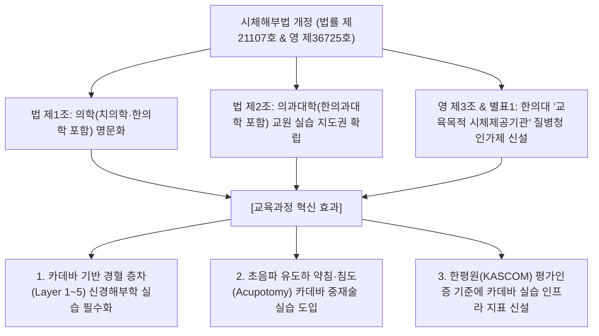

# [종합 보고서] 한의학 교육과정 및 임상 의료서비스 실태 교차분석과 AI 기반 교육과정 혁신 방안
### (부제: 2026 개정 시체해부법령·KAS2022 평가인증·WFCMS 국제표준 융합을 통한 한의과대학 교육과정 전면 혁신안)

---

## 목 차
1. [서론 및 연구 배경: 2026년 보건의료·법령 환경의 대전환](#1-서론-및-연구-배경-2026년-보건의료법령-환경의-대전환)
2. [원광대학교 한의과대학 교육과정 현황 및 구조적 결함 분석](#2-원광대학교-한의과대학-교육과정-현황-및-구조적-결함-분석)
3. [HIRA 및 KOSIS 10개년(2014~2024) 빅데이터 기반 임상 실태 및 CPG 분석](#3-hira-및-kosis-10개년20142024-빅데이터-기반-임상-실태-및-cpg-분석)
4. [[교차분석 1] CPG와 10년 진료현황 분석을 통한 한의의료 적정성 및 미래 역할 추정](#4-교차분석-1-cpg와-10년-진료현황-분석을-통한-한의의료-적정성-및-미래-역할-추정)
5. [[교차분석 2] 현행 교육과정과 임상 현실의 미스매치 및 미흡·결손 영역 분석](#5-교차분석-2-현행-교육과정과-임상-현실의-미스매치-및-미흡결손-영역-분석)
6. [법령·제도적 인프라 융합: 2026 개정 시체해부법령과 한의학 교육권의 법적 확립](#6-법령제도적-인프라-융합-2026-개정-시체해부법령과-한의학-교육권의-법적-확립)
7. [국제 표준(WFCMS) 및 한평원(KAS2022) 평가기준 정합성 비교와 평가기준 개정안](#7-국제-표준wfcms-및-한평원kas2022-평가기준-정합성-비교와-평가기준-개정안)
8. [[교육과정 혁신안] AI 기반 대체 분석 및 교과목별 학점·시수 개편 실행 모델](#8-교육과정-혁신안-ai-기반-대체-분석-및-교과목별-학점시수-개편-실행-모델)
9. [결론 및 종합 정책 로드맵](#9-결론-및-종합-정책-로드맵)

---

## 1. 서론 및 연구 배경: 2026년 보건의료·법령 환경의 대전환
대한민국 보건의료체계는 2025~2026년 초고령사회(65세 이상 인구 20% 초과) 진입, 복합 만성질환의 급증, 그리고 사법부·입법부의 획기적인 법률 개정이라는 **3대 거시적 대전환기**를 맞이하였습니다.

1. **사법부 판결**: 2022년 대법원 전원합의체 판결(초음파 진단기기 합법화) 및 2023년 뇌파계, X-ray 등 현대 진단기기 활용의 법적 정당성 확립.
2. **입법부 법령 개정**: **「시체 해부 및 보존 등에 관한 법률」(법률 제21107호, 2026. 5. 12. 시행)** 및 **동법 시행령(대통령령 제36725호, 2026. 9. 29. 시행)**을 통해 법률 제1조 및 제2조에서 **'의학(한의학 포함)', '의과대학(한의과대학 포함)'**을 명시하고, 전국 한의과대학이 **'교육목적 시체제공기관'(영 제3조 및 별표 1)**을 독자적으로 개설할 수 있는 완전무결한 실정법적 해부 교육권을 확보함.
3. **임상 현실의 요구**: 건강보험심사평가원(HIRA) 10개년 빅데이터상 외래 환자의 **78.4%가 근골격계 질환(요통, 염좌, 관절염, 디스크 등)**에 집중되어 있으며, 초음파 유도하 정밀 약침/침도 시술과 현대 진단검사를 결합한 **1차 통합의료(Primary Integrative Medicine)**로의 전환이 시급함.

그러나 현행 한의과대학 교육과정은 여전히 훈고학적 고전문헌 번역, 5대 장부별로 파편화된 내과 이론 강의, 단순 암기식 교육에 과도한 시수(전체 학점의 70% 이상)를 소모하고 있어, **확보된 법적 해부학 실습권 및 임상 현장의 현대 진단·정밀 술기 수요와 극심한 괴리(Mismatch)**를 보이고 있습니다.

---

## 2. 원광대학교 한의과대학 교육과정 현황 및 구조적 결함 분석

원광대학교 한의과대학 교육과정(2024학년도)은 **총 6년(예과 2년 + 본과 4년, 12개 학기), 총 123개 강좌, 248.5학점(주당 약 320시간 분량)**으로 구성되어 있습니다.

```
[원광대학교 한의과대학 교육과정 영역별 학점 점유 현황]
• 기초한의학 (원전/한문/이론/본초/방제): 80.0학점 (32.2%) - 훈고학적 자구 암기 과밀
• 기초의생명과학 (해부/생리/병리/약리 등): 55.0학점 (22.1%) - 카데바/초음파 연계 미약
• 임상한의학 이론 (장부내과/침구/부인/소아 등): 50.5학점 (20.3%) - 5대 장부 파편화
• 임상실습 및 술기 (병원실습/술기/원외실습): 45.0학점 (18.1%) - 정밀 능동 술기 부족
• 의료인문 / 사회 / 예방 / 법규: 15.0학점 (6.1%)
• 의료정보학 / 데이터 / AI: 3.0학점 (1.2%) - 4차 산업혁명 대응 전무
─────────────────────────────────────────────────────────────
• 총 계: 123개 강좌 / 248.5학점 (100.0%)
```

### 1) 주요 영역별 구조적 결함
1. **고전문헌 및 훈고학적 한문 교육의 비대화 (21.0학점 / 주당 28시간)**:
   - 한의학한문, 기초중국어, 의학중국어, 경서강독, 원전학 1~3, 상한론 1~2, 온병학, 의철학 등에 과도한 학점이 배정되어 학생들을 단순 자구 번역과 문헌 암기에 매몰시킴.
2. **5대 장부별 내과학(간·심·비·폐·신계)의 파편화 (12.5학점 / 10개 과목)**:
   - 환자는 복합 만성질환으로 내원하나 장부별로 분절되어 유사 변증·치법 이론의 중복 강의 비효율 발생.
3. **임상 해부학 및 현대 진단기기(초음파) 실습의 결여**:
   - 시체해부법 개정으로 한의대의 독자적 카데바 실습권이 보장되었음에도, 해부학 실습(2학점)이 단순 구조 확인에 그치고 **경혈 층차(Layer 1~5) 신경해부학 및 초음파 유도하 약침/침도 연계 실습이 부재**함.

---

## 3. HIRA 및 KOSIS 10개년(2014~2024) 빅데이터 기반 임상 실태 및 CPG 분석

```
[10개년(2014~2023년) 한의 의료계 핵심 지표 시계열 데이터]
```

| 연도 | 건보 한의원 진료비(조원) | 건보 한방병원 진료비(조원) | 건보 한의 총진료비(조원) | 전체 건보 진료비(조원) | 한의 건보 점유율(%) | 자동차보험 한의진료비(조원) | 자보 한의 점유율(%) | 한의원 수 (개소) | 한방병원 수 (개소) | 한의 외래환자 (백만명) |
|:---:|:---:|:---:|:---:|:---:|:---:|:---:|:---:|:---:|:---:|:---:|
| **2014** | 1.98 | 0.18 | 2.16 | 54.4 | **3.97%** | 0.27 | **19.0%** | 13,303 | 232 | 13.3 |
| **2017** | 2.27 | 0.31 | 2.58 | 69.5 | 3.71% | 0.55 | 31.3% | 14,150 | 309 | 13.1 |
| **2020** | 2.51 | 0.42 | 2.93 | 86.9 | 3.37% | 1.12 | 48.1% | 14,460 | 440 | 12.1 |
| **2023** | 3.07 | 0.62 | 3.69 | 107.8 | **3.42%** | 1.49 | **58.4%** | 14,610 | **580** | 12.6 |

### 1) 15대 다빈도 상병 CPG 권고등급 및 급여 현황
* **근골격계 및 염좌 질환(78.4% 집중)**: 등통증/요통(M54, 25.4%), 요추염좌(S33, 14.8%), 근막통(M79, 10.2%), 오십견(M75, 8.6%), 경추염좌(S13, 7.5%), 족관절염좌(S93, 6.8%), 관절염(M17, 5.1%), 디스크(M50/51, 4.2%) 등.
* **CPG A등급 확립 중재술**: **침(A), 전침(A), 추나요법(A), 부항(사혈)(A), 첩약(A/B), 약침(B)**.
* **구조적 위기**: 건강보험 점유율은 3.97% → 3.42%로 정체·하락한 반면, 자동차보험 진료비는 1.49조 원(점유율 58.4%)으로 폭증하고 한방병원이 2.5배 급증하여 자보 규제 강화에 따른 제도적 리스크에 직면함.

---

## 4. [교차분석 1] CPG와 10년 진료현황 분석을 통한 한의의료 적정성 및 미래 역할 추정

1. **적정성 평가**: 근골격계 및 마비 질환에서 침·약침·추나·첩약은 **불필요한 척추관절 수술을 방지하는 최상의 비용효과적 보존적 치료**임이 입증됨.
2. **미래 역할 변화**:
   - **정량적**: 2025~2026년 초고령사회 진입에 따른 노인 만성 복합통증, 근감소증, 쇠약(Frailty), 방문진료 및 통합돌봄 수요 폭발.
   - **정성적**: **‘시체해부법 기반 정밀 해부학 + 초음파 영상진단 + 침·약침·도침·추나’**가 결합된 **1차 통합의료(Primary Integrative Medicine)**로의 도약.

---

## 5. [교차분석 2] 현행 교육과정과 임상 현실의 미스매치 및 미흡·결손 영역 분석

```
┌─────────────────────────────────────────────────────────────────────────────────────────┐
│                      [임상 현장 수요 vs 현행 교육과정 미스매치 구조]                     │
├───────────────────────────────────┬─────────────────────────────────────────────────────┤
│  임상 현장 실제 수요 (HIRA/KOSIS) │       원광대학교 교육과정 개설 현황 (PDF 분석)       │
├───────────────────────────────────┼─────────────────────────────────────────────────────┤
│ • 근골격계/통증 질환: 78% 이상    │ • 침구/추나/재활 실습: 전체 학점의 약 4.5%에 불과   │
│ • 현대 진단기기(초음파/X-ray) 필수│ • 영상의학 1학점(이론), 양방진단 1.5학점에 불과     │
│ • 카데바 기반 신경해부/약침 실습  │ • 단순 구조 확인용 해부실습(2학점)에 불과           │
│ • 내과 만성질환의 복합화/통합화   │ • 간/심/비/폐/신 5개 장부로 파편화된 이론 강의 (12.5학점)│
│ • 고전 한문 번역 수요 전무(AI대체)│ • 한문/중국어/원전문헌 강독: 21학점 (주당 28시간) 과잉│
└───────────────────────────────────┴─────────────────────────────────────────────────────┘
```

---

## 6. 법령·제도적 인프라 융합: 2026 개정 시체해부법령과 한의학 교육권의 법적 확립

2025년 11월 11일 개정되어 **2026년 5월 12일 전면 시행된 「시체 해부 및 보존 등에 관한 법률」(법률 제21107호)** 및 **2026년 9월 29일 시행된 동법 시행령(대통령령 제36725호)**은 한의학 교육과정 개편에 결정적인 법적 기반을 제공합니다.



### 1) 시체해부법 개정령의 핵심 제도와 교육적 활용
1. **한의과대학의 독자적 카데바 수급권 확보 (영 제3조, 별표 1)**:
   - 질병관리청 허가를 통해 한의과대학이 독자적으로 시신 기증을 접수·보존·제공할 수 있게 됨.
   - 특히 **[별표 1] 비고 1호(기존 시설 공동사용 특례)**를 활용하여 실습실을 BL2(생물안전 2등급) 수준으로 리모델링함으로써 인프라 구축 비용을 최소화.
2. **초음파 연계 카데바 임상술기 실습의 정규 교육과정화**:
   - 단순 해부를 넘어, **초음파 탐촉자로 해부구조를 보면서 침·약침·침도를 안전하게 자침하고 신경포착(Entrapment) 부위를 박리하는 첨단 실습** 개설.

---

## 7. 국제 표준(WFCMS) 및 한평원(KAS2022) 평가기준 정합성 비교와 평가기준 개정안

### 1) WFCMS 국제표준 vs 한평원 KAS2022 비교
* **WFCMS 중의학 표준**: 5년제, **임상실습 1,500시간(48주) 의무화**, 중의내과학(통합) 및 **중의골상학(근골격계 전담)** 메이저화, 본초 140미/방제 80수/경혈 130혈 정량화.
* **한평원 KAS2022의 한계**: 성과기반을 표방하나 **P5.1.2에서 14개 전통 분과교실 단위 교원 정원을 강제**하여 대학의 과목 통폐합을 가로막고, **대법원 초음파 판결 및 개정 시체해부법령에 따른 현대 진단/카데바 실습 기준이 부재**함.

### 2) 한평원 KAS2022 5대 핵심 개정안
1. **교원 기준(P5.1.2) 혁신**: 14개 분과교실 폐지 → **『5대 통합 모듈별 전문교원 체계』**로 전환.
2. **현대 진단기기 필수화 (P2.5.5 / E)**: **「초음파 핸즈온 실습 60시간 및 진단검사 실습」** 필수기준 신설.
3. **골상·추나의학 메이저화**: 임상 78% 다빈도 질환 대응 **「척추관절 골상중재술학」** 독립 평가.
4. **지식 암기 상한제(Cap) 도입**: WFCMS 기준(본초 140미, 방제 80수) 준용 및 AI Flipped Learning 공인.
5. **시체해부법 연계 실습 지표화**: **「교육목적 시체제공기관 인가 및 초음파 가이드 카데바 실습」** 평가 반영.

---

## 8. [교육과정 혁신안] AI 기반 대체 분석 및 교과목별 학점·시수 개편 실행 모델

AI 기술(LLM 고전번역, 3D 가상해부학, 처방추천 CDSS)을 도입하여 단순 암기 과목에서 **29.5학점 / 주당 48시간을 순감축**하고, 이를 **초음파 진단, 카데바 연계 정밀 술기, CPG 임상실습으로 100% 재배치**합니다.

```
[원광대학교 한의과대학 교육과정 전면 개편 실행 모델 매트릭스]
```

| 구분 | 현행 대상 교과목군 (학수번호) | 현행 학점 (주당시수) | 개편 교과목명 (신설/통합) | 개편 학점 (주당시수) | 학점 변동 | 시수 변동 | AI 대체, 개정 시체해부법 및 교육과정 혁신 근거 |
|:---|:---|:---:|:---|:---:|:---:|:---:|:---|
| **대폭 축소 / 통폐합** | **한문·원전문헌군 (8과목)**<br>• 한의학한문 (221299)<br>• 기초/의학중국어 (221291 외)<br>• 경서강독 (221277)<br>• 원전학 1~3 (221259 외)<br>• 상한론 1·2 (222817 외)<br>• 온병학, 의철학 | **21.0학점**<br>(28시간) | **통합 원전·의사학 및 AI 문헌데이터분석** | **4.0학점**<br>(4시간) | **-17.0** | **-24.0h** | • LLM 실시간 원문 번역·주석 대체<br>• 단순 자구 해석 수업 폐지, AI 문헌 탐색 실습으로 압축 |
| **대폭 축소 / 통폐합** | **기초이론군 (3과목)**<br>• 한의학개론 (221264)<br>• 한의학기초이론 1·2 (221263 외) | **6.0학점**<br>(9시간) | **통합 한의학 원리와 현대 생체조절론** | **3.0학점**<br>(3시간) | **-3.0** | **-6.0h** | • 이론 강의를 AI Flipped Learning으로 축소<br>• 음양오행을 신경내분비 면역학적 기전과 통합 |
| **대폭 축소 / 통폐합** | **본초·방제 암기군 (6과목)**<br>• 본초학총론/1 (221258 외)<br>• 임상본초학 (222825)<br>• 방제학 1~3 (222832 외) | **16.0학점**<br>(24시간) | **통합 본초·방제학 및 임상약리학(DDI)** | **6.0학점**<br>(8시간) | **-10.0** | **-16.0h** | • 500종 본초/방제 단순 암기는 AI CDSS 검색 대체<br>• 양·한약 상호작용 및 안전성 평가 집중 |
| **대폭 축소 / 통폐합** | **장부 파편형 내과군 (10과목)**<br>• 간/심/비/폐/신계 내과학 1·2 (222742~222756) | **12.5학점**<br>(20시간) | **통합 한방내과학 (계통별·증례별 PBL)** | **6.0학점**<br>(8시간) | **-6.5** | **-12.0h** | • 5대 장부 중복 강의를 계통별(소화/호흡/대사/순환) PBL로 통합 |
| **신규 신설 / 대폭 확대** | **현대 영상의학 및 초음파**<br>• 영상의학 (222646) | **1.0학점**<br>(2시간) | **임상 초음파 진단학 및 영상의학 실습** | **4.0학점**<br>(이론2, 실습4) | **+3.0** | **+4.0h** | • **대법원 판결 대응 필수 역량 확보**<br>• 근골격계/복부 초음파 핸즈온 실습 및 AI 영상 판독 |
| **신규 신설 / 대폭 확대** | **카데바 연계 정밀 중재술**<br>• 추나의학/실습 (222794 외)<br>• 침구의학실습 1·2 | **4.0학점**<br>(6시간) | **초음파유도 카데바 중재술 및 척추관절 골상실습** | **6.0학점**<br>(이론2, 실습8) | **+2.0** | **+4.0h** | • **2026 개정 시체해부법령 및 환자 78% 대응**<br>• 카데바 기반 초음파 유도 약침/침도/추나 집중 훈련 |
| **신규 신설 / 대폭 확대** | **진단검사의학 및 임상병리**<br>• 진단검사의학 1·2 (222685 외) | **2.0학점**<br>(4시간) | **1차 의료 임상병리 및 검사해석 실습** | **3.0학점**<br>(이론2, 실습2) | **+1.0** | **0.0h** | • 혈액·소변검사기 실습 및 간/신장기능 모니터링 역량 배양 |
| **신규 신설 / 대폭 확대** | **CPG 기반 임상 & 의료 AI**<br>• 의료데이터사이언스 (221294)<br>• 의료정보학 (222831) | **3.0학점**<br>(4시간) | **CPG 기반 AI-CDSS 임상의사결정 및 보험실무** | **4.0학점**<br>(이론2, 실습4) | **+1.0** | **+2.0h** | • 국가 CPG 연계 진료, AI EMR 활용, 보험 청구 실무 교육 |
| **합 계** | **대상 33개 교과목** | **65.5학점**<br>(97시간) | **8개 핵심 통합 모듈** | **36.0학점**<br>(49시간) | **-29.5학점**<br>**(순감소)** | **-48.0시간**<br>**(순감소)** | **절감된 29.5학점은 병원 임상실습 및 서브인턴십으로 100% 재배치** |

---

## 9. 결론 및 종합 정책 로드맵

1. **2026 개정 시체해부법령 인프라의 대학 현장 착근**:
   - 전국 12개 한의과대학은 2026~2027년 질병관리청 **'교육목적 시체제공기관' 공식 인가**를 획득하고, 실습실을 BL2 수준으로 리모델링하여 **카데바-초음파 연계 정밀 실습**을 교육과정의 핵심 축으로 구축해야 함.
2. **한평원 KAS2022 평가기준의 즉각적 개정**:
   - 14개 분과교실 단위 교원 정원제를 폐지하고 **5대 통합모듈 교원제 및 초음파 실습(60h) 필수기준(E)**을 신설하여 대학의 교육과정 혁신을 제도적으로 견인해야 함.
3. **초고령사회 대응 1차 통합의료인 완성**:
   - AI 기술을 통한 지식 암기 시수 29.5학점 감축과 초음파·카데바·진단검사·CPG 실습 강화를 통해 대한민국 한의사를 **진정한 1차 통합의료 전문가**로 육성해야 함.

---
*보고서 작성일: 2026년 10월 7일*  
*참조 법령 및 자료: 시체해부법(법률 제21107호/대통령령 제36725호), 한평원 KAS2022(2025.01), WFCMS(SCM0003), HIRA 10개년 통계, 원광대 교육과정(2024)*
